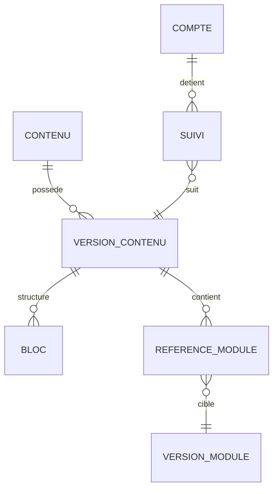
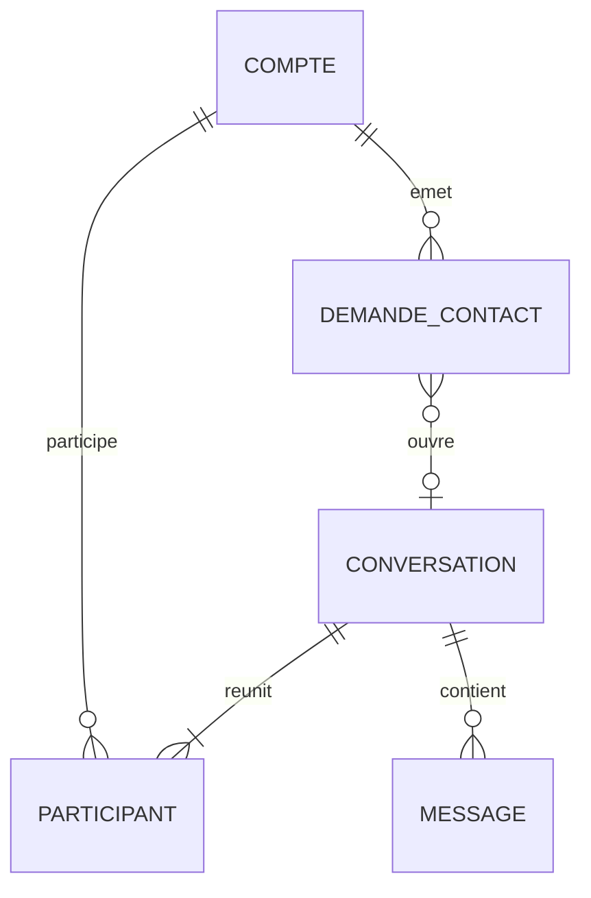
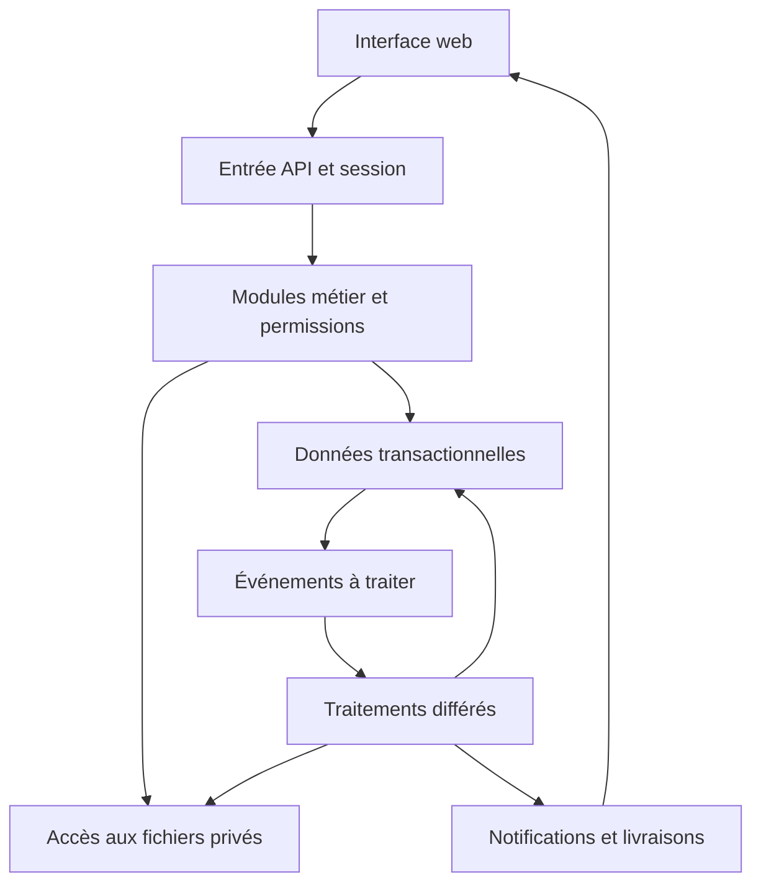
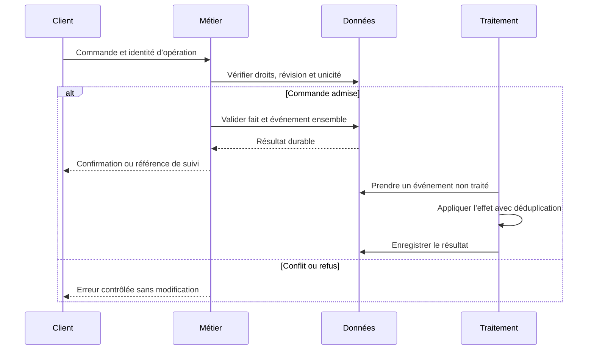

# SAVOIR+ — Référentiel consolidé de conception

Version 0.32 — 13 novembre 2026  
Statut : démonstrateur React/TypeScript publié avec **Supabase Auth, PostgreSQL et Realtime** ; Firebase retiré du code. **Référence active : périmètre en 4.7, conditions officielles en 4.8, UX en 4.9 et décision technique actuelle en 4.10.** Publication publique réussie le 13 novembre 2026 à 20 h 40 UTC. Compilation, trois tests métier et scénarios SQL d’accès passés. Connexion de deux comptes Supabase et recette mobile restent à vérifier. Soumission le **14 novembre 2026 à 15 h 30 UTC**, présentation finale le **5 décembre 2026**.

Ce fichier constitue le point d’entrée unique du référentiel. Il comporte les quatre dossiers logiques convenus, réunis ici pour éviter la dispersion. Les parties techniques et de réalisation sont des bases de travail à compléter, pas des livrables finalisés. Aucun document antérieur n’a été supprimé ou déclaré obsolète sans vérification de son remplacement.

## Sommaire

1. [Cadrage et pilotage](#partie-1--cadrage-et-pilotage)
2. [Spécifications fonctionnelles et UX/UI](#partie-2--spécifications-fonctionnelles-et-uxui)
3. [Conception technique et sécurité](#partie-3--conception-technique-et-sécurité)
4. [Réalisation, recette et exploitation](#partie-4--réalisation-recette-et-exploitation)

## Partie 1 — Cadrage et pilotage

### 1.1 Sources, portée et niveau de preuve

Source S01 : « Pasted text(7).txt », fourni dans la discussion, 2 690 lignes. Les blocs UX-008, UX-009 et UX-010 y figurent ainsi que les échanges sur la direction visuelle. Source S02 : décisions de la présente discussion du 12 novembre 2026 : référentiel transmissible, consolidation maximale, quatre dossiers et autorisation de revue.

Source S03 : « Pasted text(8).txt », 4 170 lignes logiques (4 169 séparateurs de ligne), fourni le 12 novembre 2026. Lecture des 1 480 premières lignes supplémentaires et comparaison du reste : les lignes 1 481 à 4 170 sont identiques aux 2 690 lignes de S01. Il ne s’agit donc pas de nouvelles versions des documents UX-008 à UX-010.

S03 apporte la genèse du projet, les demandes utilisateur sur la vision sociale et les premières propositions fonctionnelles. Il passe ensuite directement à UX-008 : les textes complets UX-001 à UX-007, le logo et le dossier technique ne sont toujours pas disponibles. La couverture est explicitée ici ; aucune exhaustivité de l’historique n’est revendiquée.

Les indications sur le concours, les outils suggérés et les résultats de recherches web dans S03 sont des éléments historiques, pas des faits actuels revérifiés. Le projet KONTA reste distinct : ses modules VIGIE, DOSSIER ZÉRO et SIGNAL ne sont pas des fonctionnalités SAVOIR+.

La revue couvre les sources disponibles : cohérence documentaire, navigation, inventaire, permissions de principe, états, dépendances, critères et préparation de E-01. Elle n’est ni une validation utilisateur du produit, ni un audit de conformité, ni une recette logicielle.

| Source antérieure | Destination | Couverture réelle |
| --- | --- | --- |
| UX-001 — dossier général | Partie 2 | Mention seulement ; texte complet manquant |
| UX-002 — Design System | Partie 2, direction et composants | Synthèse retrouvée ; tokens, logo, détails manquants |
| UX-003 — tableau de bord | Partie 2, fiche E-01 | Synthèse retrouvée ; fiche de reprise préparée ici |
| UX-004 — bibliothèque | Partie 2 | Synthèse et inventaire ; détails manquants |
| UX-005 — apprentissage | Partie 2 | Synthèse et inventaire ; détails manquants |
| UX-006 — progression et profil | Partie 2 | Inventaire ; détails manquants |
| UX-007 — création | Partie 2 | Inventaire ; détails manquants |
| UX-008 — administration | Partie 2, chapitre 2.3 | Texte disponible intégré ; identifiants normalisés |
| UX-009 — transversal | Partie 2, chapitre 2.4 | Texte disponible intégré ; critères désambiguïsés |
| UX-010 — matrice | Partie 2, chapitre 2.5 | Texte intégré avec corrections signalées |
| Architecture / données / sécurité | Partie 3 | Exigences identifiées ; conception détaillée à produire |
| Backlog / recette / exploitation | Partie 4 | Plan de travail préparé ; réalisation non commencée |

### 1.1 bis — Vision produit rétablie à partir de S03

**SAVOIR+ est une plateforme collaborative d’apprentissage, d’entraide et de transmission des savoirs, ouverte aux élèves, étudiants, enseignants, professionnels, artisans et autodidactes.** Les utilisateurs peuvent apprendre et transmettre ; le rôle de créateur ne doit pas être confondu avec un statut d’enseignant vérifié. Les droits concrets restent régis par la politique d’autorisation.

La source utilisateur S03, ligne 1 018, demande explicitement : partage des astuces entre élèves ; rangs et progression ; découverte des élèves qui réussissent et de leurs méthodes ; dimension réseau social ; transformation des connaissances des enseignants et professionnels en formations ; diffusion gratuite ou monétisée ; accessibilité à tous. Ces éléments appartiennent à la vision produit. Leur inclusion et leur profondeur dans chaque livraison restent à préciser.

| ID de traçabilité | Élément retrouvé | Nature de la preuve | Conséquence pour la conception |
| --- | --- | --- | --- |
| HIST-01 | Utilité réelle, simplicité, contexte togolais, éviter une simple intégration IA générique | Demande utilisateur, début S03 | Évaluer les parcours sur leur utilité et leur facilité d’accès |
| HIST-02 | Transformer les savoirs de personnes de tout domaine en formations | Demandes utilisateur S03, lignes 705 et 1 018 ; développement assistant lignes 765–916 | Restaurer la vision de création ouverte ; spécifier l’habilitation sans la réserver implicitement aux enseignants |
| HIST-03 | Entraide, astuces, découverte des personnes et réseau social | Demande utilisateur S03, ligne 1 018 | Le volet social est une composante de la vision ; ne pas le traiter comme une idée récemment ajoutée |
| HIST-04 | Rangs et progression | Demande utilisateur S03, ligne 1 018 | Préserver gamification et reconnaissance ; calculs et classements à spécifier |
| HIST-05 | Connaissances diffusées gratuitement ou monétisées | Demande utilisateur S03, ligne 1 018 | Réintégrer le modèle économique à la conception ; paiement MVP non déduit |
| HIST-06 | Six piliers : Community, Knowledge Studio, Progress, Academy, Class Radar, Talent Discovery | Proposition assistant S03, lignes 1 053–1 158, après la demande utilisateur | Utiliser comme carte de couverture historique, pas comme découpage approuvé en six livraisons |
| HIST-07 | Publications, commentaires, questions/réponses, abonnements, communautés par domaine | Proposition assistant S03, lignes 1 057–1 071 | Remettre ces fonctions dans l’inventaire à préciser ; modèle d’abonnement distinct des connexions réciproques |
| HIST-08 | Entrées audio/vidéo/PDF/photos, cours structurés, fiches, exercices et quiz | Propositions S03, lignes 828–916 et 1 215–1 253 | Prévoir un parcours de transformation assistée avec revue humaine ; médias réellement supportés à définir |
| HIST-09 | Class Radar : difficultés, erreurs récurrentes, remédiation | Intention utilisateur dans le regroupement initial ; détails proposés par l’assistant | Restaurer le volet enseignant dans la vision, sans promettre son inclusion immédiate |
| HIST-10 | Mentors, expertise, qualité des explications, reconnaissance de l’entraide | Demande de visibilité utilisateur ; mécanismes proposés S03, lignes 1 160–1 210 | Distinguer résultats vérifiés, popularité, contribution et titre de mentor |
| HIST-11 | Chat / relations | Rappel explicite de l’utilisateur dans la discussion actuelle | Demande de conception enregistrée ; aucune politique détaillée de chat retrouvée dans S03 |
| HIST-12 | Démonstration : source personnelle → ressource → quiz → apprentissage → reconnaissance | Recommandation assistant S03, lignes 1 380–1 409 | Scénario historique utile ; ne remplace pas le périmètre MVP 1.0 à valider |

Les six piliers décrivent une vision étendue. Les points XP (+20, +10, etc.), le prix d’exemple de 3 000 FCFA, les commissions, les défis hebdomadaires, les attestations et les offres premium sont des propositions ou exemples, pas des règles approuvées. La recommandation finale « C. Hybride » n’est pas accompagnée d’une réponse utilisateur explicite avant le saut vers UX-008.

### 1.1 ter — Revue de couverture après rapprochement

| Domaine | Déjà présent dans le référentiel | Lacune rétablie / travail restant |
| --- | --- | --- |
| Community | Publications, questions/réponses et signalements proposés en 2.2 undecies, pages 44–47 | Groupes structurés, talents, limites et audience à arrêter ; MVP proposé en 1.7 |
| Knowledge Studio | Création et publication, médias, OCR/IA proposés en 2.2 octies à decies, pages 30–43 | Capacités, versions, limites et conditions techniques ; report OCR/IA recommandé pour le pilote |
| Progress | XP, niveaux, progression, badges et historique | Définir l’attribution, les limites anti-abus, les contributions d’entraide et la visibilité des classements |
| Academy | Bibliothèque, modules, parcours, quiz et résultats | Préciser la diffusion gratuite/payante et ses effets d’accès si retenue dans le lot |
| Class Radar | Pas de parcours enseignant dédié aux diagnostics de classe dans la matrice actuelle | Définir population, données, interprétation humaine, limites des analyses et inclusion de version |
| Talent Discovery | Profils et progression | Définir découverte des contributeurs, compétences, preuves et règles de mise en avant |
| Relations et messagerie | Parcours proposés en 2.2 bis, pages 4–6 | Compléter préférences, états de demandes et signalements ; règles d’âge et conservation |

Les 62 entrées de la matrice UX-010 sont un inventaire historique partiel, non une preuve de couverture complète du produit. Les parcours manquants seront intégrés à la matrice au fur et à mesure de leur spécification, avec identifiants uniques et sans créer de dossiers documentaires séparés.

### 1.2 Règles de gestion documentaire

- Un seul emplacement de référence pour chaque règle ; renvois ailleurs.
- Statuts : retenu dans les échanges, spécification initiale à valider, proposition de reprise, à arbitrer, non retrouvé.
- Une exigence rédigée n’est pas automatiquement approuvée ; un test défini n’est pas un test réussi.
- Conserver les identifiants des écrans ; qualifier les critères en doublon. Chaque changement ultérieur indique sa raison, sa date et ses impacts.
- Une version de référence pour développement sera figée après revue du MVP ; elle pourra ensuite évoluer par changements tracés.
- Les formats natifs utiles (maquettes, contrats API, schémas) seront liés à la partie correspondante, sans copie concurrente des règles.

Références de méthode consultées dans la discussion : ISO/IEC/IEEE 15289:2019 (regroupement possible des informations de cycle de vie) et principe d’adaptation au projet du PMI. La présente organisation n’affirme pas une certification ou une conformité exhaustive.

### 1.3 Registre des décisions de direction

| ID | Décision à préserver | Provenance / statut |
| --- | --- | --- |
| DEC-01 | LinkedIn pour la structure et les cartes ; HTB Academy pour l’organisation pédagogique | S01, retenu dans les échanges |
| DEC-02 | Trois colonnes pour le tableau de bord étudiant desktop | S01 ; ne pas rouvrir le nombre de colonnes |
| DEC-03 | Mobile-first, desktop complet ; thèmes clair et sombre | S01 |
| DEC-04 | Navigation mobile : Accueil, Apprendre, Ressources, Plus | S01, également UX-009 §5 |
| DEC-05 | Bibliothèque distincte du tableau de bord | S01 |
| DEC-06 | Identité SAVOIR+ ; palette issue du logo, valeurs non retrouvées | S01 |
| DEC-07 | Pas de Cubes, de copie intégrale HTB, ni de mélange Labs/CTF/Jobs | S01 |
| DEC-08 | Premier concept violet illustratif écarté | S01 |
| DEC-09 | Quatre dossiers consolidés ; aucune cible de 30 documents | S02 |
| DEC-10 | Référentiel avant code et revue du passage au développement | S01 et S02 |
| DEC-11 | Structure E-01 validée ; relations et chat explicitement rappelés pour la suite | Message utilisateur du 12 novembre 2026 ; détails et périmètre à définir |
| DEC-12 | Vision sociale, entraide, création ouverte et diffusion gratuite ou monétisée rétablies | Demande utilisateur retrouvée S03 ligne 1 018 ; vision distincte du périmètre de livraison |
| DEC-13 | Étendre la carte personnelle avec profil, niveau et XP aux pages pertinentes ; choix des emplacements délégué à l’assistant | Demande utilisateur du 12 novembre 2026 ; application E-01, E-02 et E-08, détails ci-dessous |

### 1.4 Résultats de revue et traitements

| ID | Constat | Action réalisée ou traitement requis |
| --- | --- | --- |
| REV-01 | UX-008 utilise A01 ; UX-010 utilise A-01 | Normalisation A-01…A-13 dans le texte consolidé ; correspondance mécanique Axx → A-xx |
| REV-02 | UX-SEC-001 et UX-A11Y-001 désignent des critères différents dans UX-008 et UX-009 | Renommage par domaine : UX-ADM-SEC / UX-ADM-A11Y et UX-TRV-SEC / UX-TRV-A11Y ; sens conservé |
| REV-03 | UX-010 remet le nombre de colonnes à arbitrer | Corrigé : trois colonnes retenues pour E-01 desktop ; seule leur composition reste à concevoir |
| REV-04 | A-13 est P1 dans UX-008 et P0 dans UX-010 | Divergence visible dans la matrice ; priorité finale non inventée |
| REV-05 | E-02 réservé APP mais matrice d’accès décrit une bibliothèque publique | Mention VIS à arbitrer ; aucun accès public supplémentaire accordé |
| REV-06 | Matrice permet création APP mais écrans C limités ENS | Proposition explicite en 3.4 : capacités créatrices indépendantes du titre ; politique d’octroi à valider |
| REV-07 | P0 et mention MVP coexistent avec arbitrages ouverts | Les priorités historiques sont indicatives tant que le périmètre n’est pas validé |
| REV-08 | Six rôles administratifs détaillés, regroupés en codes ADM/MOD dans la matrice | Conserver six rôles ; ne pas interpréter les codes agrégés comme une politique d’autorisation |
| REV-09 | La v0.2 sous-représentait la vision sociale faute de sa source initiale | S03 confirme cette vision utilisateur ; E-01 reste une vue personnelle validée, pas une décision d’exclure les fonctions sociales. Place du fil et entrées à compléter |
| REV-10 | Neuf types de quiz annoncés sans liste disponible | Formulation corrigée pour rendre la limite explicite ; liste requise avant spécification de l’éditeur |
| REV-11 | Profil public n’est pas un écran de dépôt de recours pour compte suspendu | Parcours utilisateur du recours à préciser avant validation modération ; ne pas bloquer l’accès au recours par la suspension |
| REV-12 | Pas d’écran explicite de détail d’une ressource autonome dans l’inventaire | E-20 ajouté comme référence proposée ; fiche documentée en 2.2 quater et illustrée page 10, sans validation métier revendiquée |
| REV-13 | Hors connexion classé P1 mais erreurs réseau imposées partout | Distinguer gestion d’erreur réseau requise et mode hors ligne complet à arbitrer |
| REV-14 | Statuts de compte ne définissent pas leurs transitions et responsables | Transitions proposées en 3.4 F ; dimensions séparées, politiques et responsabilités à confirmer |
| REV-15 | Exigence d’accessibilité présente, sans preuves de test | Conserver comme cible ; aucune conformité déclarée sur la base du texte seul |

### 1.5 Arbitrages et dépendances

| Lot | Questions ouvertes | Échéance / effet sur E-01 |
| --- | --- | --- |
| Sources | S03 apporte la genèse ; UX-001…007 complets, logo et ressources AD encore manquants | Genèse rapprochée ; autres sources à intégrer si disponibles, sans prétendre les avoir relues |
| Identité visuelle | Palette HEX, typographie, icônes, illustrations | Avant haute fidélité ; pas avant structure E-01 |
| Navigation | Correspondance précise Apprendre / Ressources avec E-08 / E-02 | Proposition documentée en 2.2 ; à vérifier sur wireframe |
| MVP | Communauté, notes, création de modules/parcours, statistiques, P1/P2, A-13 | Avant validation des espaces concernés et gel MVP |
| Apprentissage | Inscription aux modules, calcul progression/XP, neuf types de quiz, durée et tentatives, reprise interrompue | Avant spécification détaillée des apprentissages ; E-01 utilise des valeurs descriptives provisoires |
| Autorisations | Bibliothèque publique, création APP, vérification enseignants/validateurs, six rôles, accès exceptionnel et support | Avant finalisation permissions et développement |
| Modération | Double validation, urgence, délais, recours indépendant, messages, export et conservation | Avant validation des parcours administratifs |
| Session et données | Expiration, liens, reconnexion, cache local, conflits, historique recherche, notifications/push et conservation | Avant conception technique finale |
| Exploitation | Budget, hébergement, volumes, performance, disponibilité, sauvegardes et objectifs de restauration | Avant choix définitifs et plan de livraison |

Responsable des arbitrages produit : porteur de SAVOIR+ ; préparation des options : conception. Responsables techniques et d’exploitation à désigner, sans inventer une équipe.

### 1.6 Point de reprise et jalons

**Situation au 13 novembre 2026 :** les parcours locaux apprendre/quiz/progression et relations/chat sont réalisés. La navigation supérieure Messagerie ouvre désormais la page complète ; le bouton Message d’un contact ouvre le chat rapide desktop. Cartes, profils, Relations et footer ont été revus selon les demandes utilisateur.

Le choix Firebase est remplacé par **Supabase**, décision utilisateur du 13 novembre. Tables, règles RLS et Realtime sont installés sur le projet SAVOIR+. Le code et les migrations sont versionnés ; la publication publique v0.32 a réussi à 20 h 40 UTC. Le référentiel et les 60 planches restent la vision produit, tandis que 4.7–4.10 définissent la livraison immédiate.

**Suite du plan :** préparer deux comptes de démonstration Supabase, vérifier l’authentification et le chat entre deux navigateurs, effectuer la recette mobile et soumettre prototype + descriptif avant le 14 novembre à 15 h 30 UTC. La présentation finale est le 5 décembre. Aucun envoi à l’organisation ni acceptation du projet n’est revendiqué. L’alignement UX global et le produit complet ne sont pas déclarés finalisés.

### 1.7 Revue transversale et proposition de première version — v0.17

#### A. Conclusion de revue et méthode

Le référentiel permet de reprendre la conception sans repartir de la discussion. Il ne permet pas encore de confier tout le produit à une équipe de développement sans décisions complémentaires. Les principales lacunes concernent les parcours de compte, les permissions détaillées, les règles de progression, les recours et les choix techniques/opérationnels.

Cette revue croise les spécifications présentes, l’inventaire des écrans, les critères d’acceptation et la carte des 47 planches. Elle ne constitue ni une recette applicative ni une nouvelle lecture exhaustive des sources historiques manquantes. Les termes « illustré », « spécifié », « validé » et « testé » sont distincts. Aucun pourcentage d’avancement global n’est annoncé : les écrans n’ont pas tous la même complexité et les preuves de réalisation n’existent pas encore.

#### B. Couverture des 73 références

| Références | Nombre | État documentaire | Travail restant avant réalisation du lot |
|---|---:|---|---|
| I-01 à I-07 | 7 | v0.18 : inscription, vérification, récupération et profil initial proposés pages 48–50 ; accueil public décrit, non dessiné intégralement | Limites, contenu des conditions et politique d’éligibilité à arrêter |
| E-01 à E-08 | 8 | Parcours illustrés pages 1–3, 7–14, 18–19 ; E-03/04/05 traités comme variantes de catalogue | Confirmer navigation/filtres, inscription et règles d’accès ; structure E-01 déjà validée |
| E-09 à E-11 | 3 | Lecture et quiz illustrés pages 15–17 et 20–24 | Achèvement, tentatives et versionnement ; un seul format de quiz détaillé |
| E-12 à E-14 | 3 | Progression illustrée pages 25–29 ; historique et badges partiels | Barème/anti-abus ; vues détaillées E-13/14 si retenues |
| E-15 à E-16, E-20 | 3 | Profils et détail ressource illustrés pages 10 et 25–29 | Audience visiteur, données exposées et cas de retrait |
| E-17 à E-19 | 3 | v0.18 : préférences, confidentialité, sécurité et sessions pages 50–52 | Paramètres de sécurité et conservation ; confirmations/export/suppression à prototyper |
| C-01 à C-11 | 11 | Socle créateur et outils pages 30–43 ; certaines vues sont des variantes/extraits | Matrice de capacités, versions, limites médias et choix du lot IA/OCR |
| C-12 à C-13 | 2 | Statistiques et profil créateur au backlog | Décider report ou spécifier ; réutilisation possible du profil E-15 |
| S-01 à S-04 | 4 | Relations/chat pages 4–6 ; demandes reçues/envoyées et exceptions pages 54/56 | Quotas, expiration et délais à fixer ; règles proposées à valider |
| S-05 à S-06 | 2 | S-05 illustré page 51 ; S-06 et suivi illustrés page 55 en v0.19 | Circuit opérateur de modération et paramètres de conservation |
| S-07 à S-10 | 4 | Communauté et entraide pages 44–47 | Valider audience, limites, résolution, blocage et suivi des signalements |
| A-01 à A-13 | 13 | UX-008 intégré ; A-05 à A-09 et audit associé illustrés pages 57–60 | Habilitations A-02 à A-04, audit détaillé, support, paramètres et règles opérationnelles à compléter |
| T-01 à T-10 | 10 | Exigences transversales et états répartis dans les planches | Notifications/préférences, recherche globale, matrice des états et prototype de bout en bout |
| **Total** | **73** | **Inventaire, pas 73 écrans finalisés** | **Le MVP proposé ci-dessous reste à arrêter** |

Les publications ordinaires, les listes de demandes et les confirmations ne sont pas toutes dessinées en écran complet : certaines variantes sont spécifiées par leurs règles. Aucun groupe communautaire structuré ni diagnostic de classe n’est caché dans ce total. La revue v0.17 n’a ajouté aucune page de pilotage. Le recueil, alors de 47 planches, passe à 52 en v0.18 avec les parcours de compte.

#### C. Première version recommandée : pilote intégré

Objectif proposé : permettre à un membre d’apprendre un module, vérifier ses acquis, créer une contribution pédagogique et obtenir de l’aide d’autres membres. Les relations et le chat font partie de cette première version recommandée, conformément à la vision utilisateur ; ils ne sont pas repoussés derrière une plateforme d’apprentissage exclusivement individuelle.

| Domaine | Inclure dans le pilote proposé | Reporter explicitement |
|---|---|---|
| Accès et profils | Compte vérifié, récupération, profil, visibilité, sessions ; page de présentation publique | Catalogue et contributions accessibles publiquement sans compte, tant que leur audience n’est pas tranchée |
| Academy | Catalogue connecté, ressources, modules, parcours, lecture et reprise, Mes apprentissages | Paiement, abonnements commerciaux et certifications |
| Évaluation | Quiz à choix unique, consignes, tentative et correction cohérentes | Autres formats historiques, banques avancées et notation manuelle |
| Progress | Progression réelle, historique essentiel ; carte profil/XP conservée avec données confirmées | Classements, titres d’expert et récompenses d’entraide ; XP/niveaux activés seulement après validation du barème |
| Création | Ressource/module/parcours, texte, images et PDF, aperçu, contrôle, versions et publication selon capacité | Hébergement/traitement audio-vidéo avancé, statistiques C-12 détaillées |
| Relations et chat | Suivis, demandes de contact, conversation individuelle textuelle, blocage et signalement | Groupes de discussion, pièces jointes chat, appels, présence et accusés de lecture avancés |
| Communauté | Publications/commentaires, questions/réponses, solution, suivi et signalement | Groupes privés, invitations, gouvernance de communautés et fil algorithmique |
| Knowledge Studio | Création manuelle et import de médias | OCR et aide générative en lot ultérieur, tant que conditions de données, service et coûts ne sont pas définis |
| Administration | Gestion minimale des comptes et capacités, signalements, décisions, sanctions/recours, audit et support | Tableaux analytiques avancés ; badges officiels A-10 tant que le circuit de validation n’est pas prêt |
| Transversal | Recherche autorisée, notifications internes, préférences essentielles, erreurs réseau, sauvegarde/reprise | Mode hors ligne complet et notifications push |
| Autres piliers | Profil et contributions comme premiers repères de talent | Class Radar, mentorat organisé, recommandations de talents et monétisation |

Ce découpage est une recommandation de conception, pas une suppression d’exigences. Les lots reportés restent dans le référentiel et ne doivent pas apparaître comme des boutons inopérants dans le pilote. Les contenus gratuits du pilote ne figent pas le modèle économique définitif. Proposition de lancement limité à une cohorte d’adultes identifiée, afin de tester les parcours ; cela ne supprime pas la vision destinée aux élèves. L’ouverture aux mineurs reste conditionnée à une politique de compte, d’audience et de contact explicitement définie.

#### D. Arbitrages préparés, sans validation implicite

| ID de revue | Choix recommandé ou travail précis | Preuve nécessaire pour clore | Décideur / dépendance |
|---|---|---|---|
| ARB-01 | Retenir le pilote intégré du tableau C, social et chat inclus | Liste inclus/reporté approuvée et versionnée | Porteur produit ; REV-07 |
| ARB-02 | Contenus et profils détaillés réservés aux membres autorisés au pilote ; page de présentation publique | Matrice des audiences par objet/action | Porteur produit ; REV-05 et profil E-15 |
| ARB-03 | Capacité de création distincte du titre enseignant ; cohorte créatrice habilitée au pilote | Qui accorde, révoque et publie, par périmètre ; aucun privilège par autodéclaration | Porteur produit + responsable sécurité à désigner ; REV-06 |
| ARB-04 | Achèvement fondé sur les activités requises et leur réussite configurée ; simple ouverture insuffisante | Formule, transitions et cas de changement de version documentés | Porteur produit / pédagogie |
| ARB-05 | Choix unique seulement au pilote ; paramètres explicites par quiz | Politique d’essais, correction et seuils, y compris réponses manquantes | Porteur produit ; REV-10 |
| ARB-06 | Références de versions publiées fixes, mise à jour volontaire | Règle pour apprenants en cours et acquis conservés, avec exemples | Produit + conception technique |
| ARB-07 | XP/niveaux conservés dans l’interface, activation conditionnée à un barème vérifiable | Événements, montants, plafonds, annulations, niveau et anti-abus | Porteur produit ; aucun chiffre illustratif réutilisé |
| ARB-08 | Messages textuels sur demande, confidentialité et blocages contrôlés | Règles d’âge, capacité de contact, conservation et gestion des abus | Produit + sécurité ; pilote adulte proposé |
| ARB-09 | Circuit de modération minimal opérable avant ouverture sociale | Responsables, droits, délais de traitement, urgence et recours accessible après suspension | Responsable de modération à désigner ; REV-11 |
| ARB-10 | Publication réservée à la capacité attribuée ; validation pédagogique indépendante | Choix du contrôle préalable et attribution des rôles ; badge absent si circuit indisponible | Produit / modération ; A-10 |
| ARB-11 | Images et PDF au pilote, limites annoncées avant transfert | Types, tailles, quotas, traitement sûr, suppression et conservation | Technique / exploitation à désigner |
| ARB-12 | OCR/IA, paiement, classes et groupes reportés | Report acté ; aucun engagement fournisseur requis pour le pilote | Porteur produit |
| ARB-13 | Sessions, données personnelles, sauvegardes et restauration définies avant déploiement | Politique par objet, objectifs de restauration et exercice vérifiable | Sécurité / exploitation à désigner |
| ARB-14 | Une architecture justifiée par les contraintes réelles | Budget, hébergement, volumétrie, équipe et objectifs de service renseignés | Porteur produit puis responsable technique |
| ARB-15 | Finaliser identité visuelle à partir d’assets autorisés | Logo/palette ou nouvelle direction expressément retenue ; tokens et composants | Porteur produit |

Tous ces points sont **ouverts avec recommandation** au 12 novembre 2026. Ils sont regroupés pour éviter une succession de validations écran par écran. La préparation peut continuer sur les parcours indépendants ; les valeurs de budget, équipe, volumétrie ou délai ne sont pas inventées. Si les anciennes sources restent introuvables, documenter expressément le remplacement des exigences retenues par la baseline actuelle au lieu de prétendre les avoir récupérées.

#### E. Risques et incohérences détectés

| Constat | Conséquence | Traitement de cette revue |
|---|---|---|
| Le point de reprise 1.6 décrivait encore le seul E-01 | Faux état d’avancement | Réécrit ; 47 planches et lots réellement documentés indiqués |
| La synthèse des piliers décrivait plusieurs parcours comme entièrement absents | Risque de refaire des travaux déjà produits | Synthèse 1.1 ter actualisée ; renvoi aux chapitres existants |
| Les priorités P0/P1 historiques mélangent vision et livraison | MVP potentiellement trop vaste | Proposition explicite C ; priorités historiques conservées comme source |
| Profils publics, bibliothèque publique et communauté connectée ont des portées différentes | Fuite ou restriction involontaire | ARB-02 centralise l’audience ; aucune extension automatique |
| Créateur assimilé à ENS dans la matrice historique | Exclusion de contributeurs ou droits excessifs | ARB-03 ; titre, capacité et validation séparés |
| XP et solution communautaire peuvent être interprétés comme compétence certifiée | Récompenses injustifiées | Barème bloqué tant que non arrêté ; badges/validation séparés |
| Design de signalement sans opérateur ni recours finalisé | Parcours social inexploitable en conditions réelles | ARB-09 préalable à l’ouverture ; ne pas reporter la modération après le chat |
| Des critères de recette existent mais pas les contrats techniques | Développement difficile à estimer et tester | Lier critères, états, données, permissions et API dans la prochaine phase |

La revue ne révèle pas de motif pour retirer le social de la vision. Elle révèle que l’administration et les parcours transversaux doivent être traités comme des dépendances du social et de la création, plutôt que comme des finitions facultatives.

#### F. Plan de clôture de conception et preuves de sortie

| Ordre | Travail à produire dans les deux livrables existants | Condition de sortie |
|---:|---|---|
| 1 | Comptes I-01…07, paramètres E-17…19, préférences S-05 | Inscription jusqu’à récupération, sessions et confidentialité ; erreurs et recours non bloqués |
| 2 | Notifications T-02/T-10, demandes S-04 et signalement S-06/S-10 | Navigation et états cohérents ; aucune fuite par notification |
| 3 | Scénarios d’administration A-02…09/A-11…13 | Rôles, sanctions, retrait et recours bout en bout ; responsable identifié avant ouverture |
| 4 | Clore ARB-01…15 applicables et réunir les règles métier | Baseline produit avec décisions, reports et limites explicites |
| 5 | Compléter partie 3 : architecture, données, états, permissions, contrats d’API | Flux et frontières de confiance revus ; aucune dépendance critique indéfinie |
| 6 | Compléter partie 4 : lots réalisables, critères, recette et exploitation | Tâches estimables ; stratégie de test, migration, restauration et déploiement |
| 7 | Revue GO du premier lot | Référence versionnée, périmètre et critères de sortie acceptés ; risques résiduels assignés |

La haute fidélité et le prototype accompagnent les parcours prioritaires après stabilisation des composants ; il n’est pas nécessaire de redessiner exhaustivement chaque variante pour commencer la conception technique. Un développement par lots sera possible après le GO du lot concerné : il ne faut ni lancer tout le produit maintenant, ni attendre des fonctionnalités explicitement reportées. **Suite actualisée en v0.27 : démonstrateur réalisé ; finaliser l’accès de soumission selon 4.8. Les jalons ci-dessus concernent la future plateforme exploitée.** Comptes, paramètres et confidentialité sont proposés en 2.2 duodecies ; leurs paramètres de sécurité et de données restent à arrêter.

## Partie 2 — Spécifications fonctionnelles et UX/UI

### 2.1 Direction et règles transversales de reprise

**Actualisation du démonstrateur v0.28 :** la répartition de navigation et la messagerie décrites en 4.9 prévalent pour la réalisation actuelle. Les règles et planches ci-dessous conservent leur valeur de conception historique du produit complet.

Desktop E-01 : profil/navigation/progression à gauche ; bienvenue, recherche, reprise, domaines et ressources recommandées au centre ; prochaines étapes, découvertes et activité à droite. Les trois colonnes ne sont pas imposées au lecteur pédagogique ni à tous les écrans administratifs.

Mobile E-01 : bienvenue, recherche, reprise, domaines, ressources recommandées, progression, activité récente ; barre inférieure persistante à quatre destinations. Le menu Plus regroupe Créer (selon droits), Progression, Profil, Notifications, Paramètres, Aide/support.

Apprentissage : sommaire, contenu central, progression, théorie, exemples, documents, exercices, quiz et synthèse ; sommaire repliable sur mobile. Les cartes présentent les métadonnées utiles sans les afficher toutes sur chaque variante compacte.

Les écrans de conception utilisent des exemples signalés comme démonstration. En production, seules les données réelles et autorisées sont affichées. Une absence de données n’est pas remplacée par un chiffre inventé.

### 2.1 bis — Carte personnelle commune : profil, niveau et XP

**Décision appliquée le 12 novembre 2026.** L’utilisateur demande une présence plus large de la carte utilisateur avec détails du profil et XP, notamment sur Mes apprentissages, et délègue le choix des emplacements. La carte devient un repère commun des espaces personnels et de découverte. Cette décision porte sur l’interface ; elle ne fixe pas les règles d’attribution des XP ni la formule des niveaux.

| Espace | Traitement retenu | Planche |
| --- | --- | --- |
| E-01 Accueil desktop | Carte existante enrichie : identité, niveau, XP et raccourcis | 1, mise à jour |
| E-02 Bibliothèque desktop | Carte en haut de la colonne gauche, navigation en dessous | 7, mise à jour |
| E-08 Mes apprentissages desktop | Colonne personnelle à gauche ; modules et parcours restent prioritaires au centre | 18, mise à jour |
| E-08 Mes apprentissages mobile | Carte compacte dans le flux, au-dessus du titre et des onglets ; non fixée à l’écran | 18, mise à jour |
| E-01 et E-02 mobile | Conserver l’accès Profil existant et éviter une carte répétée avant chaque recherche ou reprise | 2 et 8, inchangées |
| Fiches E-06, E-07, E-20 | Garder le contenu, l’auteur et la décision de consultation au premier plan ; pas de carte personnelle supplémentaire | 10–13, inchangées |
| Lecteur, consultation autonome et futures activités | Pas de carte XP persistante pendant la lecture ou une tentative ; retour vers l’espace personnel disponible | 15–17, inchangées ; règle pour E-10 |
| Relations et messagerie | Conserver les participants et échanges au premier plan ; ne pas ajouter la carte personnelle dans ce lot | 4–6, inchangées |
| Vue créateur et Communauté | Carte personnelle sur les vues de synthèse ; détails de contribution prioritaires dans les éditeurs/discussions | 30 et 44 |

**Contenu de la carte.** Avatar ou initiales, nom d’affichage, libellé de profil, niveau, XP acquis dans le niveau courant et cible du niveau suivant. Barre accompagnée d’un texte lisible ; liens « Mon profil » vers E-15 (vue personnelle) et « Ma progression » vers E-12. L’édition du profil reste une action distincte vers E-16. Le libellé de profil ne constitue ni une preuve de vérification ni une habilitation de sécurité.

La variante desktop compacte de l’accueil et la variante mobile abrègent « XP du niveau » en « XP ». Le sens reste identique ; le nom accessible explicite « expérience acquise dans le niveau courant ». Les valeurs illustrées, niveau 4 et 320 / 500 XP, sont communes aux nouvelles cartes du même utilisateur fictif. Elles ne définissent ni un seuil produit, ni un total d’XP cumulés, ni un barème approuvé.

**XP et avancement restent distincts.** Les XP représentent la reconnaissance selon un futur barème ; le pourcentage d’un module représente l’avancement pédagogique selon sa propre règle. L’affichage de 64 % de la cible XP ne doit pas devenir 64 % du module. Aucun XP n’est attribué à l’ouverture d’une page ou au simple clic sur la carte. Les mises à jour viennent uniquement d’une attribution serveur confirmée ; les règles anti-doublons et anti-abus restent à définir avec la progression.

**États.** Au chargement, afficher des emplacements neutres sans faux zéro. Si les XP ne sont pas disponibles, indiquer « XP indisponibles » avec possibilité de réessai, tout en conservant les liens de profil utilisables. Si niveau ou cible ne sont pas définis, omettre la barre au lieu d’inventer un seuil. Un nouveau compte utilise exclusivement les valeurs confirmées. Sans utilisateur connecté, aucune carte personnelle fictive ; la bibliothèque visiteur reste soumise à REV-05.

**Présentation et confidentialité.** La carte affiche le résumé du compte courant ; aucune adresse électronique, donnée scolaire privée ou autre détail sensible. Le profil complet demeure accessible par son lien. Les XP personnels ne deviennent pas publics par l’ajout de cette carte : leur visibilité sur les profils d’autrui relève des réglages et règles sociales. Sur mobile, la carte se défile avec la page et laisse rapidement place aux apprentissages. Les actions ont un focus visible et des libellés explicites ; les données du même compte restent cohérentes entre pages.

| Critère | Attendu | État |
| --- | --- | --- |
| PROF-AC-01 | Même utilisateur et mêmes XP confirmés sur E-01, E-02 et E-08 | Cohérence des exemples contrôlée ; test fonctionnel futur |
| PROF-AC-02 | Mon profil et Ma progression ouvrent leurs destinations sans attribuer de XP | Spécifié ; à tester |
| PROF-AC-03 | XP et pourcentage du module sont distincts dans les données et les libellés | Illustré ; à tester |
| PROF-AC-04 | Chargement, absence de barème et erreur n’inventent aucune valeur | Spécifié ; à tester |
| PROF-AC-05 | Carte mobile dans le flux, liens accessibles au clavier et barre décrite textuellement | Revue visuelle réalisée ; accessibilité interactive à tester |

Lors de la v0.10, seules les pages 1, 7 et 18 ont été modifiées pour cette carte. Aucune nouvelle pièce documentaire. Le lot E-10/E-11 a depuis été ajouté aux pages 20–24 sans modifier ces cartes.

### 2.2 E-01 — Fiche de conception et wireframes v0.1

Statut : structure du wireframe validée par le porteur le 12 novembre 2026 (« je valide »), avec rappel des relations et du chat à intégrer au projet. Cette validation ne couvre pas encore la haute fidélité ni la navigation sociale. Objectif : savoir où l’on en est et reprendre rapidement son apprentissage. Public principal : apprenant connecté ; autres profils seulement dans leur contexte apprenant autorisé.

| Zone | Contenu | Action / destination proposée |
| --- | --- | --- |
| Navigation | Accueil actif ; accès aux espaces autorisés | Accueil → E-01 ; Apprendre → E-08 ; Ressources → E-02 ; Plus → menu T-03 |
| Profil et progression desktop | Pseudonyme, avatar facultatif, progression personnelle | Profil → E-15/E-16 selon action ; progression → E-12 |
| Bienvenue | Titre court et contexte personnel | Pas de bannière marketing dominante |
| Recherche | Champ avec libellé et action de recherche | T-01 ; résultats autorisés uniquement |
| Reprendre | Module/activité réellement commencé, dernière section sauvegardée, progression | Continuer → E-09 ; tous mes apprentissages → E-08 |
| Domaines | Accès aux domaines pédagogiques | E-03, puis catalogue filtré |
| Ressources recommandées | Cartes sobres, métadonnées utiles et raison de recommandation si connue | Détail module E-06 / parcours E-07 ; détail ressource E-20 proposé (REV-12) |
| Prochaines étapes | Suite de l’apprentissage et découverte pertinente | Action liée à un contenu accessible ; pas d’échéance inventée |
| Activité récente | Historique personnel | E-13 ; aucun fil communautaire supposé |

La correspondance des destinations est une proposition de reprise, pas une validation antérieure retrouvée. Les largeurs, espacements, nombre de cartes et points de rupture seront évalués dans le wireframe. Travailler en niveaux de gris évite de figer une palette non reçue.

| Situation | Comportement à représenter |
| --- | --- |
| Nouvel utilisateur | Pas de faux XP ; « Commencer un apprentissage » vers bibliothèque/catalogue |
| Apprentissage en cours | Une action Continuer clairement prioritaire ; reprise depuis la dernière sauvegarde confirmée |
| Aucun contenu conseillé | État vide avec exploration des domaines |
| Chargement | Squelettes ; pas de zéro interprété comme une donnée réelle |
| Erreur partielle | Bloc concerné en erreur et réessai ; garder les autres blocs utilisables |
| Perte réseau | Alerte et nouvelle tentative ; aucune promesse de mode hors ligne |
| Session expirée | Reconnexion puis retour contrôlé vers la destination autorisée |
| Contenu retiré / accès révoqué | Ne plus proposer de reprise inaccessible ; message neutre et alternative autorisée |

| Critère de revue E-01 | Preuve attendue au prochain livrable | État |
| --- | --- | --- |
| E01-AC-01 | Trois colonnes lisibles sur desktop | Structure représentée et validée par le porteur ; tests fonctionnels ultérieurs |
| E01-AC-02 | Quatre destinations mobiles exactes, Accueil actif | Structure représentée et validée par le porteur ; tests fonctionnels ultérieurs |
| E01-AC-03 | Ordre mobile conforme, aucune perte de fonction essentielle | Structure représentée et validée par le porteur ; tests fonctionnels ultérieurs |
| E01-AC-04 | Action Continuer identifiable et état nouvel utilisateur distinct | À vérifier |
| E01-AC-05 | Bibliothèque distincte et liens annotés | À vérifier |
| E01-AC-06 | États vide, chargement, erreur, session et accès documentés | Représentés ou annotés dans le PDF ; tests fonctionnels ultérieurs |
| E01-AC-07 | Pas de Cubes, fil communautaire implicite ou fausses statistiques réelles | À vérifier |
| E01-AC-08 | Ordre clavier, focus, libellés et comportement responsive annotés | À vérifier dans maquette/prototype |

Livrable associé : **SAVOIR_Wireframes.pdf**, recueil mis à jour le 12 novembre 2026, soixante planches. Pages 1–3 : E-01 desktop, mobile et états ; pages 4–6 : relations et messagerie ; pages 7–9 : bibliothèque desktop, mobile et règles/états ; pages 10–14 : détails ressource, module, parcours, déclinaisons mobiles et actions/états ; pages 15–19 : lecteur desktop/mobile, consultation autonome, Mes apprentissages et états de sauvegarde ; pages 20–24 : consignes du quiz, tentative, vérification mobile, résultat/correction et exceptions ; pages 25–29 : progression, profil propriétaire/membre, édition, mobile et règles de reconnaissance ; pages 30–34 : espace créateur, édition, contrôle/publication, mobile et versions ; pages 35–39 : éditeur de quiz, médias, assemblage de parcours, mobile et contrôles communs ; pages 40–43 : préparation de source, relecture OCR, proposition IA, mobile et suivi des traitements ; pages 44–47 : communauté, composition, question/réponses, résolution, mobile et signalement ; pages 48–52 : inscription/vérification, connexion/récupération, profil initial/préférences, confidentialité et sécurité/sessions ; pages 53–56 : notifications, demandes reçues/envoyées, signalement/suivi et préférences mobiles ; pages 57–60 : dossier de modération, décision, recours et contrôle des effets. Les ajouts restent des propositions v0.1. [Ouvrir le recueil](https://chatgpt.com/library?file_id=libfile_8e36d58436288191a95f7fda4820e7b1&account_id=personal). Les illustrations sont des wireframes statiques en niveaux de gris, pas un logiciel interactif ni une identité graphique définitive.

Revue visuelle effectuée sur les trois pages rendues : texte lisible, absence de chevauchement observé, trois colonnes desktop, destinations mobiles conformes, ordre mobile préservé, exemples identifiés comme démonstration. La navigation clavier, la réactivité, les permissions et l’accessibilité effective restent à tester dans le prototype et le logiciel.

Les correspondances E-08 / E-02 restent des propositions de conception. Les cartes de ressources montrées sont des modules et parcours ; le détail d’une ressource autonome est désormais proposé sous E-20 (REV-12). Les boutons et icônes sont provisoires. Les contenus et chiffres d’exemple ne valident aucune règle de calcul.

Validation utilisateur enregistrée le 12 novembre 2026 : structure E-01 acceptée. Les accords de poursuite autorisent la continuation de la conception ; ils ne sont pas interprétés comme une validation détaillée de chaque règle sociale. Les pages 1–2 intègrent désormais Relations et Messages, directement sur desktop et dans Plus sur mobile. La composition E-01 précédemment validée est conservée ; les nouvelles entrées demeurent des propositions. E-02 est préparé aux pages 7–9. Les fiches E-20, E-06 et E-07 sont proposées aux pages 10–14 ; E-09, la consultation autonome et E-08 sont proposés aux pages 15–19 ; E-10 et E-11 sont désormais proposés aux pages 20–24 ; progression et profil sont désormais proposés aux pages 25–29 ; le socle de création/publication est maintenant proposé aux pages 30–34 ; suite : outils d’édition détaillés.

### 2.2 bis — Relations et messagerie : proposition fonctionnelle v0.1

**Statut : nouvelle proposition de conception à valider, non décision antérieure retrouvée.** Fondement : vision sociale utilisateur S03 et rappel explicite du chat dans la présente discussion. Objectif : découvrir les personnes et échanger autour des apprentissages, sans confondre suivi des contributions et autorisation de message privé.

#### A. Modèle proposé et limites

1. **Suivre** une personne crée un abonnement unidirectionnel à ses contributions accessibles. Cela ne donne aucun accès aux contenus privés, payants ou restreints et n’ouvre pas la messagerie. Il n’est pas ajouté en parallèle un second système d’« amis » réciproques.
2. **Demander à discuter** propose un premier message lorsque les permissions et réglages du destinataire l’autorisent. Le destinataire accepte ou refuse. Aucun second message ne peut être envoyé avant acceptation.
3. Une discussion acceptée permet des échanges individuels en texte. Groupes, audio, vidéo, fichiers, réactions, présence et accusés de lecture ne sont pas inclus par défaut dans cette proposition ; leur présence dans une version reste à décider.
4. Le fil de publications, les commentaires et les questions/réponses sont détaillés en 2.2 undecies. Les communautés avec adhésions et rôles propres restent à concevoir ; le pilier Community n’est pas déclaré intégralement couvert.
5. Les modalités pour les mineurs, l’éligibilité à la recherche et les réglages de contact par défaut doivent être approuvés avant mise en service. La proposition illustre des comptes autorisés à utiliser ces fonctions ; elle n’autorise pas tous les comptes à contacter toute personne.

#### B. Écrans et variantes ajoutés à l’inventaire

Les identifiants ci-dessous sont des références de conception nouvelles. Leur statut « proposition » ne vaut pas inclusion approuvée dans le MVP. Ils complètent les 62 entrées historiques et ne remplacent pas les écrans existants.

| ID | Écran ou variante | Accès | Contenu et action principale | Preuve visuelle |
| --- | --- | --- | --- | --- |
| S-01 | Mes relations | Compte connecté autorisé | Abonnements, abonnés, découverte ; recherche de personnes ; suivre / ne plus suivre | PDF pages 4 et 6 |
| S-02 | Conversations | Participant autorisé | Liste privée des conversations, recherche locale et accès aux demandes | PDF pages 5 et 6 |
| S-03 | Discussion individuelle | Participant d’une conversation autorisée | Historique, champ de texte, envoi, état ; options de blocage et signalement | PDF pages 5 et 6 |
| S-04 | Demandes de messages | Expéditeur ou destinataire selon vue | Demandes reçues/envoyées ; premier message ; accepter, refuser ou annuler | Réception illustrée PDF page 6 ; liste et vue expéditeur spécifiées textuellement |
| S-05 | Préférences de contact | Propriétaire du compte | Réglages intégrés à E-18 : qui peut demander une discussion, gestion des blocages | À dessiner avec E-18 |
| S-06 | Signalement d’un échange | Participant concerné | Motif, éléments sélectionnés, confirmation ; réutilise T-04 et le traitement A-06 | Spécification textuelle ; dialogue à dessiner avec modération |

E-15 (profil) est enrichi de Suivre, du statut de suivi et de Demander à discuter selon autorisation ; aucun nouveau profil concurrent. Les contributeurs restent présentés selon les données publiques et leurs validations effectives. Nombre d’abonnés et popularité ne prouvent pas l’expertise.

#### C. Navigation

| Origine | Entrée proposée | Destination |
| --- | --- | --- |
| Navigation desktop | Relations, Messages, en conservant les accès existants | S-01, S-02 |
| Barre supérieure desktop | Messages, indicateur privé éventuel | S-02 |
| Mobile | Plus → Relations / Messages | S-01, S-02 ; quatre destinations principales inchangées |
| Profil E-15 | Demander à discuter / Ouvrir la discussion | S-04 si aucun accord ; S-03 si échange déjà accepté |
| Notification autorisée | Nouvelle demande / Nouveau message | S-04 / S-03 après nouveau contrôle d’accès |
| Options d’une discussion | Voir profil, bloquer, signaler | E-15, T-04 + S-05, S-06 |

Le menu Plus conserve également Créer (selon droits), Progression, Profil, Notifications, Paramètres et Aide/support. Il devient défilable si nécessaire. La liste → détail est séparée sur mobile ; retour conserve filtres et position. Le clavier ne doit pas masquer le champ ni l’action d’envoi ; la barre inférieure peut être temporairement masquée lorsque le clavier est ouvert. La discussion ne remplace pas le contenu pédagogique par une fenêtre flottante.

#### D. Règles des relations

- Une relation de suivi est unique pour le couple abonné / personne suivie ; aucune auto-relation.
- L’état Suivre / Suivi n’est confirmé qu’après réponse du serveur ; un échec conserve l’état antérieur.
- Se désabonner retire le suivi ; cela ne supprime ni une ressource enregistrée ni une discussion existante et ne vaut pas blocage.
- Le propriétaire peut voir ses propres abonnements et abonnés autorisés. La visibilité de son graphe relationnel par des tiers reste à définir ; elle n’est pas rendue publique par ce wireframe.
- Une personne non découvrable ou bloquée n’apparaît pas dans la découverte ; l’interface ne révèle pas des attributs privés pour expliquer cette absence.
- Le contrôle des autorisations couvre recherche, profil, suivi, demande et accès direct par URL ou API.

#### E. Demande de discussion et cycle de vie

| État / événement | Côté expéditeur | Côté destinataire | Transition proposée |
| --- | --- | --- | --- |
| Aucun échange autorisé | Demander à discuter si permis ; rédiger un premier message | Aucun fil reçu avant confirmation serveur | Vers en attente |
| En attente | Premier message et statut ; annuler ; aucun second envoi | Lire la demande, voir profil, accepter, refuser, bloquer, signaler | Acceptée / refusée / annulée / bloquée |
| Acceptée | Ouvrir et écrire dans la discussion | Même accès conversationnel | Conversation active |
| Refusée | Demande close ; pas de renouvellement automatique | Demande retirée de la file active | Réouverture seulement selon procédure à définir ; pas de relance ordinaire dans cette proposition |
| Annulée avant décision | Confirmation d’annulation | Demande n’est plus actionnable | Aucun échange ouvert |
| Blocage | Message neutre d’indisponibilité si nécessaire | Gestion du blocage dans ses paramètres | Nouveaux échanges interdits dans les deux sens |

Une paire de comptes ne crée pas plusieurs conversations individuelles actives. Une demande simultanée ou une répétition réseau ne duplique pas les objets. Accepter, refuser et annuler s’appliquent à l’état serveur courant : une opération concurrente devenue invalide affiche l’état effectif, sans prétendre réussir. Les quotas, délais et expiration éventuelle des demandes restent à fixer avant développement.

#### F. Envoi, réception et brouillons

- Un message texte vide est interdit ; longueur maximale et limites de débit restent à fixer. Le texte est rendu sans exécuter de HTML ou de code fourni par l’utilisateur.
- État local : brouillon → envoi en cours → envoyé ou échec. « Envoyé » signifie accepté et stocké côté serveur ; aucun statut « lu » ni « en ligne » n’est ajouté implicitement.
- En cas d’échec, conserver le texte et proposer Réessayer avec le même identifiant logique d’envoi pour éviter les doublons. Une reprise de connexion ne doit pas répéter une soumission déjà confirmée.
- L’historique est chargé progressivement, dans un ordre stable. L’arrivée d’un message ne déplace pas une personne en train de lire des messages plus anciens ; un indicateur propose de rejoindre les nouveautés.
- Le brouillon reste en mémoire pendant la navigation de la session si possible ; aucune conservation locale persistante sur appareil partagé n’est promise. Le stockage durable de brouillons est une décision distincte.
- Les notifications respectent les préférences ; la prévisualisation de messages privés hors de la conversation doit être définie explicitement. Les journaux techniques ne copient pas le texte des conversations.
- Aucune modification ou suppression de message n’est promise dans cette première proposition. Durées de conservation, suppression de compte et éventuels droits de suppression restent à spécifier dans la politique de données.

#### G. Blocage, signalement et accès administratif

Le blocage requiert une confirmation expliquant son effet : arrêt des nouveaux messages et demandes, retrait des liens de suivi entre les deux comptes et exclusion de leur découverte mutuelle. Il ne garantit pas le retrait de contenus publics accessibles hors connexion et n’efface pas automatiquement l’historique. Un déblocage ne rétablit pas automatiquement les suivis ou l’autorisation d’échange ; les conditions d’une nouvelle demande restent à définir.

Un signalement permet de choisir le motif, d’ajouter une explication et de sélectionner les messages nécessaires au dossier. Avant confirmation, indiquer quels éléments seront transmis à l’équipe habilitée. Signaler n’entraîne pas automatiquement un blocage ; les deux actions sont accessibles séparément. Un signalement reste possible sur l’historique accessible après blocage, selon la politique de conservation.

Seuls les participants autorisés peuvent consulter l’échange ordinaire. Le support n’a pas d’accès libre. Les éléments nécessaires à un signalement sont accessibles uniquement aux rôles de modération habilités, dans le périmètre du dossier ; toute autre consultation exceptionnelle suit une procédure spécifique, motivée et auditée. Aucun chiffrement de bout en bout n’est affirmé par ces écrans : le modèle de protection technique doit être défini.

#### H. États à couvrir

| État | Retour et action attendus |
| --- | --- |
| Aucun abonnement | Expliquer la fonction ; Découvrir des personnes |
| Aucun abonné | État neutre, sans pression ni classement fictif |
| Aucun résultat | Reformuler la recherche, retirer les filtres |
| Aucune conversation | Découvrir une personne ou ouvrir un profil autorisé |
| Aucune demande | Message simple ; ne pas suggérer un échec |
| Chargement / erreur de liste | Squelette puis erreur locale et réessai |
| Envoi échoué / réseau perdu | Message non envoyé visible, texte conservé, réessai idempotent |
| Compte restreint / destinataire indisponible | Désactiver l’envoi avec message neutre ; ne pas révéler de détails privés |
| Session expirée | Reconnexion et retour contrôlé ; ne pas présenter les données locales comme confirmées |
| Demande traitée ailleurs | Rafraîchir l’état ; pas de double décision |
| Blocage actif | Composer inaccessible ; historique selon politique ; signalement encore possible si autorisé |

#### I. Critères d’acceptation à tester

| ID | Vérification | État de preuve actuel |
| --- | --- | --- |
| SOC-AC-01 | Suivre ne donne accès à aucun contenu privé ni à la discussion | Règle documentée ; test serveur à écrire |
| SOC-AC-02 | Les trois listes de relations sont accessibles sur mobile et desktop | Illustrées ; interactions à tester |
| SOC-AC-03 | Une demande contient un seul premier message ; aucun second avant acceptation | Réception illustrée ; blocage serveur à tester |
| SOC-AC-04 | Accepter ouvre l’échange ; refus / annulation n’ouvrent aucun accès | Documenté ; scénarios concurrents à tester |
| SOC-AC-05 | Une répétition de soumission ne crée ni second message ni seconde conversation | Documenté ; test d’idempotence à réaliser |
| SOC-AC-06 | Un compte tiers ne lit pas une conversation par URL, API ou recherche | Documenté ; test d’autorisation obligatoire |
| SOC-AC-07 | Blocage appliqué immédiatement aux deux sens d’envoi et aux nouveaux suivis | Documenté ; test serveur obligatoire |
| SOC-AC-08 | Signalement transmet uniquement les éléments sélectionnés et autorisés | Documenté ; dialogue et contrôle à réaliser |
| SOC-AC-09 | Échec d’envoi conserve le texte ; Envoyé nécessite confirmation serveur | Statut illustré ; erreurs à tester |
| SOC-AC-10 | Accueil / Apprendre / Ressources / Plus restent les quatre destinations | Illustré ; menu Plus harmonisé en v0.7, emplacements proposés |
| SOC-AC-11 | Focus, lecture des messages, clavier et annonces d’état sont accessibles | À tester dans prototype et réalisation |
| SOC-AC-12 | Permissions d’âge/contact et conservation sont définies avant activation | Bloquant avant mise en service ; paramètres non approuvés |

#### J. Arbitrages et prochaine étape

À valider sur cette proposition : abonnement unidirectionnel, premier message sur acceptation, échanges individuels texte, emplacement Relations / Messages et effets du blocage. À préciser avant développement : mineurs, réglages de contact, visibilité du graphe, quotas, longueur des messages, réouverture après refus/blocage, conservation et suppression.

Les pages 4–6 du recueil sont une proposition visuelle vérifiée pour la lisibilité ; aucune règle nouvelle n’est présentée comme acceptée par le porteur. Les accès sur E-01 et le menu Plus sont harmonisés en v0.7 ; la bibliothèque E-02 est maintenant documentée au chapitre suivant. Les parcours de publication communautaire et de questions/réponses sont proposés en 2.2 undecies.

### 2.2 ter — Bibliothèque pédagogique : proposition fonctionnelle v0.1

#### A. Objet, statut et couverture

E-02 permet de trouver et comparer les contenus avant de les ouvrir. Il est accessible par **Ressources** ; **Apprendre** reste l’espace des apprentissages personnels. Cette proposition poursuit la structure historique bibliothèque / modules / parcours, sans reconstituer les spécifications UX-001 à UX-007 absentes. Les exemples de personnes, durées et volumes du PDF sont fictifs.

| Objet | Définition proposée | Destination |
| --- | --- | --- |
| Ressource | Contenu autonome : fiche, document, vidéo ou explication | E-20, nouvelle référence proposée |
| Module | Unité pédagogique organisée en sections et activités autour d’un objectif | E-06 |
| Parcours | Suite de modules visant une compétence ou un métier | E-07 |

Au stade du lot bibliothèque, l’inventaire comptait 62 entrées historiques, 6 propositions sociales et 1 proposition E-20, soit 69 références uniques. Le décompte courant figure en 2.2 undecies. Ce nombre ne prouve pas la couverture complète du produit. E-20 est ajouté à la matrice pour traiter REV-12 ; sa fiche est proposée au chapitre 2.2 quater et page 10.

#### B. Recherche, filtres et tri

- Les onglets Tous / Ressources / Modules / Parcours filtrent un catalogue commun. La recherche porte sur le titre, la description et les mots-clés des seuls contenus visibles ; l’index et le classement restent à concevoir techniquement.
- Filtres proposés : domaine, niveau et revue du contenu. Dans Parcours, ajouter Compétence / Métier. Combinaison : OU entre valeurs d’une même facette, ET entre facettes et avec le texte recherché.
- Une absence de niveau ou de revue ne constitue pas une validation implicite. Un contenu sans la valeur demandée est exclu du résultat filtré correspondant. La revue d’un module ne qualifie pas automatiquement le parcours entier.
- Tri proposé : pertinence lorsqu’une requête existe, puis date de publication en départage ; sans requête, publications récentes. Le libellé doit indiquer le tri effectif. Les planches montrent le contrôle, sans développer ses options.
- Sur desktop, les filtres s’appliquent au changement de sélection. Sur mobile, le panneau prépare les sélections ; Appliquer les confirme, Fermer les abandonne. Réinitialiser dans le panneau efface les sélections préparées, sans application avant confirmation.
- Réinitialiser / Effacer les filtres conserve le texte recherché. Une puce supprimée retire uniquement son critère. Si la requête seule ne donne rien, proposer sa modification ; ne pas laisser croire qu’un effacement de filtres inexistants suffira.
- Retour depuis une fiche : conserver requête, onglet, filtres, tri et position de défilement, sous réserve de revérifier les droits. Le chargement des résultats supplémentaires et ses limites seront détaillés avec la conception technique.

#### C. Cartes, navigation et données

Une carte indique le type, le titre, l’auteur ou l’organisme responsable, les métadonnées disponibles et une action de consultation. Le module peut afficher sa durée et la progression personnelle confirmée. Le parcours indique Compétence ou Métier et son nombre de modules ; une ressource indique son format. Les badges de revue précisent le niveau, la version et le périmètre réellement examinés. Une nouvelle version ne récupère pas automatiquement le badge de l’ancienne.

Une durée inconnue est omise ou indiquée « non précisée », jamais remplacée par zéro. La durée d’un parcours n’est calculée que si les données permettent un total fiable. Les pourcentages ne sont jamais simulés pour un compte réel. Les noms et chiffres des maquettes n’engagent ni des auteurs réels ni une offre commerciale.

L’action ouvre la fiche correspondante ; elle ne déclenche ni inscription, ni démarrage, ni achat. Prévoir un lien principal accessible par carte, sans commandes interactives imbriquées. Un clic sur le nom d’auteur, si retenu, sera un lien séparé avec un libellé explicite. Les contrôles d’accès s’appliquent aussi aux compteurs, suggestions, aperçus et liens directs.

L’affichage Gratuit / Payant reste conditionné au lot commercial retenu. Les quatre exemples gratuits n’excluent pas la vision monétisée. Prix, paiement, droit d’accès et remboursement ne sont pas spécifiés par cette planche. La portée publique de la bibliothèque reste l’arbitrage REV-05 ; E-02 ne crée aucun nouveau droit visiteur.

#### D. États et accessibilité

| État | Comportement attendu |
| --- | --- |
| Chargement | Indicateur accessible ; aucune annonce prématurée de zéro résultat |
| Aucun résultat pour les critères | Conserver la requête, expliquer le résultat, permettre de modifier recherche ou filtres |
| Catalogue accessible vide | Message dédié et retour à l’accueil ; ne pas confondre avec une recherche infructueuse |
| Erreur de chargement | Réessayer avec les critères conservés ; ne pas afficher une liste vide comme un succès |
| Contenu retiré ou droits modifiés | Refuser l’accès, actualiser les résultats et expliquer sans exposer le contenu interdit |

Sur mobile, le panneau de filtres reçoit le focus, possède un titre accessible et restitue le focus au bouton Filtres à sa fermeture. Onglets, filtres et cartes fonctionnent au clavier. Annoncer le nombre de résultats après chargement, sans déplacements de focus intempestifs. Les quatre destinations mobiles restent Accueil / Apprendre / Ressources / Plus. Les tests d’accessibilité nécessitent un prototype puis une réalisation ; un PDF ne les démontre pas.

#### E. Critères de recette du futur lot

| ID | Résultat attendu | État actuel |
| --- | --- | --- |
| LIB-AC-01 | Ressources ouvre E-02 ; Apprendre conserve sa destination personnelle | Navigation illustrée |
| LIB-AC-02 | Chaque type ouvre sa fiche E-20, E-06 ou E-07 | Correspondance documentée ; fiches illustrées, interactions à tester |
| LIB-AC-03 | Recherche et filtres respectent OU interne / ET entre facettes | Spécifié ; à tester |
| LIB-AC-04 | Appliquer confirme ; Fermer annule les modifications mobiles | Parcours illustré ; à tester |
| LIB-AC-05 | Réinitialiser retire les filtres et conserve la requête | Spécifié ; à tester |
| LIB-AC-06 | Retour d’une fiche restitue le contexte de recherche | Spécifié ; à tester |
| LIB-AC-07 | Aucun résultat, catalogue vide et erreur restent distincts | États illustrés ; à tester |
| LIB-AC-08 | Cartes, compteurs et suggestions respectent les droits | Spécifié ; tests d’autorisation requis |
| LIB-AC-09 | Badge de revue correspond à la bonne version et au bon périmètre | Spécifié ; données à concevoir |
| LIB-AC-10 | Progression et durées ne sont pas inventées | Spécifié ; à tester sur données réelles |
| LIB-AC-11 | Consultation d’une carte ne déclenche ni inscription ni achat | Spécifié ; à tester |
| LIB-AC-12 | Clavier, focus, annonces et lecture des cartes sont accessibles | Intention documentée ; à vérifier sur prototype |

#### F. Suite et limites de validation

Pages 7–9 du recueil relues visuellement ; aucune fonctionnalité exécutable ni recette logicielle réalisée. Les fiches E-20, E-06 et E-07 sont désormais préparées au chapitre suivant ; lecteur et apprentissages sont maintenant proposés en 2.2 quinquies. Les signets, le catalogue visiteur, le lot payant et les règles sociales détaillées restent ouverts. La validation initiale d’E-01 et l’autorisation de continuer ne constituent pas une validation globale de ces propositions ni un GO de développement.

### 2.2 quater — Fiches détaillées : proposition fonctionnelle v0.1

#### A. Portée et enchaînement

Le lot poursuit la bibliothèque E-02 avec E-20 (ressource autonome), E-06 (module) et E-07 (parcours). Pages 10–12 : desktop ; page 13 : déclinaisons mobiles ; page 14 : actions et exceptions. Les accords « go » autorisent la poursuite du travail ; les nouveaux choix ci-dessous restent des propositions, sans validation implicite de la totalité du MVP.

La fiche permet d’évaluer un contenu avant de le consulter ou de commencer un apprentissage. Ouvrir une fiche ne crée aucune inscription, ne marque pas un contenu terminé et ne déclenche aucun achat. Retour aux résultats conserve le contexte d’E-02. En accès direct sans historique, proposer « Retour à la bibliothèque ». Une arrivée depuis E-08 doit revenir à Mes apprentissages ; le libellé et la destination suivent le contexte réel.

Les gabarits détaillés utilisent deux zones principales sur desktop : présentation/programme et accès/progression. La disposition à trois colonnes reste propre à E-01 et n’est pas imposée à ces fiches. Sur mobile, les zones s’empilent ; les actions sont dans le flux, sans masquer les informations ou la navigation Accueil / Apprendre / Ressources / Plus. Ressources est actif pour l’arrivée depuis le catalogue illustrée. Une arrivée depuis Apprendre conserve ce contexte.

#### B. Contenu commun et autorisations

Afficher selon les données disponibles : type, titre, description, auteur ou responsable, domaine, niveau, durée estimée, objectifs, prérequis, version, niveau et périmètre de revue, conditions d’accès. Ne pas transformer une donnée absente en affirmation : « Aucun prérequis déclaré » n’équivaut pas à « Aucun prérequis nécessaire ». Une durée inconnue reste non précisée. Les exemples de noms et chiffres sont fictifs.

Les fiches affichent les métadonnées que l’utilisateur est autorisé à voir. Le serveur revérifie les droits avant toute consultation, téléchargement ou démarrage. Un lien direct, un ancien résultat ou une progression antérieure ne confère pas un droit d’accès. La visibilité publique reste REV-05. Le lien de profil respecte les réglages de visibilité ; il n’ouvre aucune conversation automatiquement.

Les règles de revue du catalogue s’appliquent ici : niveau, version et périmètre précis ; aucun badge global de parcours déduit du badge d’un module. La vue détaillée de la revue et le journal de modifications restent à concevoir. Les conditions de réussite, certificats et attestations ne sont pas déduits d’un badge de revue.

#### C. E-20 — Ressource autonome

La fiche expose le format, l’usage attendu, le contenu résumé et les conditions d’utilisation. « Consulter la ressource » ouvre une consultation adaptée au format (texte, fichier, vidéo ou autre format autorisé), dont le gabarit textuel est maintenant proposé en 2.2 quinquies et page 17. Une ressource autonome n’est pas assimilée à un module ; sa simple consultation ne valide aucun acquis et ne produit pas de pourcentage pédagogique.

Le téléchargement n’est proposé que si un fichier existe et si les permissions et droits le permettent. Son absence dans l’exemple n’interdit pas ce besoin au niveau produit. Aucune licence de réutilisation n’est supposée. « Signaler un problème » rejoint le mécanisme transversal de signalement ; ne pas créer un deuxième dispositif de modération. Les commentaires, favoris et partages détaillés restent des sujets de conception, pas des fonctions implicitement livrées ici.

#### D. E-06 — Module

La fiche présente objectifs, prérequis conseillés ou obligatoires, programme ordonné, estimation de durée et état personnel. Le programme permet d’identifier les sections et activités. Les états du PDF sont fictifs ; les règles de calcul de progression, d’évaluation et de réussite restent à fixer avant développement du lecteur.

| État personnel | Action proposée | Destination et effet |
| --- | --- | --- |
| Non commencé, accès autorisé | Commencer le module | E-09, première section autorisée ; créer ou réutiliser le suivi après confirmation serveur |
| En cours | Continuer le module | E-09, dernière position compatible sauvegardée ; pas de réinitialisation |
| Terminé | Revoir le module | E-09 en consultation ; conserver l’achèvement et l’historique |
| État personnel inconnu ou en chargement | Action temporairement indisponible | Attendre la réponse ; ne pas afficher « Commencer » par défaut |
| Accès refusé ou prérequis obligatoire non satisfait | Expliquer la condition et l’action possible | Ne pas ouvrir le contenu protégé ni commencer fictivement |

Le démarrage est une action explicite. Un double clic ou une nouvelle tentative après délai réseau doit réutiliser le même suivi et ne pas créer de doublon. Le lecteur n’annonce un démarrage sauvegardé qu’après confirmation serveur. Une consultation de la fiche ou du sommaire ne termine pas une section.

Les prérequis conseillés informent sans bloquer. Un prérequis obligatoire exige une définition vérifiable, un responsable et un traitement des données manquantes. Aucun verrouillage n’est inféré de l’ordre visuel. La reprise d’une section retirée ou modifiée demande une destination compatible et une information explicite ; ne pas ramener silencieusement la progression à zéro.

#### E. E-07 — Parcours

La fiche indique Compétence ou Métier, la cible, les modules ordonnés, leur disponibilité et la progression personnelle. Les deux types utilisent le même gabarit ; le type Métier exprime un objectif d’apprentissage, sans garantie d’emploi. Le PDF présente un extrait de trois modules sur six ; la réalisation doit donner accès à la liste complète, sans inventer les éléments manquants de cet exemple.

| État | Action proposée | Comportement |
| --- | --- | --- |
| Non commencé | Commencer le parcours | Après contrôle, enregistrer le suivi et ouvrir E-09 pour le premier module admissible ; aucun saut de prérequis obligatoire |
| En cours | Continuer le parcours | Reprendre le module sauvegardé s’il reste accessible ; sinon expliquer et présenter les choix autorisés |
| Terminé | Revoir les modules | Rester sur la liste complète des modules ; une ouverture conserve l’historique |
| Aucun module admissible | Expliquer l’indisponibilité | Aucune création d’apprentissage annoncée comme réussie |

« Voir le module » ouvre E-06 sans démarrer. L’ordre est conseillé dans l’exemple ; un ordre obligatoire devra être spécifié distinctement. Les acquis d’un module déjà suivi ailleurs sont réutilisables pour une même référence et une version compatible, selon une politique de compatibilité encore à définir. Une progression n’est jamais dupliquée par simple appartenance à deux parcours.

Proposition : présenter un compte « modules terminés / modules requis » lorsque la composition requise est connue ; l’exemple simplifie à six modules requis. La gestion des modules optionnels et la règle d’achèvement globale restent ouvertes. Une durée totale n’est affichée que si le calcul est fiable. Les modifications de programme préservent l’historique ; leur effet sur la réussite devra être arbitré.

#### F. Erreurs, changements et dépendances

- Chargement : distinguer le chargement de la fiche et celui de l’état personnel ; ne pas substituer de progression fictive.
- Erreur réseau : conserver le contexte, permettre Réessayer, vérifier si une action précédente a déjà abouti avant de la répéter.
- Contenu retiré ou accès révoqué : interrompre l’accès, afficher un message adapté aux permissions, proposer le retour sans divulguer d’élément privé.
- Version incompatible : informer avant reprise ; conserver la trace des acquis et de la version antérieure. Politique de migration à arrêter en conception technique.
- Accès commercial : prévoir les états seulement après définition du lot payant ; aucun tarif ni paiement fictif n’est ajouté à ces fiches.
- Accessibilité : hiérarchie de titres, lien de retour explicite, commandes au clavier, focus visible et annonces d’état. Les barres ont un équivalent textuel ; les états ne reposent pas uniquement sur une couleur.

Données à prévoir en partie 3 : référence et version de contenu, type, auteur/responsable, objectifs, prérequis structurés, revue liée à une version, droits de consultation/téléchargement, composition du parcours, suivi utilisateur, dernier point de reprise et historique d’achèvement. Ce sont des besoins de données, pas un schéma de base validé.

#### G. Critères d’acceptation et état de préparation

| ID | Résultat attendu | Vérification restante |
| --- | --- | --- |
| DET-AC-01 | Ouvrir une fiche ne crée ni suivi ni achat | Test fonctionnel |
| DET-AC-02 | Retour restitue le bon contexte ; accès direct a un repli vers E-02 | Prototype puis test |
| DET-AC-03 | Consulter une ressource ne valide aucun acquis | Test de données |
| DET-AC-04 | Téléchargement et consultation revérifient les droits | Tests d’autorisation et de lien direct |
| DET-AC-05 | Commencer, Continuer et Revoir dépendent de l’état confirmé | Variantes et données réelles |
| DET-AC-06 | Réessai et double clic ne dupliquent pas le suivi | Test de concurrence et délai réseau |
| DET-AC-07 | Revoir conserve l’achèvement et l’historique | Test de non-régression |
| DET-AC-08 | Un prérequis conseillé ne bloque pas ; un obligatoire explicite est contrôlé | Arbitrage métier puis test |
| DET-AC-09 | Une reprise incompatible informe et conserve l’historique | Politique de version puis test |
| DET-AC-10 | Voir un module du parcours ouvre E-06 sans commencer | Prototype puis test |
| DET-AC-11 | Badges, durées et progression correspondent aux données autorisées | Contrôles métier et permissions |
| DET-AC-12 | Lecture mobile, clavier, focus et annonces restent utilisables | Prototype et tests d’accessibilité |

Les cinq nouvelles pages ont fait l’objet d’une revue visuelle. Les critères ci-dessus sont spécifiés, non exécutés : les livrables sont des wireframes statiques. E-09, la consultation autonome et E-08 sont maintenant proposés au chapitre suivant. E-10 et E-11 sont maintenant proposés en 2.2 sexies ; progression et profil sont désormais proposés aux pages 25–29 ; le socle de création/publication est maintenant proposé aux pages 30–34 ; suite : outils d’édition détaillés. Le périmètre commercial, les règles de réussite, les versions et les prérequis obligatoires restent des dépendances avant réalisation.

### 2.2 quinquies — Lecteur et Mes apprentissages : proposition fonctionnelle v0.1

#### A. Périmètre, sources et navigation

Ce lot détaille E-09, E-08 et une variante de consultation rattachée à E-20, sans nouvelle référence numérotée : l’inventaire de ce lot reste à 69 références. Il développe la direction de lecture déjà retenue (sommaire, théorie, exemples, documents, activités, synthèse) et les exigences transversales de sauvegarde confirmée et sans doublons. Les modalités nouvelles restent des propositions de conception ; elles ne reconstituent pas les UX-001 à UX-007 manquants.

| Planche | Contenu |
| --- | --- |
| 15 | E-09 desktop : sommaire, section, reprise et lecture déclarée |
| 16 | E-09 mobile : lecture et panneau de sommaire |
| 17 | Consultation d’une ressource textuelle, variante d’E-20 |
| 18 | E-08 Mes apprentissages sur desktop et mobile |
| 19 | Distinction des progrès, sauvegarde et états des listes |

Entrées du lecteur : Commencer / Continuer / Revoir depuis E-06 ou E-08, reprise depuis E-01, démarrage ou reprise d’un parcours depuis E-07. Le contexte d’origine est conservé. Quitter revient à cette origine ; si elle est absente, revenir à la fiche E-06. La consultation autonome revient à E-20. Sur mobile, le lecteur utilise Quitter et Sommaire à la place de la barre générale pendant la lecture ; cette proposition concerne le lecteur, pas les autres espaces. E-08 conserve les quatre destinations, avec Apprendre actif.

#### B. E-09 — Lecture, sommaire et activités

Le sommaire affiche les sections et activités autorisées, la section courante et les états confirmés. Sur desktop, le sommaire et le contenu peuvent défiler séparément. Sur mobile, Sommaire ouvre un panneau : focus déplacé dans le panneau, arrière-plan non interactif, fermeture par Fermer ou Échap, retour du focus au bouton. Choisir une section ferme le panneau et place le focus sur son titre. Les restrictions éventuelles sont expliquées ; elles ne sont pas inférées de l’ordre des sections.

Le contenu peut combiner texte, exemples, images décrites, documents et médias autorisés. Les commandes de média restent accessibles au clavier ; pas de son automatique. Afficher sous-titres et transcription lorsqu’ils existent, indiquer clairement leur absence et définir les exigences éditoriales avant publication. La disponibilité des médias et formats ne démontre pas à elle seule la conformité d’accessibilité.

« Section suivante » navigue sans déclarer la lecture terminée. Le sommaire permet aussi le retour à une section antérieure. La dernière section n’a pas de bouton suivant sans destination ; proposer le retour au programme ou à l’activité suivante autorisée. Le lecteur ne crée aucun compte à rebours ni tentative simplement parce qu’une section d’activité est affichée. Il présente les consignes et renvoie au démarrage explicite d’E-10, dont les règles sont proposées au chapitre 2.2 sexies.

#### C. Trois états distincts

| État | Déclencheur proposé | Ce qu’il ne prouve pas |
| --- | --- | --- |
| Position de reprise | Sauvegarde d’un repère de lecture lié à une section et une version | Ni lecture complète, ni maîtrise |
| Lecture déclarée terminée | Clic sur « J’ai terminé cette lecture », confirmé par le serveur | Ni réussite à un quiz, ni validation d’une compétence |
| Réussite évaluée | Résultat d’activité conforme à sa règle, confirmé par le serveur | Aucune certification supplémentaire implicite |

La position utilise une référence de section et, si possible, un repère de contenu stable ; un décalage brut en pixels ne suffit pas à garantir la reprise entre mobile et desktop. La fréquence de sauvegarde relève de la conception technique, avec regroupement des événements. Une modification de version doit suivre la politique de compatibilité déjà identifiée en 2.2 quater.

La lecture déclarée est une proposition explicite, non une règle historique retrouvée. Après succès, le contrôle devient « Lecture terminée » ; le clic répété ne crée pas de nouvel achèvement. Une éventuelle annulation par l’apprenant reste à décider. Le temps passé, le défilement ou la lecture vidéo ne suffisent pas à attribuer automatiquement un acquis. La formule globale de progression et les conditions d’achèvement du module restent à arrêter avec E-10/E-11. Les 40 % du PDF illustrent une donnée future confirmée ; ils ne définissent aucune pondération.

#### D. Sauvegarde, sortie et concurrence

États visibles : enregistrement en cours, enregistrement confirmé, échec avec Réessayer. Le message précise l’objet concerné (position ou lecture déclarée) pour éviter qu’un succès de position soit pris pour un succès d’activité. Pas de message de réussite avant réponse serveur. Les erreurs conservent le contexte et les données disponibles pendant la session ; aucun fonctionnement hors ligne durable n’est promis.

Lors d’une sortie alors qu’une opération est en attente ou a échoué, proposer « Rester et réessayer » ou « Quitter sans attendre ». La seconde action quitte en indiquant que seule la dernière sauvegarde confirmée sera reprise. Une fermeture forcée du navigateur peut perdre les changements non confirmés ; ne pas promettre une reprise parfaite dans ce cas. Ce dialogue de sortie est spécifié ici, non dessiné sur une planche supplémentaire.

Les requêtes répétées sont dédupliquées. Les réponses serveur obsolètes ne remplacent pas un état confirmé plus récent. En cas de deux sessions ou appareils concurrents, détecter le conflit de position et proposer de reprendre la position confirmée ou de conserver explicitement la position courante ; ne pas écraser silencieusement une session. Les détails de versionnement et de résolution sont une dépendance technique avant réalisation.

Un changement d’accès ou un retrait de contenu est contrôlé à chaque opération sensible : arrêter la consultation protégée, conserver l’historique autorisé et expliquer sans exposer les données retirées. Une erreur réseau n’est pas un contenu vide. Les alternatives proposées respectent les droits, même lorsqu’une ancienne position existe.

#### E. Consultation autonome rattachée à E-20

Le gabarit illustré concerne une ressource textuelle. Sur mobile, retour, titre, contenu et informations secondaires s’empilent ; le texte se redistribue. Les grands documents, tableaux et fichiers non redistribuables nécessitent un lecteur adapté, à préciser selon les formats retenus. Une ressource non affichable expose sa limite et offre une action autorisée (téléchargement, ouverture compatible ou retour), sans forcer une conversion non prévue.

La consultation ne crée ni inscription, ni progression de module, ni lecture pédagogique terminée. Les signets restent un arbitrage distinct. Le téléchargement exige un fichier disponible et des droits explicites, revérifiés au moment de l’action. Le signalement rejoint le mécanisme transversal existant. Les lecteurs vidéo/audio et les cas de fichier non affichable sont spécifiés au niveau des comportements, sans prétendre être intégralement maquettés par la planche textuelle.

#### F. E-08 — Listes personnelles

E-08 affiche les modules et parcours de l’utilisateur, avec type, titre, état confirmé, dernière position lorsque disponible et action appropriée. Il ne remplace pas E-02 et n’agrège pas les ressources simplement consultées. Un même module présent dans un parcours et dans la liste personnelle réutilise le même suivi ; l’affichage de deux cartes ne double pas la progression.

| Onglet | Inclusion proposée | Action |
| --- | --- | --- |
| À commencer | Ajout explicite à la liste, sans démarrage pédagogique confirmé | Voir la fiche ou Commencer après contrôle des droits |
| En cours | Démarrage confirmé et achèvement non confirmé | Continuer ; détails accessibles séparément |
| Terminés | Achèvement confirmé selon les règles applicables | Revoir le module ou les modules du parcours |

Pour alimenter À commencer, proposer sur E-06/E-07 l’action secondaire « Ajouter à mes apprentissages ». Elle ajoute un suivi planifié après confirmation, distinct du démarrage. Elle ne crée ni achat ni droit supplémentaire. Cette variante complète les fiches des pages 11–12 sans modifier leur exemple « en cours » ; elle est mentionnée page 19, pas présentée comme une ancienne décision. Après succès, afficher « Ajouté ». « Retirer de ma liste » est proposé uniquement pour un élément planifié non commencé, sans effacer un historique d’apprentissage. Le démarrage direct reste possible sans ajout préalable.

La recherche porte sur les titres de la liste autorisée et s’applique à l’onglet actif. Tri proposé : dernière activité confirmée d’abord pour En cours, dernier ajout pour À commencer, dernier achèvement pour Terminés. Retour depuis une fiche ou le lecteur conserve onglet, recherche et position ; rafraîchir les états confirmés. Un onglet vide propose une action adaptée : explorer le catalogue, reprendre les contenus en cours ou modifier la recherche.

Si l’accès est révoqué, conserver seulement l’historique et les métadonnées autorisés, avec un état indisponible et sans bouton Continuer trompeur. Si la liste ne charge pas, afficher une erreur et Réessayer, pas « Aucun apprentissage ». Les compteurs éventuels utilisent la même portée de permissions que les résultats. Les affectations institutionnelles ne sont pas supposées : ce besoin dépend du cadrage Class Radar.

#### G. Critères d’acceptation du futur lot

| ID | Résultat attendu | État |
| --- | --- | --- |
| LEC-AC-01 | Entrée et sortie du lecteur conservent l’origine et les droits | Spécifié ; à tester |
| LEC-AC-02 | Sommaire mobile gère focus, fermeture et titre de section | Illustré ; à tester sur prototype |
| LEC-AC-03 | Navigation seule ne marque pas une lecture terminée | Spécifié ; à tester |
| LEC-AC-04 | Lecture déclarée ne réussit pas une activité évaluée | Spécifié ; à tester |
| LEC-AC-05 | Sauvegarde n’est annoncée qu’après confirmation de l’opération concernée | États illustrés ; à tester |
| LEC-AC-06 | Réessais et réponses tardives ne créent ni doublon ni régression | Conception technique et tests requis |
| LEC-AC-07 | Sortie en erreur indique la limite de reprise et laisse le choix | Dialogue spécifié ; à prototyper |
| LEC-AC-08 | Conflit de session ou de version n’écrase pas silencieusement le suivi | Politique et tests requis |
| LEC-AC-09 | Entrer dans une section d’activité ne démarre pas de tentative | Spécifié ; à relier à E-10 |
| LEC-AC-10 | Ressource autonome ne crée ni inscription ni progression pédagogique | Variante illustrée ; à tester |
| LEC-AC-11 | Médias, sommaire et messages fonctionnent au clavier et avec lecture assistée | Tests d’accessibilité requis |
| APP-AC-01 | Ajout planifié et démarrage sont deux actions distinctes | Spécifié ; à tester |
| APP-AC-02 | Trois onglets reflètent l’état personnel confirmé | En cours illustré ; autres variantes à tester |
| APP-AC-03 | Recherche, tri et retour conservent le contexte | Spécifié ; à tester |
| APP-AC-04 | Historique autorisé reste distinct d’un droit d’accès courant | Spécifié ; tests d’autorisation requis |
| APP-AC-05 | Liste vide, recherche vide et erreur sont distinguées | États décrits ; à tester |

Revue réalisée : contrôle visuel des cinq nouvelles pages et conservation des quatorze pages antérieures. Aucun test logiciel exécuté : il s’agit de wireframes statiques. Le lot E-10/E-11 est désormais proposé au chapitre suivant avec règles de tentatives, durée, soumission et correction. La liste historique des neuf types de quiz n’est toujours pas disponible ; ne pas inventer une correspondance complète.

### 2.2 sexies — Activités, quiz et résultats : proposition fonctionnelle v0.1

#### A. Portée et couverture

Ce lot relie E-09 à E-10 (consignes, tentative, vérification et envoi), puis E-11 (résultat, correction et historique). Pages 20–21 : consignes et tentative desktop ; page 22 : question, vérification et confirmation mobile ; page 23 : résultat/correction desktop ; page 24 : exceptions. Ces vues et dialogues sont des états des écrans existants : l’inventaire de ce lot reste à 69 références uniques.

Les règles nouvelles ci-dessous sont des propositions, distinctes des exigences historiques de sauvegarde confirmée et de définition des règles par type d’activité. La source disponible annonce neuf formats sans fournir leur liste complète. Un quiz à choix unique illustre le parcours ; aucune liste de neuf formats n’est reconstituée par supposition. Questions ouvertes, correction manuelle et chronométrage sont décrits comme variantes à détailler, sans prétendre à leur conception exhaustive.

**Jeu d’exemple du PDF :** cinq questions, une réponse par question, un point par bonne réponse, zéro pour réponse fausse ou absente, aucune pénalité négative ; seuil quatre sur cinq ; deux tentatives autorisées ; pas de limite de temps ; retour aux questions autorisé ; correction disponible après chaque soumission confirmée. Nouvelle tentative autorisée même après réussite s’il reste un droit de tentative. Ces paramètres servent à vérifier la cohérence du parcours et ne deviennent pas les valeurs par défaut de tous les quiz.

La page 21 montre deux réponses enregistrées sur cinq ; la page 22 montre plus tard quatre réponses et une question laissée vide ; la page 23 illustre quatre réponses correctes et une absence, soit 4/5. Les questions non détaillées dans les planches ne constituent pas une banque de questions livrée. L’exemple ne prouve aucune validité psychométrique ou pédagogique du quiz réel.

#### B. Consignes et début d’une tentative

Avant de commencer, présenter le but, le format, le nombre de questions, le barème, le seuil s’il existe, le quota et le nombre de tentatives restantes, la durée ou l’absence de limite, les possibilités de retour/reprise, le traitement des réponses absentes et la disponibilité de la correction. Les paramètres obligatoires doivent être définis avant publication ; une configuration incohérente ne permet pas le démarrage.

Consulter les consignes ne consomme aucune tentative. « Commencer le quiz » crée une tentative ouverte après contrôle serveur des droits, du quota et de la version. La consommation est enregistrée atomiquement à ce démarrage confirmé, une seule fois. Si une tentative ouverte existe déjà, proposer « Reprendre la tentative » ; ne pas en créer une nouvelle. À statut inconnu après une erreur, retrouver le résultat du démarrage plutôt que consommer une tentative supplémentaire.

Une seule tentative ouverte par utilisateur et activité dans cette proposition. Une deuxième session reprend la même tentative ; une édition concurrente est détectée et n’écrase pas silencieusement les réponses. Les mécanismes précis d’unicité, révision et déduplication relèvent de la conception technique. L’octroi exceptionnel d’une tentative supplémentaire après incident nécessite une politique et un rôle habilité, encore à définir ; aucun geste automatique non tracé.

#### C. Répondre et sauvegarder

Le choix unique utilise un groupe de boutons radio accessible : titre de question, consigne, options et état courant. Une seule option sélectionnée ; un changement remplace la réponse précédente. L’effacement volontaire de la sélection, s’il est proposé, revient à « Sans réponse » et doit aussi être sauvegardé. Le sommaire distingue question courante, réponse enregistrée, réponse modifiée en attente et absence de réponse. « Enregistrée » n’indique jamais que la réponse est correcte.

Précédente, Suivante et navigation par numéro conservent les réponses de la tentative. Première et dernière questions adaptent leurs actions ; après la dernière, ouvrir la vérification. L’état de sauvegarde se rapporte à la dernière révision de réponse. Pas de correction immédiate dans cet exemple. Les explications et réponses attendues ne sont pas livrées au client avant que la politique de correction ne le permette.

Enregistrement en cours / confirmé / échec sont des états distincts. Une navigation pendant une sauvegarde peut conserver la modification en session, mais l’envoi final attend la confirmation de toutes les dernières révisions. En échec, proposer Réessayer sans perdre les modifications encore en session. Une fermeture forcée peut perdre les changements non confirmés ; aucun mode hors ligne durable n’est promis. Quitter et reprendre n’envoie pas la tentative ; une sortie avec sauvegarde incomplète suit le choix explicite rester/réessayer ou quitter avec avertissement.

#### D. Vérification et envoi définitif

Le récapitulatif affiche les réponses enregistrées, les questions sans réponse et les liens pour revenir à chaque question. Il n’affiche pas de verdict. Dans l’exemple, une question vide peut être envoyée et vaut zéro ; la confirmation le rappelle. Si une autre activité exige toutes les réponses, expliquer cette règle dans les consignes et bloquer l’envoi en pointant les questions concernées.

« Envoyer mes réponses » ouvre une confirmation ; « Continuer à répondre » la ferme sans soumettre. « Confirmer et envoyer » soumet une version cohérente de la tentative. Pendant l’envoi, empêcher les nouvelles modifications et les clics répétés ; le serveur déduplique l’action. Après confirmation, les réponses de cette tentative sont figées.

Un délai réseau ne prouve ni réussite ni échec de soumission. Afficher « Vérification de l’envoi… », interroger le statut de la même tentative et ne pas autoriser un nouvel envoi divergent. Si le serveur confirme qu’elle reste ouverte, rétablir l’édition et permettre une nouvelle soumission dédupliquée. Si elle est soumise, ouvrir le résultat ou l’attente de correction. Une tentative soumise n’est jamais reconstruite à partir d’un brouillon local obsolète.

#### E. Résultats, correction et nouvelle tentative

| Situation confirmée | Présentation et action |
| --- | --- |
| Correction automatique terminée, seuil atteint | Score, seuil annoncé, réussite de l’activité, correction autorisée et retour au module |
| Correction terminée, seuil non atteint | Score, points à revoir et nouvelle tentative uniquement si autorisée |
| Activité sans seuil | Score ou retour descriptif sans verdict de réussite inventé |
| Correction manuelle ou différée | « En attente de correction », statut de soumission ; aucun zéro ni échec provisoire |
| Tentatives épuisées | Historique et révision accessibles selon droits ; limite expliquée, pas de bouton inopérant |
| Correction non encore publiable | Résultat autorisé et explication du calendrier ou de la condition de publication |

La correction montre, lorsqu’autorisé, l’énoncé de la version tentée, la réponse donnée ou son absence, la réponse attendue, le barème appliqué et une explication utile. Un lien renvoie à la section pertinente d’E-09, sans lancer une nouvelle tentative. L’historique des tentatives est une vue d’E-11 : identifiant de tentative, date, état et résultat autorisé. Sa vue détaillée n’est pas dessinée dans ce lot.

« Nouvelle tentative » retourne aux consignes actualisées avant le démarrage explicite ; le simple clic depuis le résultat ne consomme rien. Les résultats antérieurs sont conservés. Proposition pour le parcours formatif : une réussite antérieure de la même version compatible reste acquise, même si une tentative de révision ultérieure obtient un score inférieur ; afficher le résultat de chaque tentative distinctement. Cette proposition de conservation d’acquis reste à confirmer avec la politique globale de progression.

Réussir un quiz ne termine pas automatiquement le module : les autres éléments requis doivent être vérifiés selon une règle explicite. Aucun certificat, rang ou montant de XP n’est dérivé implicitement du score. Une attribution de XP, lorsqu’un barème sera défini, sera confirmée et dédupliquée séparément ; les répétitions ne doivent pas permettre de multiplier indéfiniment la même récompense.

#### F. Chronométrage, versions et autorisations

Le quiz illustré n’a pas de limite de temps. Pour une variante chronométrée, afficher avant démarrage la durée autorisée, les aménagements applicables et le traitement de l’expiration. Le serveur fixe l’heure de début et l’échéance ; retour, rafraîchissement et déconnexion ne suspendent pas le temps implicitement. Une éventuelle pause relève d’une règle explicite.

Proposition de traitement à l’expiration : figer et soumettre les dernières réponses reçues avant l’échéance, avec un motif d’envoi automatique distinct. Les modifications locales non reçues ne sont pas considérées comme enregistrées. La politique doit prévoir les incidents et éventuels recours ; les règles de tolérance et les aménagements ne sont pas inventés par ces wireframes. Le minuteur, ses annonces accessibles et son état expiré restent à prototyper avant activation de ce mode.

Au démarrage, la tentative fige une référence de version comprenant questions, options, barème et règles applicables. Une publication ultérieure ne modifie pas rétroactivement l’énoncé ou la correction de cette tentative. Un retrait pour sécurité/modération peut interrompre l’accès : expliquer sans fuite de contenu, conserver les traces autorisées et appliquer une politique de compensation à définir. Les corrections de note doivent conserver une trace du changement et informer l’utilisateur selon la politique retenue.

Les réponses, résultats et compteurs sont personnels et vérifiés côté serveur. L’utilisateur ne peut consulter la tentative d’un autre par changement d’identifiant. Un auteur ou un support ne reçoit pas automatiquement le droit de consulter toutes les réponses ; les habilitations suivent le périmètre défini. Ni le client ni la carte XP ne font autorité pour le score ou l’achèvement.

#### G. Accessibilité, mobile et données à préparer

Sur mobile, consignes et résultats s’empilent sans perdre les règles ni les actions ; question/vérification/confirmation sont illustrées page 22. Les variantes mobiles complètes d’entrée et de résultat restent à prototyper. Le groupe de réponses fonctionne au clavier ; une sélection n’entraîne pas automatiquement un changement de question. Le focus suit le titre de la question ; la confirmation reçoit le focus et le restitue à l’action d’origine à l’annulation. Les erreurs et sauvegardes sont annoncées sans détourner le focus ; l’état ne dépend pas uniquement d’une couleur.

Besoins de données à préparer : activité/version, règles de tentative et de publication de correction, tentative ouverte/soumise/à corriger/corrigée, version de réponse, événement de démarrage/envoi, score et verdict, explication, historique et éventuelle attribution de XP. Les liens vers les critères existants UX-SAV et les contrôles d’accès doivent être conservés dans le futur backlog. Aucun schéma ni API n’est déclaré validé ici.

#### H. Critères d’acceptation et suite

| ID | Attendu | Vérification restante |
| --- | --- | --- |
| QUIZ-AC-01 | Les règles applicables sont visibles avant le démarrage | Prototype et données configurées |
| QUIZ-AC-02 | Consignes et Nouvelle tentative ne consomment aucun quota seules | Test fonctionnel |
| QUIZ-AC-03 | Démarrage répété crée une seule tentative et consomme une seule unité | Test de concurrence et délai réseau |
| QUIZ-AC-04 | Une tentative ouverte est reprise avec les réponses confirmées | Test de reprise et multi-session |
| QUIZ-AC-05 | Navigation conserve les réponses sans révéler la correction | Test fonctionnel et contrôle des données renvoyées |
| QUIZ-AC-06 | Dernière révision non sauvegardée empêche l’envoi final | Test d’erreur et réponses serveur tardives |
| QUIZ-AC-07 | Récapitulatif et confirmation explicitent les questions vides | Prototype et test métier |
| QUIZ-AC-08 | Envoi dédupliqué et statut incertain ne créent pas un deuxième résultat | Tests de réseau et idempotence |
| QUIZ-AC-09 | Soumission confirmée empêche toute modification ultérieure | Tests côté serveur |
| QUIZ-AC-10 | Attente de correction n’est ni un zéro ni un échec | Test de variante différée |
| QUIZ-AC-11 | Résultat et correction utilisent la version réellement tentée | Test de publication concurrente |
| QUIZ-AC-12 | Quota épuisé et accès révoqué sont expliqués et contrôlés | Tests d’autorisation |
| QUIZ-AC-13 | Réussite d’activité, achèvement du module et XP restent distincts | Politique progression puis tests métier |
| QUIZ-AC-14 | Durée et expiration, si activées, reposent sur l’échéance serveur annoncée | Variante à prototyper et tester |
| QUIZ-AC-15 | Questions, navigation et confirmation sont accessibles sur mobile/clavier | Tests d’accessibilité |

Les cinq nouvelles planches ont été relues visuellement ; les dix-neuf précédentes sont conservées. Les critères sont documentés, non exécutés sur un logiciel. Progression E-12 et profil E-15/E-16 sont maintenant proposés au chapitre suivant ; le socle de création/publication est désormais proposé en 2.2 octies. À résoudre avant réalisation des évaluations : formats réellement retenus, règles globales d’achèvement, politique de score retenu, corrections différées, accès aux réponses et gestion des incidents chronométrés.

### 2.2 septies — Progression, reconnaissance et profil : proposition fonctionnelle v0.1

#### A. Périmètre et principes

Ce lot développe E-12, E-15 et E-16, en conservant la carte personnelle décidée en DEC-13. E-13 Historique et E-14 Badges sont accessibles depuis E-12 ; les règles minimales de leurs données sont décrites ici, mais leurs écrans complets restent à détailler. Aucun nouvel identifiant : l’inventaire de ce lot demeure à 69 références.

| Planche | Contenu |
| --- | --- |
| 25 | E-12 progression personnelle, indicateurs, aperçu du journal XP et des réalisations |
| 26 | E-15 : vue du propriétaire et aperçu pour un autre membre |
| 27 | E-16 : modification du profil et audience des blocs |
| 28 | Mobile : progression, profil membre et extrait du formulaire d’édition |
| 29 | Règles de reconnaissance et de visibilité |

Les valeurs « niveau 4 », « 320 / 500 XP » et « 180 XP avant le niveau 5 » sont cohérentes avec les cartes précédentes. Les mouvements +20/+30, deux modules, trois quiz et un badge sont des exemples fictifs. Les deux mouvements affichés sont un extrait et ne sont pas censés expliquer à eux seuls le solde du niveau. Les montants ne constituent pas un barème validé.

XP, niveau, badge, résultat pédagogique et rôle de sécurité sont des notions différentes. Le nombre d’abonnés ou le titre saisi par une personne ne prouve pas son expertise. Aucun diplôme ni vérification officielle n’est déduit du niveau.

#### B. E-12 — Progression et comptages

La carte personnelle ouvre E-12 par Ma progression. E-12 affiche le niveau, les XP du niveau courant, la cible suivante et les indicateurs personnels confirmés. Les liens mènent à E-08 Mes apprentissages, E-13 Historique, E-14 Badges et E-15 Mon profil. Sur mobile, Plus est actif pour l’entrée depuis le menu ; un accès depuis une autre origine conserve une navigation de retour cohérente.

Proposition de comptage : modules terminés = références de modules distinctes ayant un achèvement confirmé dans le périmètre retenu ; quiz réussis = activités distinctes ayant une réussite acquise, pas nombre de tentatives réussies ; badges = attributions actives distinctes. Un module inclus dans deux parcours ne compte pas deux fois. Les règles de compatibilité des versions et le périmètre temporel doivent être définis avant réalisation ; le gabarit illustre un cumul personnel, sans filtre de période implicite.

Proposition de calcul : un barème de niveaux définit des seuils cumulés croissants. Le niveau est déterminé par le solde d’XP éligibles confirmé ; les XP affichés dans ce niveau correspondent à la différence entre le solde et son seuil d’entrée. La cible de la barre correspond à l’écart entre les seuils de ce niveau et du suivant. À un éventuel niveau maximal, indiquer « Niveau maximal » sans inventer une cible suivante. Les seuils chiffrés, le nombre de niveaux et la politique de migration du barème restent à arrêter.

Les valeurs sont fournies par la même source de progression que les cartes E-01/E-02/E-08. Pendant un chargement ou une erreur, afficher un état explicite ; un solde inconnu n’est pas zéro. La navigation vers les apprentissages reste utilisable même si le calcul d’XP est indisponible.

#### C. Journal XP et règles d’attribution proposées

| Déclencheur candidat | Traitement proposé | Limite |
| --- | --- | --- |
| Premier achèvement confirmé d’un module éligible | Attribution unique selon barème applicable | Relecture et répétition technique ne rémunèrent pas à nouveau |
| Première réussite confirmée d’une activité éligible | Attribution unique pour la référence/règle définie | Multiples tentatives ne multiplient pas la même récompense |
| Contribution d’entraide ou contenu publié | Attribution possible après contrôle défini | Critères de qualité, anti-abus et rôle de validation à spécifier |
| Ouverture de page, suivi ou clic | Aucune attribution dans cette proposition | Évite une récompense purement liée au clic |
| Correction d’une attribution injustifiée | Mouvement compensatoire motivé et traçable | Ne pas effacer silencieusement l’historique |

Ces choix sont des propositions de conception et n’impliquent pas l’activation de tous les déclencheurs au MVP. Le cumul éventuel de la récompense d’un quiz et de celle du module qui le contient doit être explicitement autorisé par le barème ; il ne doit pas être une conséquence accidentelle des événements techniques.

Chaque mouvement prévoit : utilisateur, événement source, date, montant signé, motif lisible, version de règle et référence d’origine. Unicité sur l’événement d’attribution ; le réessai technique ne crédite pas deux fois. Le solde doit être réconciliable avec le journal. Une annulation conserve le lien avec le mouvement original ; une correction de note ne change les XP que selon une règle documentée.

Proposition : une annulation justifiée peut recalculer le niveau courant, avec explication visible ; elle ne détruit pas le résultat historique ou l’activité d’origine. La gestion d’un solde négatif, des contestations, des changements rétroactifs de barème et des abus reste à finaliser avant activation. Aucun chiffre d’XP n’est calculé par le client comme source d’autorité.

E-13 regroupera l’historique personnel des activités et résultats ; le journal XP y constitue une catégorie distincte, avec liens vers les sources accessibles. Les contenus retirés ne sont pas rediffusés au travers d’un ancien mouvement. Les filtres, pagination et vues complètes d’historique restent à dessiner.

#### D. Badges, réalisations et expertise

E-14 présente les badges avec critères, date d’attribution, source et état (obtenu, non obtenu, révoqué si applicable). L’exemple « Premier module » est un badge illustratif de réalisation, pas une compétence certifiée. Un badge ne devient pas un diplôme par son apparence. Un rôle vérifié ou une qualification doit disposer de sa propre preuve et de son propre processus.

Les badges sont privés par défaut dans cette proposition ; le partage suit les réglages d’audience. Une révocation conserve un historique autorisé et son motif, selon la politique à définir. Classements, séries quotidiennes, titres de mentor et découverte des talents restent dans la vision produit ; ils ne sont pas considérés comme spécifiés par cet écran personnel. Leur équité, anti-abus et visibilité nécessitent un lot propre.

#### E. E-15 — Vue personnelle et vue d’un tiers

La vue propriétaire contient identité, présentation, intérêts, progression personnelle et accès à Modifier mon profil, Aperçu, Mes relations et Ma progression. Le propriétaire ne voit pas d’action pour se suivre lui-même ou se contacter. Le profil E-15 reste la même référence pour les vues propriétaire, membre et visiteur autorisé ; ne pas créer un profil public concurrent.

L’aperçu affiche l’audience choisie et précise s’il porte sur la version enregistrée ou sur des modifications non enregistrées. Il ne publie rien. La planche 26 montre un exemple visible aux membres : nom, présentation, biographie, intérêts et contributions accessibles ; niveau, XP, résultats et graphe relationnel restent masqués. Le libellé « Apprenant » est une présentation personnelle, sans privilège associé.

Sur le profil d’une autre personne : Suivre / Suivi respecte le modèle unidirectionnel déjà proposé ; Demander à discuter ouvre S-04 si autorisé, Ouvrir la discussion rejoint S-03 après acceptation. En demande en attente, afficher cet état et ne pas permettre un second premier message. Suivre ne donne ni accès privé ni droit automatique de message. Blocage et signalement rejoignent les mécanismes existants ; ils ne sont pas dupliqués.

Un profil ou bloc non accessible n’expose ni les données ni leurs compteurs par lien direct ou recherche. Les contributions du profil respectent aussi leurs propres droits : ouvrir l’audience du profil n’ouvre pas un document privé. À l’inverse, restreindre le profil ne change pas automatiquement les droits d’une contribution publiée ailleurs ; l’interface doit l’expliquer. Le graphe relationnel et les scores détaillés restent privés dans ce lot.

#### F. E-16 — Formulaire et audience

Champs proposés : avatar/initiales, nom d’affichage, présentation courte, biographie et centres d’intérêt. L’adresse de connexion, le mot de passe et les données de sécurité relèvent des paramètres de compte, pas de ce formulaire public. Les formats, longueurs et tailles de photo doivent être arrêtés ; le futur formulaire les affiche près du champ et présente des erreurs explicites. Le serveur valide et traite les contenus avant affichage ; une présentation libre ne modifie aucun rôle.

L’audience se définit pour le profil et certains blocs. Options proposées : Moi uniquement, Membres, Public. L’audience effective d’un bloc est l’intersection de son réglage et de celui du profil, puis des permissions de contenu et contraintes de compte. Choisir Public pour un bloc d’un profil réservé aux membres ne le rend pas accessible aux visiteurs.

| Élément | Réglage initial proposé | Observations |
| --- | --- | --- |
| Profil, nom et avatar | Membres pour un compte éligible à la découverte | Passage Public explicite ; politique d’âge/éligibilité à définir |
| Biographie et intérêts | Membres, sans dépasser l’audience du profil | Données facultatives, propriétaire toujours autorisé |
| Niveau et XP | Moi uniquement | Partage choisi séparément |
| Badges et réalisations | Moi uniquement | Aucun score détaillé exposé par ce réglage |
| Réponses, résultats détaillés, messages | Privé, hors réglage de profil public | Autorisations métier spécifiques pour les rôles habilités |
| Abonnés et abonnements visibles par des tiers | Non activés dans ce lot | Arbitrage social restant |

Le réglage initial Membres est une proposition à confronter au public cible ; il ne constitue pas une décision d’exposition des mineurs. Tant que les règles d’éligibilité ne sont pas arrêtées, ne pas activer automatiquement la découverte ou l’audience publique pour les comptes concernés. Les réglages de contact restent indépendants : un profil visible ne vaut pas consentement à recevoir tout message.

Enregistrer contrôle les droits et les champs, puis confirme la version enregistrée avant mise à jour des cartes. L’avatar peut être retiré au profit d’initiales ; téléchargement invalide et échec réseau conservent le formulaire sans faux succès. Annuler restaure la version enregistrée après avertissement si des modifications sont présentes. En cas de modification concurrente, montrer le conflit et proposer de recharger ou de réappliquer les changements après comparaison, sans écrasement silencieux.

Réduire l’audience retire l’accès sur les surfaces et index contrôlés par le service selon un mécanisme à définir et tester ; cela ne promet pas la disparition de copies antérieures ou externes. Un aperçu non connecté permet de vérifier le rendu visiteur avant une éventuelle publication. Le mobile illustré est un extrait du formulaire ; tous les champs et réglages desktop doivent rester accessibles en défilant, avec les mêmes validations et audiences.

#### G. Critères de recette et état de préparation

| ID | Attendu | Vérification restante |
| --- | --- | --- |
| PROG-AC-01 | Niveau et XP identiques entre carte commune et E-12 | Exemple vérifié ; test de source commune |
| PROG-AC-02 | XP, avancement et réussite restent distincts | Tests métier et affichage |
| PROG-AC-03 | Réessai d’événement ne double pas l’attribution | Test de concurrence/déduplication |
| PROG-AC-04 | Journal, solde et correction sont réconciliables | Barème puis tests de calcul |
| PROG-AC-05 | Indisponibilité n’affiche pas un faux zéro | Tests de chargement/erreur |
| PROG-AC-06 | Module partagé entre parcours n’est pas compté deux fois | Politique de version puis test |
| PROG-AC-07 | Badge ne confère ni rôle ni certification implicite | Revue métier et permissions |
| PROF-AC-06 | Vue propriétaire différente du rendu membre/visiteur | Prototype et tests d’audience |
| PROF-AC-07 | Audience effective combine profil, bloc et contenu | Tests serveur, liens directs et recherche |
| PROF-AC-08 | Suivre ne donne aucun accès privé ni conversation automatique | Tests sociaux existants réutilisés |
| PROF-AC-09 | Présentation libre ne change aucune habilitation | Tests serveur |
| PROF-AC-10 | Erreur/conflit d’édition conserve les modifications et évite l’écrasement silencieux | Tests formulaire et concurrence |
| PROF-AC-11 | Enregistrement confirmé met à jour les cartes cohérentes | Test fonctionnel |
| PROF-AC-12 | Mobile et clavier donnent accès aux champs, audiences et actions | Prototype complet et tests d’accessibilité |

Revue réalisée : cinq planches relues visuellement et vingt-quatre précédentes conservées. Les critères restent à tester sur un logiciel. Le socle de création/publication (Knowledge Studio) est maintenant proposé au chapitre suivant ; ses outils spécialisés restent à détailler. Avant développement de la progression : fixer barèmes, seuils, règles de réussite/versions, audiences initiales et politique d’âge ; compléter E-13/E-14 et le parcours de visibilité mobile.

### 2.2 octies — Création et publication : socle fonctionnel proposé v0.1

#### A. Couverture du lot et continuité

Pages 30–34 : espace créateur et choix du type, éditeur de module, contrôle/publication d’une ressource, variantes mobiles et états des versions. Les références existantes C-01 à C-05 et C-08 à C-11 sont utilisées ; aucun nouvel écran numéroté. C-01/C-02/C-03 sont rapprochés dans une entrée commune, sans supprimer leur responsabilité : vue d’ensemble, liste personnelle et choix du type.

| Référence | Traitement actuel |
| --- | --- |
| C-01 / C-02 | Vue Mes contenus, recherche, filtres et accès aux actions autorisées, page 30 |
| C-03 | Choix Ressource / Module / Parcours sur la même entrée ; sur mobile, choix après Créer |
| C-04 / C-05 | Métadonnées et édition structurée ; section d’un module illustrée page 31 |
| C-08 | Accès à l’aperçu apprenant ; rendu réutilise les gabarits E, sans progression réelle |
| C-09 / C-10 | Contrôles et audience page 32, confirmation mobile page 33 |
| C-11 | Cycle de versions et exceptions page 34 ; gestion détaillée à compléter |
| C-06 / C-07 | Choix unique et socle média détaillés en 2.2 nonies ; autres formats de quiz restant à définir |
| C-12 / C-13 | Statistiques et présentation du créateur : restent au backlog |

La carte utilisateur est conservée sur la vue d’ensemble desktop du créateur, comme repère personnel ; l’éditeur et la publication restent centrés sur le contenu. Les exemples de contenus sont fictifs et peuvent représenter un contenu personnel ou un périmètre de contribution autorisé ; aucun transfert réel de propriété n’est effectué.

#### B. Droits de création, publication et validation

La vision utilisateur permet à différents profils de transmettre leurs connaissances. REV-06 reste ouvert : l’historique utilise ENS pour certains écrans, alors que la matrice envisage la création par APP. Proposition de résolution à arrêter dans la matrice de permissions : une capacité de création accordée au compte, distincte du titre déclaré ; capacités séparées d’éditer, importer, soumettre à revue, publier et gérer les versions, limitées au contenu concerné.

Le présent wireframe représente un créateur habilité ; il n’accorde automatiquement aucun droit à tous les APP et ne transforme pas une autodéclaration enseignant en permission. Les codes ENS historiques sont conservés comme trace de la source, non comme politique définitivement résolue. Un compte sans capacité de création reçoit une explication et, si retenu, un parcours de demande d’accès à concevoir. Révocation et périmètre sont contrôlés côté serveur sur chaque opération, y compris un lien direct vers un brouillon.

La publication directe de la page 32 est une branche conditionnelle : seulement si le créateur, le type de contenu et l’audience sont autorisés, et si aucune revue préalable n’est obligatoire. Sinon, remplacer l’action par « Soumettre à revue » avec explication. La politique par type/audience reste à trancher avant réalisation. Aucune publication réelle n’est exécutée par ces documents.

L’auteur ne s’attribue pas lui-même un badge de validation pédagogique. La revue suit A-10 et une habilitation distincte ; gestion des conflits d’intérêts et séparation auteur/validateur à préciser dans les permissions. Les trois niveaux historiques restent Revue communautaire, Validation pédagogique et Validation renforcée, chacun lié à une version et un périmètre. Publier ou passer les contrôles ne délivre aucun de ces niveaux.

#### C. Mes contenus et création d’un brouillon

La liste affiche les contenus accessibles au créateur : type, titre, version et statuts. Recherche par titre ; filtres par publication et revue, avec les raccourcis illustrés Tous, Brouillons, Publiés et À corriger. À corriger est un état de revue et peut coexister avec une version publiée antérieure. Dans la réalisation, exposer les deux statuts lorsqu’ils sont pertinents pour éviter de perdre cette distinction. Une liste vide propose Créer ; une recherche vide propose de modifier les critères ; une erreur propose Réessayer sans annoncer une absence de contenu.

Choix des objets : une ressource autonome (texte/document/autre format retenu), un module organisé en sections/activités, ou un parcours assemblant des modules. Le choix initial ouvre le bon formulaire. Changer de type après saisie ne transforme pas silencieusement les données : proposer une action explicite et préserver le brouillon ou expliquer les pertes avant confirmation. L’assemblage des parcours reste à détailler au prochain sous-lot.

Créer confirme une référence de brouillon et son propriétaire/périmètre, sans publication. Métadonnées proposées : titre, description, domaine, niveau si applicable, objectifs et prérequis pour les objets pédagogiques, langue, estimation de durée si fiable, auteur/responsable, sources et droits. Les exigences exactes varient selon le type et seront matérialisées dans C-04 ; la planche 31 illustre une section et non tous les champs.

#### D. Édition et sauvegarde

Le module possède une structure ordonnée : informations, sections et activités. L’auteur ajoute, renomme et réordonne les éléments. Fournir des commandes Monter/Descendre ou équivalentes accessibles, sans dépendre exclusivement du glisser-déposer. Une suppression précise l’élément concerné et ses conséquences ; les références d’activités et de médias ne disparaissent pas sans contrôle. L’édition de quiz s’ouvre dans C-06, avec les règles apprenantes E-10/E-11 comme contraintes.

L’éditeur permet texte, titres, listes, liens et médias autorisés. Le contenu saisi est traité pour ne pas exécuter de code arbitraire ; le collage et l’import doivent préserver une structure lisible. Les limites de format, taille et volume sont une dépendance technique à annoncer dans l’interface. Images informatives décrites, médias accompagnés des alternatives prévues, liens explicites ; aucun contrôle automatique ne justifie à lui seul une déclaration de conformité d’accessibilité.

Le brouillon est sauvegardé avec une version de révision. États : modifications non enregistrées, enregistrement en cours, enregistré après confirmation serveur, échec ou conflit. Les changements de section et l’aperçu ne font pas disparaître les modifications. En cas d’échec, conserver le contenu en session et permettre Réessayer ; ne pas promettre un brouillon durable après fermeture forcée sans sauvegarde confirmée.

Une sauvegarde concurrente ne doit pas écraser silencieusement un autre intervenant : détecter la révision divergente, présenter les différences et permettre de réappliquer les changements. Le mode de collaboration temps réel n’est pas inclus par défaut. Le démarrage, la sauvegarde et la publication utilisent des opérations dédupliquées pour éviter les doubles contenus et versions.

#### E. Médias, sources et assistance IA

Un média importé reste privé tant que sa disponibilité, ses contrôles et les permissions de son contenu d’usage ne permettent pas l’accès. Distinguer transfert, traitement, disponible et échec ; une vignette ne prouve pas que le fichier final est utilisable. L’auteur renseigne la provenance et les droits d’utilisation ; leur présence dans un champ n’établit pas juridiquement leur validité. Le contrôle « conforme » du wireframe porte sur la complétude configurée, pas sur une expertise juridique ou pédagogique.

Les URLs, aperçus et fichiers originaux doivent respecter les droits du contenu ; l’accès au brouillon ne doit pas être contournable par l’adresse du média. Retirer un contenu applique la décision à ses fichiers associés et à sa découvrabilité. La réutilisation d’un même média dans plusieurs contenus doit tenir compte de chaque contexte d’autorisation et des dépendances avant suppression.

Knowledge Studio conserve l’import, l’OCR et l’assistance IA dans le périmètre de conception ; leur parcours proposé est détaillé en 2.2 decies. Principes : action volontaire, source et droits identifiables, traitement asynchrone explicite, résultat en brouillon distinct, contrôle humain et traçabilité avant publication. Une sortie d’IA ne reçoit pas automatiquement une validation et ne remplace pas silencieusement un contenu existant. Aucun fournisseur, modèle, clé API, coût ou service connecté n’est choisi par ce lot documentaire.

#### F. Aperçu et contrôle avant publication

C-08 rend la version choisie comme ressource, module ou parcours, en réutilisant E-20/E-06/E-07 et le lecteur lorsque pertinent. Afficher clairement le mode Aperçu et la version ; une audience simulée ne donne aucun accès réel. Un quiz testé dans l’aperçu ne consomme pas de tentative apprenant et n’attribue pas de progression/XP. L’éditeur habilité peut tester la correction, mais les réponses attendues ne doivent pas être exposées dans les données apprenantes avant leur disponibilité autorisée.

C-09 vérifie la dernière révision sauvegardée : champs requis selon type, structure cohérente, médias disponibles, références accessibles à l’audience visée, informations de droits et d’accessibilité requises, configuration cohérente des activités, absence de verrou de modération et permissions de publication. Chaque erreur propose une destination de correction. Les avertissements sont distincts des erreurs bloquantes ; la durée absente de la page 32 n’est qu’un exemple d’avertissement possible.

Si une modification intervient après le contrôle, invalider le résultat obsolète et relancer les contrôles nécessaires avant publication. Aucun bouton Publier ne contourne le contrôle serveur, même si l’interface affiche zéro erreur. Le contrôle vérifie des contraintes définies ; l’exactitude pédagogique demeure un sujet de revue et de responsabilité éditoriale distinct.

#### G. Publication, revue et gestion des versions

C-10 présente titre, version, audience et conditions d’accès ; le clic Publier ouvre une confirmation et ne suffit pas à déclarer le succès. L’audience « Membres autorisés » du PDF correspond aux membres éligibles selon les permissions, pas à tous les comptes sans distinction. Public reste conditionné par l’arbitrage d’accès visiteur et la politique de publication. Gratuit est un exemple ; aucun prix ni flux d’achat n’est ajouté avant le cadrage commercial.

La confirmation publie une version cohérente après revérification des droits et des dépendances. Le serveur fait foi ; afficher le succès seulement après confirmation, puis proposer Voir la version publiée / Gérer le contenu. Une indisponibilité d’indexation ou de traitement expose l’état réel et ne promet pas une apparition immédiate dans le catalogue. En cas de statut incertain, retrouver l’état de la même opération avant de réessayer.

| Action/état | Règle proposée |
| --- | --- |
| Brouillon | Non visible à l’audience apprenante ; accès limité aux intervenants habilités |
| Soumission à revue | Figer la version examinée, le niveau demandé et le périmètre ; pas de publication implicite |
| Retours à corriger | Motifs et liens vers les éléments ; correction dans un nouveau brouillon/révision |
| Version publiée | Référence identifiable, audience et badge éventuel liés à cette version |
| Modifier un publié | Créer une nouvelle version de travail ; l’ancienne reste visible tant que la politique le permet |
| Publier une mise à jour | Refaire contrôles et revue requise ; préserver résultats/tentatives liés à l’ancienne version |
| Archiver | Arrêter les nouvelles mises en avant/inscriptions selon politique ; effet sur les inscrits à définir et annoncer |
| Retirer/modérer | Appliquer l’interdiction d’accès et les mesures sur les fichiers ; conserver les traces autorisées |

La publication et la revue sont deux dimensions séparées : non soumise/en revue/à corriger/validée ne remplace pas brouillon/publiée/archivée/retirée. Une version nouvelle n’hérite pas automatiquement du badge d’une version précédente. Les modifications substantielles déclenchent le réexamen prévu par A-10 ; la définition du caractère substantiel et l’effet sur les apprenants restent à arrêter.

Une dépendance de parcours ne devient pas publique parce que le parcours l’est. Avant publication, contrôler la disponibilité et l’audience de chaque module requis, sans élargir leurs droits. Avant archivage ou retrait, identifier les parcours et apprentissages concernés ; le retrait pour modération conserve la priorité de protection. Les politiques de maintien d’accès et de migration seront définies dans C-11 et la conception technique.

#### H. Mobile, critères et suite

Le mobile utilise une liste de contenus, un choix de type, un panneau de structure et l’édition dans le flux. Les champs, contrôles et audiences restent identiques au desktop ; les extraits de la page 33 ne prétendent pas montrer tout le formulaire. L’éditeur peut privilégier un écran plus grand pour certaines actions complexes, mais ne doit pas masquer une action essentielle sans alternative. Gestion de focus pour structure, aperçu et confirmation ; navigation clavier et messages d’état accessibles à prototyper.

| ID | Attendu | Vérification restante |
| --- | --- | --- |
| CRE-AC-01 | Création, édition et publication vérifient les capacités et le périmètre | Matrice REV-06 puis tests serveur |
| CRE-AC-02 | Choix et sauvegarde de brouillon ne publient rien | Test fonctionnel |
| CRE-AC-03 | Types Ressource/Module/Parcours gardent leurs structures propres | Formulaires détaillés puis tests |
| CRE-AC-04 | Réessai de création/sauvegarde ne crée aucun doublon | Tests de délai réseau |
| CRE-AC-05 | Échec et conflit ne détruisent pas silencieusement les modifications | Tests concurrence et sortie |
| CRE-AC-06 | Médias et aperçus respectent les droits du brouillon et du contenu | Tests liens directs et permissions |
| CRE-AC-07 | Aperçu ne crée ni tentative réelle, ni progression, ni XP | Test d’intégration |
| CRE-AC-08 | Contrôle porte sur la révision réellement publiée | Tests de modification après contrôle |
| CRE-AC-09 | Erreur bloquante empêche la publication côté serveur | Tests métier et contournement UI |
| CRE-AC-10 | Confirmation et succès sont distincts ; l’envoi est dédupliqué | Tests réseau et double clic |
| CRE-AC-11 | Publication ne délivre aucun badge de revue automatique | Tests données et permissions |
| CRE-AC-12 | Nouvelle édition ne remplace pas silencieusement la version publiée | Tests version et reprise apprenant |
| CRE-AC-13 | Dépendances de parcours n’élargissent pas les droits d’un module | Tests de droits composés |
| CRE-AC-14 | Retrait concerne aussi les fichiers et la découvrabilité | Tests accès et index |
| CRE-AC-15 | Mobile/clavier permettent structure, édition et confirmation | Prototype et tests d’accessibilité |

Revue réalisée : cinq nouvelles planches relues visuellement et vingt-neuf précédentes conservées. Les critères sont documentés, pas testés sur un produit. Les outils C-06, C-07 et la variante parcours de C-04/C-05 sont détaillés en 2.2 nonies. Le lot import/OCR/assistance IA est détaillé en 2.2 decies. Les publications communautaires et questions/réponses sont détaillées en 2.2 undecies, séparément du contenu pédagogique ; les fonctions Relations/Messages ne les remplacent pas.

### 2.2 nonies — Outils de création : quiz, médias et parcours — proposition v0.1

#### A. Portée et correspondance des écrans

Ce lot approfondit le socle créateur sans modifier les rôles historiques ni déclarer la conception complète. Les capacités de création et de publication restent soumises à REV-06. Les contrôles proposés sont des exigences à développer et à tester, pas des fonctions déjà disponibles.

| Écran existant | Détail apporté | Planche |
|---|---|---|
| C-06 | Édition d’un quiz à choix unique, correction et paramètres | 35 |
| C-07 | Import, états, métadonnées et insertion de médias | 36 |
| C-04 / C-05, variante parcours | Assemblage de modules référencés et contrôle d’audience | 37 |
| Variantes mobiles des mêmes écrans | Édition, insertion et ordre accessibles sans glisser-déposer | 38 |
| Contrôles communs, raccord C-08 / C-09 / C-10 | Blocages et conditions de publication | 39 |

La planche mobile présente des extraits : structure et réglages complets doivent rester accessibles dans leurs panneaux. Aucun nouvel identifiant d’écran n’est créé. La carte profil/XP reste utile sur les vues de synthèse ; ces outils privilégient l’espace de travail et le retour au module.

#### B. Éditeur de quiz et contrat avec la tentative apprenante

L’auteur ajoute et ordonne des questions, édite l’énoncé, les options, la bonne réponse, l’explication et les points. Chaque question et option possède un identifiant stable indépendant de sa position. Changer le type de question ou supprimer un élément renseigné affiche les conséquences avant confirmation. Une modification d’un quiz publié prépare une nouvelle version ; elle ne réécrit ni une tentative en cours ni une correction historique.

Le seul format détaillé ici est le **choix unique**. La source évoque neuf types de quiz sans fournir leur liste complète : les huit autres formats ne sont ni inventés ni réputés couverts. Pour un choix unique publiable, demander un énoncé non vide, au moins deux options non vides et distinctes, exactement une réponse correcte et une explication de correction. Le caractère distinct est vérifié après suppression des espaces périphériques ; une simple variation typographique ne doit pas contourner le contrôle.

Le barème proposé attribue les points de la question si la réponse est correcte, zéro sinon ; aucune pénalité implicite. Les points sont positifs, finis et exprimés dans une unité explicite. Le total provient des questions actives. Le seuil de réussite doit appartenir à l’intervalle autorisé et ne pas dépasser ce total. Un seuil en pourcentage doit être identifié comme tel et sa conversion documentée ; ne pas mélanger points et pourcentage. Modifier les questions ou leur pondération invalide le contrôle précédent du seuil.

L’exemple illustré comporte cinq questions d’un point, un seuil de quatre points sur cinq, deux tentatives, aucune limite de temps et une correction après chaque envoi final. Ces valeurs servent à la démonstration et ne constituent pas des réglages globaux validés. L’auteur doit voir les règles de durée, nombre de tentatives, traitement des réponses manquantes, réussite et ouverture de correction. Elles alimentent les consignes E-10/E-11 depuis la même version, sans double saisie contradictoire. La publication bloque si une règle nécessaire manque ou est incohérente.

« Tester en aperçu » exécute un scénario isolé : aucune tentative consommée, aucun score réel, aucune progression ni attribution d’XP. L’aperçu doit permettre de vérifier consignes, question, récapitulatif et correction. Les bonnes réponses sont réservées aux auteurs autorisés ; elles ne sont pas livrées au client apprenant avant le moment prévu. Réussir un quiz ne délivre pas implicitement un badge ou une certification. La randomisation, les banques de questions et la notation manuelle restent hors de cette spécification détaillée.

#### C. Bibliothèque média et insertion dans un brouillon

L’import distingue quatre états : transfert, traitement, disponible, échec. Une progression affichée correspond à une mesure réelle ; à défaut, montrer un état indéterminé. La fin du transfert ne signifie pas que le fichier a passé les contrôles et peut être inséré. Seul un média disponible peut être sélectionné pour insertion. Un échec indique la cause exploitable et propose réessai ou remplacement ; l’annulation ne supprime pas d’autres fichiers ni des références déjà établies.

Le contrat technique devra fixer les types autorisés, tailles, durées et quotas avant développement de l’import. Vérifier le contenu réel du fichier, les autorisations et les contrôles de sécurité nécessaires ; ne pas se limiter à son extension ou au type déclaré par le navigateur. Ce lot n’invente pas de valeurs de limites. Un réessai de la même opération ne crée pas plusieurs médias par accident ; un nom de fichier identique ne suffit pas à conclure que deux fichiers sont identiques.

Le panneau média expose nom, état, format, source/auteur, déclaration des droits et utilisations. Pour une image informative, une description alternative contextualisée est requise dans le contenu. Un statut décoratif doit être un choix explicite pertinent ; une description générique du fichier peut être adaptée par usage. Les exigences détaillées de sous-titrage et transcription vidéo/audio restent à compléter avant de déclarer ces formats accessibles. La déclaration de droits constitue une information de l’auteur, pas une vérification juridique automatique.

L’insertion crée une référence dans le brouillon courant. Elle ne rend pas le fichier public et n’accorde aucun accès supplémentaire. Originaux, dérivés, miniatures, aperçus et téléchargements appliquent les droits de l’usage et du contenu. Un lien direct ne doit pas contourner les restrictions du brouillon ou du module. Les droits sont vérifiés au moment de l’insertion et à nouveau avant publication.

« Retirer du contenu » supprime une référence ; « Supprimer le média » agit sur l’actif. Avant suppression, afficher les utilisations et empêcher de casser silencieusement un contenu publié. Le remplacement d’un média publié prépare une version explicite et une revue des dépendances. Une mise à jour ne remplace pas automatiquement tous les usages. Un retrait pour raison d’accès ou de droits protège immédiatement les usages concernés ; la conservation des traces autorisées suit la politique de rétention, à préciser techniquement.

#### D. Assemblage des parcours

Le créateur renseigne titre, objectif, type de parcours et audience, puis sélectionne les modules qu’il est autorisé à réutiliser. Le sélecteur distingue visibilité et droit de référencement : pouvoir consulter un module ne permet pas nécessairement de l’intégrer. Il affiche la version choisie et les incompatibilités d’accès. La variante utilise C-04/C-05 et conserve les fiches E-07 comme destination apprenante.

Les modules sont référencés, pas recopiés avec de nouveaux droits. Proposition : fixer explicitement leur version dans une publication du parcours. Une version plus récente devient une mise à jour à examiner, pas un remplacement automatique. Le retrait d’un module du parcours retire le lien et ne supprime pas le module source. Les commandes Monter/Descendre sont disponibles au clavier et sur mobile, avec un retour de focus cohérent.

L’exemple présente trois modules requis et un ordre conseillé. **Ordre conseillé et prérequis obligatoire sont distincts** : la position ne verrouille pas à elle seule l’accès au module suivant. Les règles de modules optionnels, de déverrouillage et de prérequis restent à arbitrer ; si des dépendances obligatoires sont introduites, leur validation devra détecter les cycles et les impasses. Proposition de base : empêcher le doublon d’une même référence de module au sein d’une version de parcours. Le partage d’un module entre parcours ne doit pas dupliquer artificiellement acquis et XP.

L’audience prévue doit pouvoir accéder à chaque module requis. Une incompatibilité bloque la publication et offre trois résolutions : choisir une version accessible, restreindre l’audience du parcours ou retirer/remplacer le module. Le parcours ne peut pas élargir les droits du module pour résoudre le problème. Recontrôler les accès sur la révision effectivement publiée, y compris en cas de changement concurrent. Après publication, un retrait de module doit rendre l’indisponibilité explicite et préserver les acquis historiques autorisés, sans déclarer le parcours achevé par défaut.

La durée agrégée ne s’affiche comme totale que si les données sont suffisantes et leur méthode définie ; sinon indiquer une estimation partielle. Le type « métier » exprime une orientation pédagogique et ne promet ni recrutement ni qualification professionnelle reconnue. L’impact d’une nouvelle version sur les suivis en cours et la reconnaissance des acquis demeure une politique à arrêter avant réalisation.

#### E. Contrôles communs et critères de recette

Les trois outils utilisent les états de sauvegarde et les règles de concurrence du socle créateur. Un contrôle positif porte sur une révision précise ; toute modification pertinente le rend périmé. Le contrôle final revérifie côté serveur questions, médias, permissions et dépendances. Un conflit de modification ne se résout pas par écrasement silencieux. Le retour depuis une erreur conserve le brouillon et mène à l’élément concerné. Les états sont nommés et annoncés, sans dépendre uniquement de la couleur.

| Critère | Résultat attendu | Vérification à réaliser |
|---|---|---|
| OUT-AC-01 | Choix unique avec zéro ou plusieurs bonnes réponses non publiable | Tests métier |
| OUT-AC-02 | Options vides ou identiques détectées | Tests de validation |
| OUT-AC-03 | Total et seuil recalculés après changement des points/questions | Tests de barème |
| OUT-AC-04 | Consignes et correction apprenantes utilisent la version configurée | Test de bout en bout |
| OUT-AC-05 | Aperçu sans tentative, score, progression ni XP réels | Test d’isolation |
| OUT-AC-06 | Réponse correcte inaccessible avant l’échéance prévue | Tests d’autorisation et API |
| OUT-AC-07 | Média en traitement ou en échec impossible à insérer | Tests des transitions |
| OUT-AC-08 | Réessai d’import sans doublon accidentel de l’opération | Test réseau/interruption |
| OUT-AC-09 | Originaux et dérivés suivent les droits effectifs | Tests liens directs et accès |
| OUT-AC-10 | Suppression distingue référence et média ; usages visibles | Test de dépendances |
| OUT-AC-11 | Module visible mais non réutilisable exclu de l’assemblage | Test de permissions |
| OUT-AC-12 | Audience incompatible bloque la publication du parcours | Test d’audiences croisées |
| OUT-AC-13 | Ordre modifiable au clavier ; aucune obligation déduite du rang | Recette accessible |
| OUT-AC-14 | Nouvelle version sans remplacement silencieux des références publiées | Test de versionnement |
| OUT-AC-15 | Contrôle périmé ou conflit concurrent empêche une publication incohérente | Tests de concurrence |

Revue documentaire : cinq nouvelles planches inspectées ; les trente-quatre précédentes sont conservées. Les critères ci-dessus ne sont pas des tests exécutés sur un produit. Les questions ouvertes restent les autres formats de quiz, limites des médias, accessibilité audio/vidéo détaillée, prérequis, politique de versions et capacités créateur REV-06.

L’import, l’OCR et l’assistance IA sont détaillés en 2.2 decies. Les publications communautaires et l’entraide sont détaillées en 2.2 undecies, distinctes des relations et messages déjà couverts. Le dossier technique, la recette transversale et les arbitrages ouverts restent nécessaires avant une décision de passage au développement.

### 2.2 decies — Knowledge Studio : import, OCR et assistance IA — proposition v0.1

#### A. Périmètre, rattachement et statut

Ce lot décrit la transformation volontaire d’une source en matériau éditable. Il complète C-07 (source et import), C-05 (extraction, relecture et proposition), C-06 (questions proposées) et C-09/C-10 (contrôle et publication). Le suivi des traitements se rattache à l’espace créateur C-01/C-02. Ce sont des variantes des écrans existants ; aucun nouvel identifiant n’est ajouté à l’inventaire de 69 références.

Les planches 40 à 43 représentent respectivement la préparation d’une source, la relecture OCR, une proposition de structure et les variantes mobiles avec états asynchrones. Les textes extraits et les références de pages sont des données fictives de démonstration. Aucun fichier utilisateur n’a été envoyé à un service d’OCR ou d’IA pour réaliser ce lot ; aucun fournisseur, modèle, clé API ou tarif n’est sélectionné.

L’entrée passe par « Importer » ou « Assistance » dans un brouillon autorisé. Le créateur peut importer un média sans en extraire le texte, extraire du texte sans recourir à une aide générative et éditer manuellement sans utiliser ces fonctions. La disponibilité de l’assistance dépend du périmètre retenu et des capacités du compte (REV-06). Un service non configuré se présente comme indisponible, sans bouton donnant l’impression qu’une opération réelle a commencé.

#### B. Source et lancement de l’extraction

Conserver l’original et sa version, le propriétaire, le nom, la source/auteur, les droits déclarés et l’audience effective. Le créateur choisit le document, les pages et la langue lorsque nécessaire. Avant lancement, afficher les données concernées, le service/destinataire configuré et les conditions utiles de traitement. Les limites de format, volume, durée et quota seront arrêtées techniquement ; aucune valeur n’est déduite de l’exemple de six pages.

Le contrôle préalable distingue document accepté, fichier refusé, document protégé, absence de pages exploitables et manque de droits. Un fichier protégé n’est pas contourné automatiquement : demander une version exploitable que l’auteur est autorisé à fournir. Les contrôles de sécurité et d’accès de C-07 s’appliquent aussi aux originaux, aperçus et textes dérivés. Les droits déclarés restent une déclaration de l’auteur, pas une certification de conformité.

Proposition : privilégier le texte natif lorsqu’il est exploitable et réserver l’OCR aux pages scannées ou choisies. Une extraction native de mauvaise qualité reste signalable et peut être retraitée. L’application affiche ce qui sera traité ; elle ne laisse pas croire qu’un PDF mixte a été intégralement lu si seules ses pages textuelles l’ont été. Les tableaux, formules, colonnes et écritures manuscrites sont des cas à qualifier lors du choix technique ; leur fidélité n’est pas garantie par l’existence d’un résultat textuel.

#### C. Tâches asynchrones, interruption et reprise

Chaque opération conserve un identifiant stable, sa source/version, sa sélection, son type, son auteur, ses dates et son état. États proposés : en attente, en cours, résultat à relire, résultat partiel, échec et annulé. « Annulation demandée » est un état intermédiaire visible, distinct de « annulé ». Le serveur fait autorité pour les transitions. La fermeture de l’écran ne vaut pas annulation ; le créateur retrouve la tâche depuis son espace, avec une notification selon ses préférences.

N’afficher un pourcentage ou un nombre de pages traitées que s’il est mesuré. Sinon, montrer un indicateur indéterminé et un état descriptif. Un échec expose une cause exploitable sans révéler d’informations techniques sensibles. Distinguer dépassement de limite, service indisponible, refus du fichier, page illisible, accès révoqué et résultat vide. Proposer un recours adapté : corriger la sélection, fournir une autre source, saisir manuellement, réessayer les pages concernées ou abandonner.

Un double clic, une reconnexion ou la répétition d’une requête ne doit pas déclencher deux opérations facturables identiques : utiliser une clé d’opération et consulter d’abord son statut. Un nouveau traitement volontaire crée une nouvelle révision clairement distinguée. Après une réponse incertaine, ne pas relancer automatiquement une génération payante. Si l’annulation intervient trop tard, indiquer le résultat réel ; ne pas garantir l’annulation d’un coût déjà engagé. Les coûts ou quotas, quand ils existent, doivent être présentés avec leur unité et leur caractère estimatif avant lancement. La politique exacte reste à décider avant activation.

Une révocation d’accès empêche l’usage du résultat même si le traitement était déjà engagé. Les réponses tardives sont rattachées à leur tâche et ne réapparaissent pas comme résultat actif après une annulation confirmée. Les résultats déjà produits restent privés et suivent une politique explicite de conservation ou de suppression ; aucune durée de rétention n’est inventée ici.

#### D. Relecture et correction OCR

La vue desktop juxtapose la page source et son texte ; sur mobile, les onglets Source/Texte gardent la même page et la même sélection. La navigation au clavier, les noms des commandes et les annonces d’état doivent être accessibles. Le texte extrait est éditable dans une copie de travail, avec provenance conservée par page ou segment. L’original et le résultat brut ne sont pas écrasés par la correction.

Un indicateur de confiance n’est affiché que si le service en fournit un et si son sens est expliqué. Il ne constitue pas une preuve d’exactitude. Les nombres, noms propres, unités, négations et éléments de structure appellent une relecture explicite. Un passage non reconnu reste marqué comme manquant ; le système ne le complète pas silencieusement par génération.

Le créateur peut corriger, exclure une page ou réessayer une portion. Chaque page retenue doit être relue ; une exclusion volontaire est récapitulée avant insertion. Un résultat partiel peut servir à un brouillon si ses omissions sont explicites, sans être présenté comme extraction complète. Le bouton d’insertion ouvre le choix de destination et le récapitulatif, puis applique l’opération confirmée. « Relu par l’auteur » signifie prêt à intégrer au brouillon : ce n’est pas une validation pédagogique officielle ni une approbation de modération.

#### E. Assistance générative volontaire

Les actions proposées sont résumer, reformuler, proposer une structure et proposer des questions à choix unique. Les autres formats de quiz restent à définir. Le créateur choisit les passages relus ou un texte qu’il a saisi, l’objectif et la destination envisagée. Le service reçoit uniquement ce périmètre et les instructions nécessaires ; les autres documents, messages privés et données de profil ne sont pas ajoutés par défaut.

Le lancement est une action explicite. Les conditions du service, sa destination, les usages éventuels des données, la rétention et les options disponibles doivent être établis et exposés avant activation. L’accès à un document ne suffit pas à autoriser sa transmission à un prestataire. Si les conditions ou autorisations nécessaires ne sont pas établies, la fonction reste indisponible et le travail manuel reste possible.

La sortie est une **proposition séparée**, avec source/version, opération, date et repères de provenance. Les instructions trouvées dans le document sont traitées comme contenu de source et ne doivent pas modifier les règles du traitement, provoquer un envoi ou déclencher des outils. Le lot n’inclut ni recherche web automatique ni action externe initiée par le document.

Pour les affirmations fondées sur le document, les repères doivent correspondre à des pages ou segments réellement transmis. Un contenu ajouté sans appui identifiable est marqué à vérifier. Des références produites par le modèle ne sont pas considérées valides parce qu’elles ont l’apparence d’une citation. Le créateur vérifie fidélité, exactitude, omissions et droits avant application. En cas de source insuffisante, proposer de préciser la demande ou d’ajouter une source autorisée ; ne pas remplir les lacunes comme si elles provenaient du document.

Les questions générées passent les mêmes contrôles C-06 que les questions manuelles : énoncé, options distinctes, une seule bonne réponse, justification et barème cohérent. Une génération ne fixe pas automatiquement les paramètres de tentative, seuils, XP ou certification. Une sortie refusée, vide, interrompue ou inexploitable reste distincte d’un résultat prêt à relire.

#### F. Application au brouillon et contrôle final

Le créateur peut modifier, sélectionner, refuser ou demander une autre proposition. Une régénération ne supprime pas la proposition déjà retenue sans choix explicite. Avant application, montrer destination, mode (ajout ou remplacement explicite), passages retenus, exclusions et changements. L’ajout est proposé par défaut ; remplacer nécessite de présenter le contenu concerné et sa conséquence.

L’application vérifie la révision attendue du brouillon et les droits courants. En cas de conflit, conserver la proposition et demander une comparaison ; aucun écrasement silencieux. Une nouvelle tentative de la même insertion ne duplique pas les blocs. Après succès, conserver une révision permettant de revenir à l’état précédent selon la politique de versions, sans effacer d’autres changements concurrents.

Le contenu rejoint le circuit normal C-08/C-09/C-10. La provenance et le statut de relecture demeurent traçables pour les personnes autorisées ; le détail des traces accessibles aux apprenants reste à arrêter. Le contrôle final porte sur la version réellement enregistrée. L’IA ne publie rien, n’accorde aucun badge, ne délivre aucune validation officielle et ne confère aucun rôle. La revue pédagogique applicable reste indépendante de la simple relecture d’une extraction ou d’une proposition.

#### G. Critères de recette et points ouverts

| Critère | Résultat attendu | Vérification à réaliser |
|---|---|---|
| IMP-AC-01 | Import seul sans génération ni publication implicites | Test de parcours |
| IMP-AC-02 | Texte natif et pages OCR identifiés, sélection respectée | Jeux de PDF mixtes |
| IMP-AC-03 | Original, extraction brute et corrections distincts | Test de versions |
| IMP-AC-04 | Page manquante visible ; résultat partiel jamais présenté comme complet | Tests d’échec partiel |
| IMP-AC-05 | Retrouver une tâche après fermeture sans nouveau lancement | Test de reprise |
| IMP-AC-06 | Réessai réseau et double clic sans opération dupliquée | Test d’idempotence |
| IMP-AC-07 | Annulation demandée distincte de l’annulation confirmée | Test de course annulation/résultat |
| IMP-AC-08 | Données transmises limitées à la sélection autorisée | Inspection des requêtes |
| IMP-AC-09 | Instructions intégrées au document sans effet sur les permissions ou outils | Tests de contenu hostile |
| IMP-AC-10 | Références de sortie vérifiables ; ajouts non sourcés signalés | Revue d’échantillons |
| IMP-AC-11 | Quiz proposé soumis aux règles de C-06 | Tests métier |
| IMP-AC-12 | Insertion confirmée, destination explicite, aucun doublon | Test de parcours et répétition |
| IMP-AC-13 | Révision concurrente ou accès révoqué bloque l’application | Tests de concurrence et permissions |
| IMP-AC-14 | Mobile garde le contexte source/texte ; commandes accessibles | Recette clavier et lecteur d’écran |
| IMP-AC-15 | Aucune publication, validation officielle ni attribution d’XP par le traitement | Tests d’intégration |

À arrêter avant réalisation : inclusion au MVP, habilitations, formats et limites, capacités OCR, service et conditions de données, coût/quotas, délais/reprise, conservation, journalisation et restitution de provenance. Aucun test applicatif n’est exécuté dans ce lot documentaire. Les quatre nouvelles planches sont relues visuellement et les trente-neuf précédentes conservées.

Les publications communautaires et l’entraide sont détaillées en 2.2 undecies : publication, question, réponse, résolution et signalement, raccordés aux relations/messages déjà spécifiés. Les arbitrages métier, la conception technique et la recette transversale restent à clôturer avant le passage au développement.

### 2.2 undecies — Publications communautaires et entraide — proposition v0.1

#### A. Périmètre et navigation

Ce lot traduit la vision sociale HIST-07 et DEC-12 en parcours de publication, commentaire, question et réponse. Il complète les relations et les messages, sans les remplacer. L’accueil E-01 conserve sa structure personnelle validée. La Communauté dispose d’une entrée desktop dédiée et d’un accès mobile « Plus → Communauté » ; les quatre destinations mobiles principales restent inchangées. La carte personnelle avec profil, niveau et XP est présente dans la vue de synthèse S-07, selon DEC-13. Elle n’occupe pas les vues de rédaction et de discussion focalisées.

| ID proposé | Écran | Accès proposé | Couverture |
|---|---|---|---|
| S-07 | Communauté | Compte connecté autorisé | Fil, recherche, filtres, contributions ; planche 44 |
| S-08 | Composer une contribution | Compte autorisé à publier | Publication ou question, brouillon, aperçu ; planche 45 |
| S-09 | Discussion communautaire | Selon audience et capacité de participation | Publication/commentaires ou question/réponses, solution ; planches 46–47 |
| S-10 | Signalement communautaire | Membre autorisé à consulter l’élément | Motif, précision, confirmation ; planche 47 ; circuit A-06 |

**Inventaire courant : 73 références uniques**, soit les 62 entrées historiques, E-20 et S-01 à S-10. Ces quatre références complètent la matrice sans modifier les codes historiques. Les chiffres de 69 indiqués dans les lots précédents décrivent leur périmètre à cette date. La couverture d’un écran n’implique pas la clôture de tous ses états ni sa validation métier.

Le domaine est un filtre thématique. Il ne crée pas un groupe privé avec membres, invitations ou administrateurs. Ces communautés structurées, la découverte avancée des talents, le mentorat et les classements restent au backlog. Le périmètre MVP/V1.5 reste à arbitrer. Aucune vente, publicité ou monétisation des échanges n’est définie ici.

#### B. Fil et découverte

La vue distingue Publication et Question, avec auteur autorisé, date, domaine, extrait et nombre de commentaires/réponses accessibles. Les questions affichent Ouverte ou Résolue. Le tri initial proposé est chronologique, du plus récent au plus ancien ; pas de classement opaque présenté comme une mesure de qualité. Les filtres proposés sont Tous, Mes abonnements, Mes contributions, Questions ouvertes et Domaine. « Mes abonnements » utilise les suivis S-01 ; suivre quelqu’un n’étend aucun droit de lecture.

La recherche communautaire porte sur les contributions autorisées, séparément du catalogue pédagogique. Les résultats et extraits, compteurs, pièces jointes et notifications respectent les mêmes droits que la discussion. Un module lié ouvre sa fiche avec ses propres permissions ; le partage du lien n’accorde aucun accès. Un profil respecte E-15 ; la demande de discussion applique S-04 et les préférences de contact. Une participation ou une réponse ne crée pas automatiquement de relation ni de conversation privée.

Prévoir chargement, aucun échange, filtre sans résultat, erreur et accès retiré. Ne pas confondre zéro contribution et donnée indisponible. Conserver filtres et position lors du retour depuis une discussion. Un contenu supprimé ou retiré ne réapparaît pas à partir d’un cache ou d’un ancien lien.

#### C. Composer et publier

L’auteur choisit Publication ou Question. Une publication contient un texte et un domaine, avec titre facultatif proposé ; une question exige un titre, le contexte, ce qui a été essayé et le domaine. Le formulaire ne doit pas exiger un résultat d’essai fictif : l’auteur peut expliquer ce qu’il ne sait pas encore faire. Les limites de longueur, quotas et pièces jointes restent à définir avant développement.

L’audience proposée pour ce lot est « membres connectés autorisés ». La matrice historique évoque un accès public limité ; sa portée n’étant pas fixée, cette proposition ne l’active pas. La visibilité publique et l’indexation externe doivent faire l’objet d’une décision explicite. Les rôles, âge, statut de compte et éventuelles restrictions sont contrôlés côté serveur. La capacité de publier dans la communauté est distincte de celle de publier un module pédagogique.

Le brouillon est privé ; seuls les éléments confirmés enregistrés sont récupérables. Un aperçu montre le type, l’auteur, l’audience, le texte et les pièces jointes. Les médias disponibles, leurs droits et leurs descriptions suivent C-07 ; un fichier en traitement bloque sa propre publication. L’utilisateur peut retirer la pièce jointe pour continuer. Éviter la divulgation de coordonnées, secrets et informations inutiles dans les conseils de rédaction, sans inventer de détection automatique fiable.

Le bouton final précise « Publier la question » ou « Publier la contribution ». Le serveur revérifie droits, révision et médias. Un double clic ou un résultat réseau incertain ne crée pas deux publications. Si le statut est inconnu, consulter celui de l’opération avant réessai ; conserver le texte saisi. Après confirmation, ouvrir la discussion publiée. La publication ne délivre aucune validation pédagogique.

#### D. Commentaires, réponses et solution

Une publication reçoit des commentaires ; une question reçoit des réponses. Proposition de premier périmètre : une liste principale et un seul niveau de réponse contextuelle, avec mention explicite du message parent. Éviter une arborescence illimitée. Les réponses apparaissent chronologiquement ; si une solution est mise en tête, son emplacement est identifié et la liste ne la compte pas deux fois.

Le formulaire garde le texte en cas d’échec et distingue Envoi en cours, Envoyé confirmé et Envoi à vérifier. Il applique les mêmes contrôles de droits, longueur et répétition que la publication. L’auteur peut modifier sa contribution ; une mention Modifié et une trace réservée aux personnes habilitées assurent la traçabilité. L’historique des versions n’est pas rendu intégralement public par défaut. Les modifications concurrentes ne s’écrasent pas silencieusement.

Proposition : seul l’auteur de la question peut choisir une réponse comme solution, avec une seule solution active. Il peut retirer ce choix ou rouvrir la question. Une résolution sans réponse choisie n’est pas incluse dans ce premier périmètre ; l’auteur peut publier sa propre réponse et la choisir, avec identification explicite. Un modérateur peut retirer un contenu selon ses droits, mais ne s’attribue pas implicitement le pouvoir de choisir la solution à la place de l’auteur.

Modifier le texte d’une réponse choisie retire son statut de solution et rouvre la question jusqu’à une nouvelle confirmation par l’auteur. Supprimer ou modérer cette réponse produit aussi une réouverture explicite. Une modification du titre ou du corps de la question rouvre la résolution pour éviter qu’une ancienne réponse semble résoudre une nouvelle demande. Les transitions sont atomiques et journalisées ; l’interface actualise le statut après confirmation.

« Solution choisie par l’auteur » exprime une utilité reconnue dans ce contexte, pas une vérité certifiée. La réaction « Utile » est proposée comme action réversible, une par compte et par contribution, sans auto-réaction sur sa propre contribution. Elle n’accorde ni niveau d’expertise, ni badge, ni XP automatique. La politique de reconnaissance de l’entraide reste à définir avant d’afficher des récompenses.

#### E. Abonnements, blocage et notifications

Suivre une question est distinct de suivre une personne. Le membre peut activer ou arrêter le suivi ; être abonné à l’auteur ne l’inscrit pas automatiquement à toutes ses discussions. Les notifications proposées concernent nouvelles réponses/commentaires sur ses contributions, réponses directes et changement de solution selon les préférences T-10. Les courriels ou notifications externes évitent de révéler des extraits restreints. À l’ouverture, l’accès est contrôlé à nouveau.

Proposition de blocage communautaire : empêcher les nouvelles interactions directes entre les deux comptes et masquer leurs contributions réciproques dans les vues ordinaires authentifiées. Ne pas supprimer les réponses des tiers ; afficher si nécessaire un repère indisponible sans révéler le texte masqué. Les citations et mentions ne doivent pas servir à contourner le blocage. Les membres habilités à modérer accèdent aux éléments nécessaires dans leur périmètre audité. Le blocage n’est pas présenté comme une garantie d’invisibilité sur un éventuel web public ; cette portée reste liée à l’arbitrage d’audience.

#### F. Retrait, signalement et recours

Distinguer retrait par l’auteur, masquage par blocage et retrait de modération. Retirer une contribution avec des réponses affiche les conséquences avant confirmation. Proposition : conserver un repère minimal de discussion retirée lorsque nécessaire à la compréhension des réponses autorisées, sans conserver publiquement le corps, les pièces jointes ou l’identité devenue non visible. La suppression définitive et la rétention des traces doivent être fixées dans la politique de données.

S-10 permet de signaler précisément une publication, question, réponse ou commentaire, avec motif et précisions facultatives. La confirmation fournit un accusé de réception et un accès au suivi autorisé. L’identité du déclarant n’est pas montrée à la personne signalée ; seules les personnes habilitées disposent des informations nécessaires. Les preuves sont limitées à l’objet concerné et à son contexte autorisé. Le signalement rejoint A-06/A-07, puis les décisions A-08/A-09 selon leurs habilitations. Signaler seul n’entraîne pas automatiquement retrait ou sanction.

Le blocage est proposé comme action distincte du signalement. L’auteur concerné reçoit le motif communicable d’une décision et la voie de recours autorisée, sans divulgation de données du déclarant. REV-11 reste ouvert : le parcours de recours doit fonctionner même pour un compte suspendu. La relecture pédagogique A-10 exclut les publications communautaires ; une réponse populaire ou choisie ne contourne pas cette séparation.

#### G. Critères de recette et prochaine étape

| Critère | Résultat attendu | Vérification à réaliser |
|---|---|---|
| COM-AC-01 | Accueil personnel préservé ; accès Communauté desktop et Plus mobile | Recette de navigation |
| COM-AC-02 | Publication/commentaire et question/réponse distingués | Tests des variantes |
| COM-AC-03 | Audience effective appliquée aux listes, liens, extraits, médias et recherche | Tests d’autorisation |
| COM-AC-04 | Brouillon privé et envoi répété sans doublon | Tests réseau et idempotence |
| COM-AC-05 | Aucun accès à un module ou au chat accordé par une participation | Tests de droits croisés |
| COM-AC-06 | Une solution active, choisie uniquement par l’auteur de la question | Tests métier et permissions |
| COM-AC-07 | Modification/retrait de question ou réponse choisie invalide la résolution | Tests de transitions |
| COM-AC-08 | Réaction Utile réversible, unique et sans auto-réaction | Tests de concurrence |
| COM-AC-09 | Aucun badge, XP ni certification implicite | Tests d’intégration |
| COM-AC-10 | Suivi de question distinct du suivi de personne | Test de préférences |
| COM-AC-11 | Blocage effectif sans effacement des contributions tierces | Tests de visibilité et interactions |
| COM-AC-12 | Signalement ciblé, confidentiel et distinct de la sanction | Recette du circuit A-06 à A-09 |
| COM-AC-13 | Retrait répercuté dans liens, caches et notifications | Tests de retrait |
| COM-AC-14 | Édition concurrente et envoi incertain conservent le travail | Tests de concurrence et reprise |
| COM-AC-15 | Parcours clavier/mobile et annonces d’état utilisables | Recette d’accessibilité |

Revue de conception : quatre nouvelles planches inspectées ; les quarante-trois pages précédentes sont conservées. Ces critères sont à tester sur le futur produit. Les groupes structurés, visibilité publique, limites de participation, politique d’âge, reconnaissance de l’entraide, rétention et périmètre de livraison restent ouverts.

**Prochaine étape recommandée : revue transversale de couverture et arbitrages**, avant d’ajouter de nouveaux lots. Rassembler dans le même référentiel les écrans restants, décisions bloquantes, priorités MVP et dépendances techniques ; proposer un ensemble cohérent de choix. Les paramètres, notifications, recours et scénarios d’administration méritent cette revue. Le nombre de planches ne constitue pas un accord de passage au développement.

### 2.2 duodecies — Comptes, paramètres et confidentialité — proposition v0.1

#### A. Couverture et statut

Ce lot précise I-01 à I-07, E-17 à E-19 et S-05 sans créer de nouvel identifiant. L’inventaire reste à 73 références. Pages 48–52 : inscription/vérification, connexion/récupération, profil initial/préférences, confidentialité/contacts et sécurité/sessions. Les vues sont des propositions ; elles ne fixent ni les durées de sécurité ni une politique juridique de conservation. Le pilote adulte et l’audience connectée proposés en 1.7 restent des arbitrages ouverts.

I-01 est une page de présentation avec proposition de valeur, accès Se connecter/Créer un compte et liens vers aide, conditions et confidentialité. Aucun témoignage, compteur ou catalogue public non autorisé n’est inventé. Son écran complet reste à dessiner avec l’identité visuelle ; la planche 48 commence à l’entrée inscription. L’inscription et les panneaux de préférences gardent un ordre de champs lisible sur mobile ; la planche 49 montre le format étroit. Les confirmations sensibles sont décrites ici, mais ne sont pas toutes dessinées.

#### B. Inscription, vérification et profil initial

Proposition minimale : adresse de connexion, mot de passe et acceptation explicite des conditions applicables, avec lien distinct vers la politique de confidentialité. La version des conditions acceptée et la date sont conservées. Les consentements facultatifs restent séparés et non précochés. La règle d’éligibilité (notamment âge ou invitation du pilote) doit être décidée avant ouverture et contrôlée sans collecter une date de naissance complète par simple commodité.

Les exigences du mot de passe sont visibles avant saisie ; autoriser les gestionnaires de mots de passe, le collage et l’affichage temporaire via une commande accessible. Les valeurs et contrôles exacts seront fixés dans la conception sécurité. Les erreurs de format sont rattachées au champ. Une erreur publique ne révèle pas si une adresse appartient déjà à un compte. Le parcours confirme une demande reçue par un message neutre ; les instructions envoyées au canal vérifié donnent la suite adaptée. Le renvoi est limité et son indisponibilité expliquée, sans inventer de durée dans la maquette.

Une adresse non vérifiée n’ouvre pas les capacités de publication, de participation ou de messagerie. Le compte en attente peut uniquement poursuivre les actions autorisées de vérification et d’aide. Le lien est associé à l’opération et à l’adresse concernées, à usage contrôlé et avec expiration. Un lien ancien, invalidé ou déjà utilisé ne crée pas de session authentifiée par défaut. La répétition d’une requête de création ou de confirmation est traitée sans doublon de compte ni double activation. Le renvoi d’un nouveau lien rend les précédents inutilisables dans cette proposition.

La correction d’adresse pendant une demande non terminée concerne uniquement cette demande, après contrôle de son contexte ; elle n’est pas un moyen de modifier un compte existant. Après vérification confirmée, proposer I-07 : nom d’affichage, photo facultative et centres d’intérêt facultatifs. Le nom ne vaut ni identité vérifiée ni privilège. « Compléter plus tard » utilise un nom provisoire neutre non dérivé de l’adresse e-mail, modifiable ensuite, et n’attribue aucun rôle créateur. Un utilisateur revenu par un lien de confirmation se connecte si son contexte de session n’est plus valide.

#### C. Connexion, récupération et changement d’adresse

La connexion proposée utilise l’e-mail et le mot de passe. Après authentification réussie, vérifier l’état du compte et les permissions avant d’ouvrir la destination. Les erreurs d’identifiants restent génériques ; l’état détaillé non vérifié, restreint ou suspendu n’est dévoilé qu’après preuve d’identité suffisante. Distinguer un échec technique d’un refus d’authentification. Ne pas réenvoyer en boucle un mot de passe après une erreur réseau.

La récupération I-05 répond de manière neutre, qu’un compte corresponde ou non. Les limites anti-abus et l’expiration sont configurées côté serveur. I-06 vérifie le lien avant de permettre la définition et confirmation du nouveau secret. Proposition après succès : invalider les liens de récupération restants et révoquer toutes les anciennes sessions, puis demander une nouvelle connexion. Le changement de mot de passe ne vérifie pas à lui seul une nouvelle adresse et ne lève ni sanction ni restriction. Un lien expiré mène à une nouvelle demande, pas à une activation implicite.

En E-19, changer le mot de passe ou l’adresse exige une réauthentification récente selon la politique retenue. Le changement d’adresse vérifie la nouvelle adresse avant de la rendre effective, notifie l’ancienne et conserve une trace sans secret. En cas d’échec, l’adresse actuelle reste active. L’adresse nouvelle doit satisfaire les règles d’unicité sans exposer un autre compte. Une nouvelle demande concurrente invalide la précédente selon une règle explicite ; la confirmation vérifie la révision attendue.

La perte d’accès au canal vérifié passe par un parcours support de récupération d’identité à définir. Aucun opérateur ne modifie l’adresse ou ne désactive les protections sur simple déclaration. Les preuves requises, habilitations, éventuels facteurs supplémentaires et procédure d’urgence sont des dépendances de sécurité avant ouverture. Aucune authentification fédérée ni méthode de MFA n’est réputée incluse par cette maquette.

#### D. Paramètres et visibilité

E-17 sépare préférences d’interface, confidentialité, notifications et sécurité. Les langues proposées sont seulement celles réellement disponibles ; l’exemple français ne promet aucune traduction complète. Le thème peut suivre le système, et la réduction des animations tient compte des préférences de l’appareil. Le bouton Enregistrer confirme le succès serveur ; en erreur, conserver les choix modifiés et distinguer les valeurs en attente des valeurs effectivement appliquées.

E-18 regroupe la visibilité du profil et des blocs, les contacts, les blocages et l’accès aux démarches sur les données. Le réglage ne dépasse jamais l’audience maximale autorisée par la plateforme. Proposition de pilote : profil minimal consultable par les membres autorisés, résultats et progression détaillée privés par défaut. Les choix déjà proposés en E-15/E-16 sont édités depuis une même source de données ; pas de réglages contradictoires entre profil et confidentialité. L’adresse de connexion n’apparaît pas dans le profil ou la carte XP.

S-05 propose trois valeurs pour les nouvelles demandes de messages : Personne, Personnes que je suis, Membres autorisés. Le défaut recommandé est Personnes que je suis. La direction du suivi est explicite : suivre un membre l’autorise à demander le contact selon ce réglage ; être suivi par lui ne suffit pas. Une demande reste soumise à acceptation. Les blocages, restrictions de compte et règles d’âge priment sur ce choix.

Un passage à un réglage plus restrictif invalide les demandes en attente devenues non autorisées, avec mise à jour neutre chez l’expéditeur. Les conversations déjà acceptées restent ouvertes dans cette proposition ; l’interface l’explique. Pour arrêter un échange existant, utiliser le blocage selon S-03/S-05. Débloquer requiert confirmation et ne restaure automatiquement ni suivi ni accord de conversation. Les participants peuvent déposer une nouvelle demande si leurs droits actuels le permettent ; les anciens messages restent régis par leur politique de conservation et d’accès.

#### E. Sessions, expiration et retour au travail

La liste de sessions affiche des repères compréhensibles : type de navigateur/appareil, session actuelle et dernière activité observée par le serveur. Ne pas exposer de jeton, secret ou localisation précise non nécessaire ; ne pas présenter une déduction de localisation comme un fait fiable. Les dates utilisent le fuseau d’affichage explicite. Chaque révocation est contrôlée et confirmée par le serveur.

« Déconnecter les autres sessions » nécessite confirmation, protège la session actuelle si autorisée et invalide les autres accès côté serveur. Déconnecter l’appareil courant conduit à la connexion après invalidation. Les sockets du chat et les requêtes ultérieures respectent aussi la révocation ; une interface restée ouverte ne conserve pas ses droits par défaut. L’accès administrateur obéit aux habilitations distinctes, pas à un pouvoir général sur toutes les sessions privées.

À expiration, informer, proposer reconnexion et préserver seulement le travail récupérable dans un contexte sûr. Ne pas stocker un mot de passe ou du contenu privé durablement dans le navigateur pour faciliter cette reprise. Une déconnexion volontaire avertit si des modifications ne sont pas enregistrées ; le choix d’attendre une sauvegarde ne doit pas empêcher l’utilisateur de quitter sa session. Les données privées affichées sont retirées après déconnexion ; les caches ne permettent pas de relire une conversation en revenant en arrière.

Le retour après reconnexion utilise une destination interne autorisée, recontrôle ses permissions et recharge les données confirmées. Une soumission de quiz, un message ou une publication interrompus ne sont pas répétés automatiquement. Leur statut est consulté avant un éventuel réessai. Une révocation de droit ne doit pas être traitée comme une simple session expirée à reconnecter indéfiniment.

#### F. Désactivation, suppression, export et sanction

Ces actions possèdent des états séparés. La suspension est une restriction administrative ; la désactivation volontaire est une indisponibilité choisie par le propriétaire ; la suppression est une opération de données. La désactivation définitive mentionnée dans UX-008 désigne une sanction administrative sans durée prévue, pas la suppression physique des données. La terminologie de l’interface doit rendre cette différence visible.

| Situation ou action | Acteur autorisé | Effets proposés | Sortie et limites |
|---|---|---|---|
| En attente de vérification | Titulaire avec contexte de demande valide | Capacités ordinaires non ouvertes | Vérification puis contrôles d’état ; pas d’activation par un tiers |
| Compte actif | Membre authentifié | Capacités selon rôles et périmètres | Modification de droits contrôlée à chaque action |
| Désactivation volontaire | Propriétaire réauthentifié | Révoquer sessions ; masquer le profil et interdire nouvelles interactions ; expliquer le sort des contributions avant confirmation | Réactivation après authentification et contrôles ; sanctions persistantes |
| Restriction ou suspension | Autorité de modération habilitée | Retirer les capacités visées ; communiquer motif/durée selon décision | Expiration ou décision de levée ; changement de mot de passe sans effet sur la sanction |
| Suppression demandée | Propriétaire réauthentifié ou procédure autorisée | Accusé de réception et suivi privé ; restrictions selon politique à finaliser | Ne pas annoncer l’effacement avant son exécution ; éventuelle annulation selon politique explicite |
| Suppression exécutée | Processus autorisé | Compte non réactivable ; purge/anonymisation selon catégories et dépendances définies | Traces et sauvegardes traitées selon politique ; aucune promesse d’effacement instantané universel |

Les états de vérification, les sanctions et les demandes de données sont des dimensions distinctes, pas un seul statut écrasable. Leur combinaison est résolue par la règle la plus restrictive applicable. Une réactivation volontaire ne retire pas une suspension ; une demande de suppression ne fait pas disparaître l’historique d’une décision par simple changement d’état.

Avant désactivation ou suppression, présenter un récapitulatif concret : sessions, profil, apprentissages, contenus pédagogiques référencés, publications, messages et données partagées avec d’autres membres. Les effets exacts sur ces catégories et leurs durées de conservation restent à arrêter. Aucun effacement en cascade des réponses ou droits d’autrui n’est implicite. La confirmation exige une action explicite avec réauthentification ; l’absence de clic n’est pas un consentement.

« Demander mes données » ouvre une démarche privée : vérifier l’identité, confirmer le périmètre, préparer, notifier et délivrer par accès contrôlé avec expiration. L’export exclut secrets, données privées de tiers et éléments réservés à la modération. Aucun fichier sensible n’est joint automatiquement à un e-mail. Les états demande reçue, préparation, disponible, expiré et échec sont distincts. Le format, le périmètre exact et les délais de traitement doivent être définis avant activation ; l’interface ne promet pas un délai inventé.

Un compte suspendu dispose d’une session limitée ou d’un canal sécurisé réservé à la lecture de sa décision et au dépôt/suivi de son recours. Cette capacité n’autorise pas le chat, la participation ou la consultation de données tierces. Le futur lot A-08 doit préciser la preuve d’identité, les responsables, délais, pièces et réponses ; REV-11 est donc partiellement traité par une entrée UX, pas clos. Les données de recours ne transitent pas par le profil public.

#### G. Critères d’acceptation et dépendances

| Critère | Résultat attendu | Vérification à réaliser |
|---|---|---|
| CPT-AC-01 | Inscription minimale, consentements facultatifs distincts | Revue formulaire et modèle de données |
| CPT-AC-02 | Réponses publiques sans divulgation d’existence de compte | Tests d’inscription/récupération |
| CPT-AC-03 | Non-vérifié sans participation/publication/chat | Tests de permissions directes |
| CPT-AC-04 | Liens expirés, répétés ou remplacés sans activation indue | Tests de transitions et concurrence |
| CPT-AC-05 | Récupération réussie invalide liens et anciennes sessions | Tests multi-appareil |
| CPT-AC-06 | Adresse modifiée seulement après contrôles et confirmation | Tests d’échec et de demandes concurrentes |
| CPT-AC-07 | Profil initial facultatif sans exposition d’e-mail ni privilège | Tests de création et affichage |
| CPT-AC-08 | Préférences cohérentes entre E-16/E-18 ; succès serveur nécessaire | Tests de sauvegarde et erreur |
| CPT-AC-09 | Contact respecte direction du suivi, acceptation et blocage | Matrice de tests sociaux |
| CPT-AC-10 | Restriction de contact invalide demandes non autorisées ; accords existants expliqués | Tests d’états sociaux |
| CPT-AC-11 | Révocation de session appliquée aussi aux connexions temps réel | Tests de session et chat |
| CPT-AC-12 | Reconnexion sans redirection non autorisée ni répétition d’opération | Tests de reprise |
| CPT-AC-13 | Désactivation/réactivation ne contourne pas une sanction | Tests des états combinés |
| CPT-AC-14 | Suppression demandée distincte d’exécutée ; export sans données tierces | Recette des démarches de données |
| CPT-AC-15 | Accès au recours maintenu sans rétablir les capacités ordinaires | Test bout en bout après suspension |

Revue documentaire : cinq nouvelles planches relues et quarante-sept précédentes conservées. Aucun test applicatif exécuté. Restent à arrêter : exigences et facteurs d’authentification, limites/expirations, éligibilité/âge, service d’e-mail, perte du canal vérifié, politique d’export/suppression/rétention, confirmations détaillées et circuit de recours. Ces dépendances maintiennent ouverts ARB-02, 08, 09, 13, REV-11 et REV-14 ; elles ne constituent pas un GO développement.

Notifications, demandes de contact et suivi des signalements sont proposés en 2.2 terdecies. La suite porte sur administration/modération et recours, en réutilisant les règles de compte.

### 2.2 terdecies — Notifications, demandes et suivi des signalements — proposition v0.1

#### A. Couverture et séparation des objets

Ce lot complète T-02, T-10, S-04, S-06 et S-10 sans ajouter d’identifiant à l’inventaire de 73 références. Pages 53–56 : centre de notifications, demandes reçues/envoyées, dépôt/suivi d’un signalement, préférences et exceptions mobiles. La planche 54 juxtapose deux variantes d’onglet pour les comparer ; le produit affiche l’onglet choisi. La planche 55 juxtapose le dépôt et le suivi après réception confirmée, pas deux états simultanés d’un même formulaire.

Une notification informe ; une demande de contact exige une décision ; un signalement constitue une démarche privée. Lire ou marquer une notification comme lue n’accepte aucune demande, ne clôt aucun signalement et n’envoie aucun accusé de lecture d’un message privé. Le centre d’alertes ne remplace pas les listes sources et leurs états métier.

#### B. Centre de notifications et préférences

Chaque élément porte catégorie, titre, date, état lu/non lu et destination autorisée. Les catégories héritées d’UX-009 sont conservées ; Relations/messages est ajoutée pour les événements sociaux. N’afficher les catégories de création, validation, administration ou établissements que lorsqu’elles sont disponibles et autorisées. Le filtre mobile illustré est un extrait, pas la suppression des autres catégories.

Le tri proposé est chronologique décroissant avec pagination stable. Les filtres Toutes, Non lues et Catégorie conservent le contexte au retour. Distinguer liste vide, aucun résultat filtré, chargement, erreur et session expirée. Les chiffres ne sont affichés qu’après confirmation de la source ; une erreur n’est pas un zéro.

Une notification devient lue sur action explicite « Marquer comme lue » ou après ouverture réussie de sa destination ou de son état d’indisponibilité. Le simple affichage de la liste ne marque pas tout comme lu. « Tout marquer comme lu » porte sur les notifications présentes au début de l’opération, toutes catégories confondues, avec ce périmètre indiqué ; les nouveaux événements arrivés ensuite restent non lus. Le compteur suit la confirmation serveur et se synchronise entre appareils. Marquer une notification comme lue ne supprime pas son historique.

Dédupliquer par événement, destinataire et type de notification. Plusieurs événements distincts peuvent être regroupés uniquement si la présentation permet de comprendre le groupe ; le regroupement ne perd ni les destinations ni les états nécessaires. Les messages privés ne sont pas recopiés dans un aperçu de notification dans cette proposition : utiliser un titre générique et un lien contrôlé vers la conversation.

T-10 sépare les catégories d’alertes facultatives des communications essentielles du compte. Désactiver les alertes communautaires empêche de nouvelles alertes facultatives de cette catégorie après confirmation du réglage ; cela ne retire pas les réponses, suivis de questions ou données historiques. Les alertes déjà présentes ne sont pas effacées. Les demandes et événements restent accessibles depuis leur espace source, même si leur notification facultative est désactivée.

Proposition pilote : centre interne, sans push ni e-mails sociaux. Les e-mails nécessaires à la vérification et à la récupération restent distincts des préférences sociales. Les informations essentielles de sécurité, décisions de compte et démarches de données doivent rester accessibles dans un espace dédié ; leur classification et leurs canaux doivent être arrêtés avant activation. Ne pas transformer chaque événement en alerte obligatoire. Les exemples Activées/Désactivées de la planche 56 sont des choix de démonstration, pas des défauts approuvés.

Avant génération, affichage et ouverture, vérifier l’audience actuelle. Une notification devenue non autorisée est masquée ou neutralisée sans garder un extrait sensible. Une cible supprimée, une demande clôturée ou un accès révoqué affiche un état compréhensible ; aucune notification ancienne ne restaure des droits. Une URL interne est validée et ne peut servir de redirection libre vers un site externe. Les journaux ne reproduisent pas les textes privés.

#### C. Demandes reçues et envoyées

S-04 est accessible depuis Messages et la notification concernée. Les deux onglets montrent uniquement les demandes de l’utilisateur courant. La demande reçue présente le profil autorisé, le premier message et les actions Accepter, Refuser, Bloquer, Signaler. L’expéditeur voit son message, le statut et Annuler tant que la demande est en attente ; il ne peut pas envoyer un second message avant acceptation.

Accepter vérifie identité du destinataire, état courant, permissions, restrictions et blocages. Le serveur crée ou retrouve l’unique conversation individuelle autorisée et rattache le premier message sans le dupliquer. Le suivi de personne reste indépendant. Accepter une demande ne crée pas automatiquement une relation de suivi.

Refuser clôt la demande sans justification obligatoire. L’expéditeur reçoit un état neutre de clôture, pas la cause privée ni le détail d’une sanction. Le destinataire peut consulter son propre choix selon la conservation définie. Aucun renouvellement automatique ni relance ordinaire après refus n’est proposé ; la procédure de réouverture reste à arrêter. Une annulation avant décision ferme la demande, sans effacer un dossier de signalement éventuel.

En cas de course accepter/refuser/annuler, une seule transition serveur est appliquée. Les autres actions affichent le résultat réel. Une annulation arrivée après acceptation ne supprime pas la conversation : elle indique que la demande a déjà été traitée. Les demandes croisées ne valent pas consentement mutuel automatique. Proposition : garder la première demande en attente pour la paire de comptes ; la seconde action conduit à cette demande reçue et nécessite une acceptation explicite. Aucun second premier message n’est créé.

Le réglage de contact, le blocage et les restrictions sont revérifiés à la décision. Une demande devenue interdite ne peut plus être acceptée ; elle est neutralisée. Les délais d’expiration et limites de débit restent configurables et à définir. Ne pas inventer une expiration automatique dans l’interface tant que sa règle n’est pas décidée. Débloquer ne réactive pas une ancienne demande ; les nouvelles demandes restent soumises aux règles de S-05 et à la politique de réouverture.

#### D. Signalement d’un message et suivi privé

S-06 démarre depuis une demande ou un échange accessible ; S-10 depuis un objet communautaire autorisé. Le formulaire identifie l’objet, le motif, les précisions facultatives et les éléments nécessaires. Pour un échange, le déclarant sélectionne les messages concernés et vérifie le contexte transmis. La déclaration ne donne pas un accès libre à toute la conversation à tous les opérateurs. Tout accès supplémentaire relève d’une capacité motivée, limitée et auditée, telle que prévue dans UX-008.

Avant envoi, afficher les éléments transmis et leur finalité. Après confirmation serveur, fournir une référence privée stable et ouvrir le suivi. Un résultat réseau incertain conserve le texte et la sélection disponibles en session, consulte l’état de la même opération puis propose un réessai sans doublon. Ne pas afficher un dossier reçu avant confirmation. Les signalements répétés du même déclarant sur le même objet peuvent être rapprochés côté modération ; ce rapprochement ne dévoile aucun autre déclarant et ne supprime pas silencieusement de nouveaux éléments pertinents.

Le suivi s’ouvre depuis « Mes signalements » dans Aide, les options de signalement et les notifications autorisées. Cette liste et son détail sont des variantes de S-06/S-10, pas de nouveaux écrans numérotés. Pour chaque dossier : référence, type d’objet, date, état communicable, éventuelle demande de précision et résultat communicable. Ne pas inclure les notes internes, données privées des tiers, identité d’autres déclarants ou détail confidentiel d’une sanction.

| État visible proposé | Sens pour le déclarant | Action disponible |
|---|---|---|
| Reçu | Réception confirmée, pas encore décision | Consulter sa déclaration |
| En cours d’examen | Traitement en cours | Consulter le suivi |
| Précisions demandées | Une demande ciblée attend une réponse | Répondre à cette demande, avec contrôle des pièces éventuelles |
| Clôturé | Traitement terminé pour cette démarche | Lire le résultat communicable et les possibilités de suite explicitement prévues |

L’illustration de la planche 55 montre ces étapes et la zone de précisions ; le bouton de complément n’est actif que lorsqu’une demande de précision est ouverte. Aucun délai garanti ou sanction automatique n’est déduit de ces états. Le déclarant n’obtient pas un pouvoir de décision sur la sanction. Une nouvelle information ou contestation de clôture suit une procédure encore à préciser ; ne pas réouvrir automatiquement en boucle.

La copie nécessaire des éléments signalés doit rester rattachée à leur version, avec intégrité, droits et conservation définis. Un retrait public n’efface pas automatiquement les preuves autorisées ; inversement, la conservation de preuves ne les rend pas publiquement consultables. Le déclarant peut retrouver le suivi même si la cible est retirée, mais ne récupère pas l’accès au contenu retiré par ce moyen.

Signaler et bloquer restent deux actions indépendantes. Signaler seul ne retire pas un contenu, ne sanctionne pas et ne clôt pas un échange. Le destinataire d’une sanction utilise le parcours de décision/recours A-08 et l’accès limité prévu au chapitre comptes ; il n’accède pas au suivi privé du déclarant. Le traitement opérateur, les délais, les habilitations et le recours sont le prochain lot de conception.

#### E. Critères de recette et suite

| Critère | Résultat attendu | Vérification à réaliser |
|---|---|---|
| SUI-AC-01 | Lu/non lu distinct des états de demande et de message | Tests de transitions croisées |
| SUI-AC-02 | Tout marquer comme lu n’absorbe pas les événements arrivés ensuite | Test de concurrence |
| SUI-AC-03 | Répétition technique sans notification dupliquée | Test d’idempotence |
| SUI-AC-04 | Préférences confirmées, événements sources toujours accessibles | Test de catégories et sauvegarde |
| SUI-AC-05 | Aucun extrait privé exposé par une notification obsolète | Tests de droits et retrait |
| SUI-AC-06 | Demandes reçues/envoyées réservées aux participants | Tests d’accès direct |
| SUI-AC-07 | Acceptation unique, conversation et premier message non dupliqués | Test de concurrence |
| SUI-AC-08 | Demandes croisées sans acceptation implicite | Test de simultanéité |
| SUI-AC-09 | Refus, annulation et restriction produisent un état cohérent et discret | Tests métier et confidentialité |
| SUI-AC-10 | Périmètre des preuves affiché avant signalement | Recette formulaire |
| SUI-AC-11 | Envoi incertain sans faux accusé ni dossier dupliqué | Test réseau |
| SUI-AC-12 | Suivi privé sans notes internes ni données tierces | Tests de projection et autorisation |
| SUI-AC-13 | Précisions possibles seulement quand demandées et autorisées | Tests d’états |
| SUI-AC-14 | Cible retirée sans perte du suivi autorisé ni accès indu à la preuve | Tests de retrait |
| SUI-AC-15 | Mobile, clavier, focus et annonces d’état cohérents | Recette d’accessibilité |

Quatre nouvelles planches relues visuellement ; les cinquante-deux précédentes sont conservées. Aucun test applicatif exécuté. Restent ouverts : quotas, expiration des demandes, réouverture après refus, conservation des alertes/preuves, délais opérateurs, classification des communications essentielles et procédure de suite après clôture. **Prochaine unité : modération et recours**, du dossier opérateur à la décision motivée puis à la contestation par la personne concernée.

### 2.3 Administration et modération — texte consolidé UX-008

Les règles ci-dessous conservent le statut de spécification initiale de la source. Les corrections mécaniques REV-01 et REV-02 sont appliquées ; les choix ouverts restent ouverts.

Spécifications UX/UI : Espace administrateur et modération
Version : 0.1
Statut : Document de conception — à consolider
Périmètre : MVP 1.0
Dépendances : DOC-UX-002 Design System, DOC-UX-004 Bibliothèque pédagogique, DOC-UX-007 Espace créateur, spécifications de gouvernance et de sécurité.

#### 1. Objectif
L'espace administrateur doit permettre aux personnes habilitées de gérer SAVOIR+ de manière contrôlée, traçable et sécurisée.

Il couvre notamment :

la consultation et la gestion des comptes utilisateurs ;

l'attribution et la révocation des rôles ;

la modération des contenus ;

le traitement des signalements ;

la gestion des sanctions et recours ;

le suivi des demandes de validation pédagogique ;

la consultation des journaux d'audit ;

le suivi de l'état général de la plateforme.

L'espace d'administration doit être distinct de l'expérience habituelle des apprenants et créateurs.

Principe fondamental : un administrateur ne doit pas disposer automatiquement de tous les pouvoirs. Chaque opération doit dépendre du rôle, du périmètre d'intervention et des permissions effectivement accordées.

#### 2. Principes UX et de gouvernance
Moindre privilège : chaque membre de l'équipe dispose uniquement des droits nécessaires.

Traçabilité : les opérations sensibles sont journalisées.

Séparation des responsabilités : une personne ne doit pas pouvoir réaliser seule certaines opérations critiques.

Décisions justifiées : les sanctions et refus doivent être motivés.

Recours : les utilisateurs concernés doivent pouvoir contester les décisions prévues par la politique de modération.

Neutralité de l'interface : les informations affichées doivent distinguer les faits vérifiés, les signalements et les suspicions.

Protection des données : les informations consultables par l'administration sont limitées au strict nécessaire.

Réversibilité contrôlée : les décisions doivent pouvoir être réexaminées sans effacer leur historique.

#### 3. Rôles administratifs
Six rôles sont actuellement retenus.

| Rôle | Responsabilité principale |
| --- | --- |
| Super administrateur | Gouvernance globale et opérations critiques |
| Administrateur | Gestion opérationnelle de la plateforme selon ses permissions |
| Responsable de modération | Organisation et supervision de la modération |
| Modérateur | Traitement des signalements et contenus |
| Support | Assistance aux utilisateurs |
| Auditeur | Consultation contrôlée des traces et opérations |

##### 3.1 Super administrateur
Peut gérer les paramètres globaux et les rôles administratifs autorisés.

Les opérations les plus sensibles restent soumises à une validation supplémentaire lorsque cela est prévu.

##### 3.2 Administrateur
Peut gérer les utilisateurs, les contenus et les paramètres qui lui sont explicitement attribués.

Il ne doit pas pouvoir modifier arbitrairement les mécanismes de sécurité fondamentaux.

##### 3.3 Responsable de modération
Peut :

affecter les dossiers de modération ;

superviser les files de traitement ;

examiner les décisions ;

suivre les délais et volumes ;

demander une seconde revue.

##### 3.4 Modérateur
Peut :

consulter les signalements autorisés ;

examiner les contenus concernés ;

demander des informations complémentaires ;

prendre les mesures autorisées par sa politique de permissions ;

documenter ses décisions.

##### 3.5 Support
Accès limité aux informations nécessaires à la résolution des demandes :

profil minimal ;

ticket ou demande ;

historique technique utile ;

état du compte.

Le support ne doit pas consulter librement les documents académiques privés, les réponses sensibles ou les conversations privées.

##### 3.6 Auditeur
Dispose d'un accès en lecture aux informations d'audit qui entrent dans son périmètre.

Il ne doit pas pouvoir modifier les événements audités.

##### 3.7 Attribution des rôles
L'attribution d'un rôle administratif sensible nécessite une double validation.

L'interface doit afficher :

le rôle demandé ;

la personne concernée ;

le périmètre ;

le demandeur ;

le second approbateur ;

la justification ;

la date d'effet.

Un simple champ modifiable dans le profil utilisateur ne peut jamais conférer un privilège administratif.

#### 4. Inventaire des écrans
| ID | Écran | Priorité | MVP |
| --- | --- | --- | --- |
| A-01 | Tableau de bord administratif | P0 | Oui |
| A-02 | Gestion des utilisateurs | P0 | Oui |
| A-03 | Fiche utilisateur | P0 | Oui |
| A-04 | Gestion des rôles et permissions | P0 | Oui |
| A-05 | File de modération | P0 | Oui |
| A-06 | Détail d'un signalement | P0 | Oui |
| A-07 | Décision de modération | P0 | Oui |
| A-08 | Sanctions et recours | P0 | Oui |
| A-09 | Gestion des contenus signalés | P0 | Oui |
| A-10 | Demandes de validation pédagogique | P1 | Oui, version initiale |
| A-11 | Journaux d'audit | P0 | Oui |
| A-12 | Gestion des tickets de support | P1 | Oui, version simple |
| A-13 | Paramètres administratifs | P1 | Accès limité |

#### 5. A-01 — Tableau de bord administratif
##### 5.1 Objectif
Donner une vision opérationnelle de l'état de la plateforme.

##### 5.2 Structure
Indicateurs principaux
Utilisateurs actifs.

Comptes en attente de vérification.

Contenus publiés.

Contenus en attente de modération.

Signalements non traités.

Recours en attente.

Demandes de validation pédagogique.

Chaque indicateur doit préciser sa définition et sa période de calcul.

Files de travail
Afficher les dossiers nécessitant une action :

signalements urgents ;

dossiers non affectés ;

recours en attente ;

demandes de vérification ;

opérations sensibles à approuver.

Activité récente
Présenter les événements administratifs pertinents :

compte suspendu ;

rôle attribué ;

contenu retiré ;

signalement clôturé ;

recours traité.

Les informations sensibles ne doivent être visibles que pour les rôles autorisés.

##### 5.3 Règles
Les indicateurs sont calculés à partir des données du serveur.

Les données sont filtrées selon le périmètre du rôle.

Aucun indicateur ne doit exposer des données personnelles inutiles.

Les alertes doivent distinguer urgence réelle et simple information.

#### 6. A-02 — Gestion des utilisateurs
##### 6.1 Objectif
Permettre aux personnes autorisées de retrouver et gérer les comptes.

##### 6.2 Recherche et filtres
Recherche par :

nom d'utilisateur ;

adresse e-mail lorsque le rôle le permet ;

identifiant interne ;

établissement, lorsque pertinent.

Filtres :

statut du compte ;

date de création ;

état de vérification ;

rôle ;

établissement ;

comptes signalés ;

comptes nécessitant une intervention.

##### 6.3 Statuts de compte
Les statuts suivants sont retenus :

pending_verification

active

restricted

suspended

deactivated

deletion_pending

L'interface doit expliquer le sens de chaque statut.

##### 6.4 Résultats
Chaque ligne présente uniquement les informations nécessaires :

nom d'utilisateur ;

statut ;

date de création ;

vérification du compte ;

rôle ou contexte institutionnel pertinent ;

dernière activité, si autorisée.

Les actions proposées dépendent des permissions du membre administratif.

#### 7. A-03 — Fiche utilisateur
##### 7.1 Objectif
Afficher une synthèse contrôlée des informations utiles à la gestion d'un compte.

##### 7.2 Sections
Identité et compte
identifiant interne ;

nom d'utilisateur ;

adresse e-mail selon autorisation ;

date de création ;

statut ;

état de vérification.

Rôles et rattachements
rôles actifs ;

périmètres institutionnels ;

appartenances vérifiées ;

demandes en attente.

Historique administratif
sanctions ;

restrictions ;

signalements pertinents ;

recours ;

modifications administratives.

Assistance
tickets ouverts ;

incidents techniques associés ;

demandes en cours.

##### 7.3 Limites d'accès
La fiche ne constitue pas une autorisation générale de consulter toutes les données de l'utilisateur.

En particulier :

les documents académiques restent protégés ;

les notes personnelles ne sont pas accessibles sans justification et permission spécifique ;

les réponses détaillées aux activités ne sont pas librement consultables ;

les mots de passe ne sont jamais visibles ;

les informations privées non pertinentes sont masquées.

Toute consultation exceptionnelle de données sensibles doit être encadrée, justifiée et journalisée.

#### 8. A-04 — Gestion des rôles et permissions
##### 8.1 Objectif
Gérer les habilitations administratives et les rôles contextuels.

##### 8.2 Présentation
Afficher :

utilisateur concerné ;

rôle ;

périmètre ;

permissions associées ;

date d'attribution ;

date d'expiration éventuelle ;

auteur de la décision ;

statut de validation.

##### 8.3 Attribution
Processus proposé :

Sélectionner l'utilisateur.

Choisir le rôle autorisé.

Définir le périmètre.

Justifier la demande.

Soumettre à approbation si nécessaire.

Obtenir la seconde validation.

Appliquer le changement côté serveur.

Journaliser l'opération.

##### 8.4 Révocation
La révocation doit :

invalider immédiatement les droits concernés côté serveur ;

mettre à jour les accès actifs ;

conserver l'historique ;

informer les personnes concernées lorsque nécessaire.

##### 8.5 Règles
Refus par défaut.

Permissions cumulables uniquement si autorisées.

Rôle global distinct d'un rôle institutionnel ou contextuel.

Un utilisateur peut posséder plusieurs rôles dans différents contextes.

Aucun changement de rôle privilégié sans contrôle approprié.

#### 9. A-05 — File de modération
##### 9.1 Objectif
Centraliser les signalements et contenus nécessitant un examen.

##### 9.2 Organisation
Onglets possibles :

Nouveaux.

En cours.

En attente d'informations.

Décision à valider.

Clôturés.

Recours.

##### 9.3 Informations par dossier
identifiant du dossier ;

type de signalement ;

contenu concerné ;

date ;

niveau de priorité ;

statut ;

modérateur affecté ;

ancienneté du dossier.

##### 9.4 Filtres
type de problème ;

date ;

priorité ;

statut ;

modérateur ;

type de contenu.

##### 9.5 Catégories de signalement
Les catégories retenues sont :

désinformation ;

harcèlement ;

haine ;

contenu sexuel inapproprié ;

spam ;

usurpation d'identité ;

violation du droit d'auteur ;

exposition de données personnelles ;

autre.

Le classement automatique éventuel peut aider à organiser les dossiers, mais ne constitue pas une preuve ni une décision.

#### 10. A-06 — Détail d'un signalement
##### 10.1 Objectif
Donner au modérateur les éléments nécessaires pour examiner un dossier.

##### 10.2 Contenu
Résumé
identifiant ;

date ;

motif ;

priorité ;

état ;

personne affectée au dossier.

Élément signalé
contenu concerné ;

auteur ;

date de publication ;

contexte utile ;

version du contenu.

Déclaration du signalant
motif choisi ;

description facultative ;

pièces jointes autorisées.

Historique
changements de statut ;

affectations ;

notes internes ;

décisions précédentes ;

éventuels recours.

##### 10.3 Protection
Les identités des signalants sont masquées lorsque leur divulgation n'est pas nécessaire.

Les notes internes ne sont pas visibles par les utilisateurs concernés.

L'accès au dossier est limité aux personnes habilitées.

Les pièces jointes sont contrôlées.

#### 11. A-07 — Décision de modération
##### 11.1 Objectif
Formaliser une décision claire, motivée et traçable.

##### 11.2 Décisions possibles
Selon le type de dossier et les permissions :

aucune violation constatée ;

signalement insuffisant ;

demande de modification ;

avertissement ;

retrait ou masquage du contenu ;

restriction du compte ;

suspension ;

transmission à un responsable pour décision complémentaire.

La suppression définitive d'un compte ne doit pas être une action ordinaire de modération.

##### 11.3 Formulaire de décision
Champs :

décision ;

faits constatés ;

règle applicable ;

justification ;

durée, si applicable ;

portée de la mesure ;

information destinée à l'utilisateur ;

pièces ou références utiles.

##### 11.4 Règles
Toute décision doit être motivée.

Les mesures doivent être proportionnées à la situation et aux règles applicables.

Les faits vérifiés doivent être séparés des allégations.

Les sanctions sensibles peuvent nécessiter une seconde validation.

L'historique ne peut pas être effacé par le modérateur.

Les décisions doivent être communiquées à la personne concernée selon la procédure définie.

#### 12. A-08 — Sanctions et recours
##### 12.1 Durées de suspension retenues
24 heures.

7 jours.

30 jours.

Une exception justifiée peut être prévue selon la politique de gouvernance.

##### 12.2 Présentation d'une sanction
Afficher :

utilisateur concerné ;

mesure ;

motif ;

date de début ;

date de fin ;

décideur ;

validateur éventuel ;

état ;

possibilité de recours.

##### 12.3 Recours
Un recours doit être accessible pour les suspensions et les désactivations définitives.

Le formulaire permet à l'utilisateur :

de consulter la décision ;

de comprendre le motif ;

de présenter ses observations ;

de joindre des éléments autorisés ;

de suivre l'état du recours.

##### 12.4 Traitement
Le recours doit être examiné par une personne habilitée, distincte du décideur initial lorsque cela est possible et requis par la procédure.

États proposés :

reçu ;

en examen ;

information complémentaire demandée ;

accepté ;

rejeté ;

clôturé.

Toute décision sur recours doit être motivée et historisée.

#### 13. A-09 — Gestion des contenus signalés
##### 13.1 Objectif
Permettre l'examen des contenus signalés sans modifier arbitrairement leur historique.

##### 13.2 Types de contenus
ressources pédagogiques ;

modules ;

parcours ;

publications communautaires ;

commentaires ;

images et documents associés.

##### 13.3 Actions
Selon les permissions :

consulter ;

masquer temporairement ;

retirer ;

demander une modification ;

restaurer ;

transmettre à un responsable ;

consulter l'historique des versions.

##### 13.4 Règles
Une action de modération ne doit pas altérer silencieusement le contenu original.

Les versions précédentes restent traçables selon la politique de conservation.

L'auteur doit être informé lorsqu'une mesure le concerne, sauf exception justifiée.

Les contenus retirés ne doivent plus être accessibles par des liens publics ordinaires.

Les copies ou fichiers associés doivent respecter la même décision d'accès.

#### 14. A-10 — Demandes de validation pédagogique
##### 14.1 Objectif
Permettre le suivi des demandes de validation par un enseignant ou un professionnel compétent.

##### 14.2 Types de contenus concernés
ressources ;

cours ;

fiches de révision ;

exercices ;

quiz.

Les publications communautaires ne sont pas incluses dans ce processus.

##### 14.3 Informations affichées
contenu ;

auteur ;

domaine ;

version ;

type de validation demandé ;

validateur affecté ;

date de soumission ;

état ;

historique.

##### 14.4 Niveaux de validation
Les trois niveaux retenus sont :

Revue communautaire.

Validation pédagogique.

Validation renforcée.

Chaque niveau doit préciser son périmètre et sa portée.

##### 14.5 Règles
Une validation concerne une version précise.

Une modification substantielle peut imposer une nouvelle validation.

L'IA peut signaler des problèmes, mais ne peut pas délivrer seule une validation officielle.

Un recours peut être examiné par un autre validateur.

La date, la version, le domaine et le périmètre doivent être conservés.

Une validation ne doit pas être présentée comme une certification officielle si elle n'a pas cette portée.

#### 15. A-11 — Journaux d'audit
##### 15.1 Objectif
Assurer la traçabilité des opérations sensibles.

##### 15.2 Événements à enregistrer
connexion administrative ;

attribution ou révocation d'un rôle ;

changement de permission ;

suspension ou restriction ;

retrait ou restauration d'un contenu ;

décision de modération ;

décision sur recours ;

accès exceptionnel à une donnée sensible ;

modification d'un paramètre critique ;

validation administrative.

##### 15.3 Informations d'un événement
identifiant de l'événement ;

acteur ;

action ;

objet concerné ;

périmètre ;

date et heure ;

résultat ;

justification ;

identifiant de requête ou de transaction, si disponible.

##### 15.4 Interface
Filtres :

acteur ;

type d'action ;

objet ;

période ;

résultat.

Le détail d'un événement doit permettre de comprendre l'action sans exposer inutilement des données sensibles.

##### 15.5 Intégrité
Les événements d'audit ne sont pas modifiables par les utilisateurs ordinaires.

Les accès aux journaux sont eux-mêmes contrôlés.

Les journaux ne doivent pas stocker de secrets ou de mots de passe.

La durée de conservation doit être définie dans la politique de données.

Les exportations sont réservées aux rôles autorisés et journalisées.

#### 16. A-12 — Gestion des tickets de support
##### 16.1 Objectif
Permettre à l'équipe support de suivre les demandes des utilisateurs.

##### 16.2 Catégories
accès au compte ;

problème technique ;

contenu ou publication ;

demande relative aux données ;

problème de paiement, si un service payant est introduit ultérieurement ;

autre.

##### 16.3 Informations
identifiant du ticket ;

utilisateur ;

sujet ;

description ;

date ;

priorité ;

statut ;

agent affecté.

##### 16.4 Statuts
nouveau ;

ouvert ;

en attente ;

résolu ;

fermé.

##### 16.5 Règles
Le support ne doit consulter que les données nécessaires.

Les réponses internes ne doivent pas être visibles par l'utilisateur.

Les informations sensibles ne doivent pas être demandées sans nécessité.

Les tickets doivent conserver un historique.

La clôture doit être identifiable.

#### 17. A-13 — Paramètres administratifs
##### 17.1 Objectif
Centraliser les paramètres accessibles aux rôles habilités.

##### 17.2 Paramètres envisageables
catégories de signalement ;

motifs de modération ;

durées de sanctions autorisées ;

seuils de notification ;

taxonomies pédagogiques ;

règles de validation ;

paramètres d'affichage administratif.

Les paramètres de sécurité fondamentaux ne doivent pas être modifiables depuis une interface ordinaire sans procédure renforcée.

##### 17.3 Contrôle des changements
Tout changement critique doit présenter :

valeur actuelle ;

nouvelle valeur ;

justification ;

demandeur ;

approbateur éventuel ;

date d'application.

#### 18. Responsive design et navigation
##### 18.1 Desktop
L'espace d'administration privilégie :

navigation latérale ;

tableaux filtrables ;

vues détaillées ;

panneaux de contexte ;

actions clairement séparées des informations.

##### 18.2 Mobile
Les opérations complexes restent accessibles, mais les tableaux deviennent des cartes ou des listes structurées.

Les actions sensibles nécessitent une confirmation lisible.

##### 18.3 Accessibilité
navigation clavier ;

focus visible ;

libellés explicites ;

contrastes conformes ;

états non dépendants uniquement de la couleur ;

messages d'erreur compréhensibles ;

confirmations accessibles.

#### 19. Critères d'acceptation
| ID | Critère vérifiable |
| --- | --- |
| UX-ADM-001 | L'espace administratif est séparé de l'espace apprenant. |
| UX-ADM-002 | Les écrans affichent uniquement les données autorisées par le rôle. |
| UX-ADM-003 | Les utilisateurs peuvent être recherchés selon les permissions. |
| UX-ADM-004 | Les statuts de compte sont clairement identifiés. |
| UX-ADM-005 | Une fiche utilisateur ne donne pas un accès général aux données privées. |
| UX-ADM-006 | L'attribution d'un rôle sensible exige les validations prévues. |
| UX-ADM-007 | La révocation invalide les permissions côté serveur. |
| UX-MOD-001 | Les signalements sont centralisés dans une file de traitement. |
| UX-MOD-002 | Chaque dossier conserve son historique. |
| UX-MOD-003 | Le modérateur peut consulter le contenu et le contexte autorisés. |
| UX-MOD-004 | Une décision doit comporter une justification. |
| UX-MOD-005 | Les sanctions affichent leur durée et leur portée. |
| UX-MOD-006 | Les suspensions et désactivations définitives ouvrent une possibilité de recours. |
| UX-MOD-007 | Les recours sont suivis et motivés. |
| UX-MOD-008 | Les contenus retirés ne restent pas accessibles publiquement. |
| UX-VAL-001 | Les demandes de validation sont suivies par version. |
| UX-VAL-002 | Une validation ne peut pas être attribuée automatiquement par l'IA. |
| UX-AUD-001 | Les actions sensibles sont enregistrées dans les journaux. |
| UX-AUD-002 | Les journaux ne sont pas modifiables par les utilisateurs ordinaires. |
| UX-SUP-001 | Le support dispose d'un accès limité aux données nécessaires. |
| UX-ADM-SEC-001 | Les opérations critiques suivent une procédure de confirmation. |
| UX-ADM-A11Y-001 | Les écrans administratifs sont utilisables au clavier. |

#### 20. Décisions restant à valider
Matrice exacte des permissions de chacun des six rôles.

Liste des opérations nécessitant systématiquement une double validation.

Durée de conservation des journaux d'audit.

Délais cibles de traitement des signalements.

Niveaux de priorité et critères d'urgence.

Procédure détaillée de recours.

Règles de conservation des contenus retirés.

Limites d'accès du support aux informations techniques.

Politique de vérification des enseignants et validateurs.

Exportation des journaux et rapports administratifs.

Notifications à envoyer aux utilisateurs après une décision.

Procédure de gestion des incidents de sécurité.

#### 21. Dépendances techniques
L'architecture devra prévoir :

une gestion centralisée des rôles et permissions ;

des autorisations par contexte et périmètre ;

une séparation entre les actions de modération et les actions d'administration ;

une procédure de double validation ;

des journaux d'audit protégés ;

une gestion des signalements et recours ;

des transitions de statut contrôlées ;

une gestion des sanctions avec dates d'effet ;

des notifications sécurisées ;

une protection des données sensibles ;

une journalisation des accès exceptionnels ;

une politique de conservation et de suppression des données.

Les contrôles doivent être exécutés côté serveur et renforcés par les politiques de sécurité de la base de données.

Aucun écran ou mécanisme décrit ici n'est considéré comme développé ou testé.

#### 22. Statut de validation
Document : DOC-UX-008
Version : 0.1
Statut : Proposition détaillée à consolider
Développement : Non autorisé à ce stade
Validation UX/UI : En attente de revue globale

Ce document constitue le socle de l'espace administratif et de modération de SAVOIR+. Il devra être harmonisé avec la matrice des permissions, les procédures de gouvernance, les exigences légales et l'architecture de sécurité avant le passage en développement.

### 2.3 bis — Circuit opérateur de modération et recours — proposition v0.1

#### A. Portée et rattachement

Ce lot applique les principes UX-008 à A-05, A-06, A-07, A-08 et A-09, avec traces A-11 et contrôles de capacités A-04. Planches 57–60 : file/dossier, préparation d’une décision, décision/recours côté membre, application et restauration. Les vues membre sont des variantes du parcours A-08 accessibles avec une permission limitée ; elles ne donnent pas accès à l’administration. Aucun nouvel identifiant n’est créé : l’inventaire reste à 73 références.

Les durées de suspension 24 heures, 7 jours et 30 jours sont reprises de la spécification historique. Leur présence n’est pas un barème automatique liant un motif à une peine. La planche 58 utilise une restriction de messagerie de 24 heures comme exemple à valider. La liste des mesures sensibles soumises à seconde validation, les exceptions, délais et critères d’urgence restent ouverts.

#### B. File, affectation et examen

La file contient uniquement les dossiers du périmètre de l’opérateur, avec référence, type de cible, statut, priorité motivée, date et affectation. Les filtres À prendre/Mes dossiers et les états vide/erreur sont distincts. Un nombre de signalements ne prouve pas une faute et ne déclenche pas une sanction automatique. La grille de priorité et la procédure d’urgence doivent être arrêtées avant ouverture.

Prendre en charge enregistre l’opérateur et la révision du dossier, sans élargir ses permissions. Une prise en charge concurrente affiche l’affectation effective et permet une transmission autorisée ; aucun écrasement silencieux. L’opérateur peut demander des précisions, transmettre à un responsable ou déclarer un conflit d’intérêts. Le conflit empêche sa décision sur le dossier jusqu’à réaffectation selon la procédure. Un accès support n’équivaut pas à une habilitation de modération.

Le dossier sépare déclaration, preuves et faits constatés. Les preuves sont rattachées à leur source/version, avec dates et intégrité contrôlables. Les messages privés visibles sont ceux du périmètre autorisé ; consulter le dossier ne donne pas accès à toutes les conversations de la personne. Un élargissement exceptionnel exige motif, habilitation et trace spécifiques. Les consultations sensibles, décisions et transmissions sont journalisées sans recopier le contenu privé dans les journaux techniques ordinaires.

#### C. Préparation et approbation de la décision

Les choix hérités comprennent classement sans suite, avertissement, demande de modification, masquage/retrait de contenu, restriction, suspension et transmission. La suppression définitive de données n’est pas une sanction ordinaire. Une décision comporte cible et version si pertinente, faits vérifiés, règle/version applicable, justification, mesure, portée, durée éventuelle et texte communicable. Le texte interne et les messages aux personnes concernées sont des champs distincts pour éviter la divulgation de preuves privées ou de l’identité d’un déclarant.

Avant confirmation, afficher les conséquences : contenu et dérivés concernés, capacités retirées, début/fin prévus, voie de recours et besoin éventuel d’approbation. La décision reste en brouillon tant que les champs requis ou autorisations manquent. L’opérateur ne choisit pas lui-même de contourner une seconde validation exigée par la politique. Un approbateur doit être habilité, distinct du préparateur et ne pas être impliqué dans un conflit d’intérêts. Une modification de la cible, de la portée, de la durée, des faits ou de la justification invalide l’approbation précédente.

Si une procédure d’urgence est retenue, elle doit préciser les acteurs, mesures temporaires permises, durée, contrôles ultérieurs et communications. En l’absence de cette politique, aucun bouton d’urgence ne contourne le circuit normal. L’absence d’un second opérateur n’est pas une autorisation d’auto-approbation.

#### D. Application, échecs et communication

| État de décision | Sens | Action suivante |
|---|---|---|
| Brouillon | Mesure préparée, sans effet | Compléter ou soumettre |
| En attente d’approbation | Contrôle complémentaire requis | Approbation/rejet par la capacité autorisée |
| Approuvée | Autorisation acquise sur une révision précise | Appliquer avec nouvelle vérification d’état |
| Application en cours / en échec | Effets pas tous confirmés | Suivre et reprendre les seules opérations nécessaires |
| Appliquée | Effets attendus confirmés | Communiquer et suivre la durée/le recours |
| Levée ou remplacée | Nouvelle décision ou échéance traitée | Vérifier les droits restants et conserver l’historique |

L’exécution utilise une identité d’opération stable ; un réessai ne prolonge pas une sanction ni ne crée une deuxième mesure. Une erreur partielle ne doit pas être affichée comme succès complet. La restriction doit être opposable côté serveur dès que son effet est annoncé, y compris sur le chat temps réel. Le détail de cohérence entre permissions, index, fichiers et caches appartient à la conception technique ; un état partiel visible permet une reprise contrôlée.

Le début effectif et la fin sont enregistrés sans ambiguïté de fuseau et affichés dans le fuseau utilisateur explicite. Une notification échouée n’annule pas une restriction effectivement appliquée ; son état de livraison est suivi séparément. Inversement, ne pas notifier une mesure comme appliquée si son exécution n’est pas confirmée. Toute notification recontrôle la destination et l’audience.

Un retrait de contenu s’applique aux liens ordinaires, résultats de recherche, aperçus et fichiers associés. Les preuves réservées restent sous accès distinct. Le modérateur n’édite pas silencieusement le texte original pour le rendre conforme. Un classement sans suite ne modifie pas automatiquement les droits de la cible. Le déclarant reçoit uniquement le résultat communicable dans S-06/S-10 ; la personne visée reçoit le motif communicable, la portée, les dates et la voie de recours, sans identité du déclarant ni notes internes.

#### E. Recours de la personne concernée

La personne concernée consulte sa décision après authentification ou preuve d’identité appropriée. Une suspension ou désactivation administrative maintient un accès limité à cette décision, au dépôt et au suivi de son recours. Cet accès n’ouvre ni les autres dossiers, ni le chat, ni les données tierces. Un lien public de profil n’est jamais utilisé comme formulaire de contestation. Le mécanisme technique de cette session limitée reste à concevoir.

Le formulaire contient référence de décision, observations et éléments joints autorisés. Les pièces suivent les contrôles médias ; leur traitement n’est pas présenté comme terminé avant vérification. Avant envoi, rappeler les effets du dépôt : proposition, la mesure reste applicable sauf décision explicite de suspension de son exécution. Le délai applicable, s’il existe, est visible et issu d’une politique approuvée ; aucun délai n’est inventé. En cas d’envoi incertain, vérifier la réception et réutiliser l’identité de la requête avant réessai.

Le recours suit Reçu, En examen, Précisions demandées, puis Décidé et Clôturé après communication et contrôle des effets. La décision sur recours peut maintenir, modifier ou lever la mesure, avec justification. Le résultat et l’état d’exécution restent distincts : un recours favorable n’affiche pas « accès rétabli » tant que les effets ne sont pas confirmés.

Proposition opérationnelle : examen par une personne habilitée distincte du décideur initial et de son approbateur, sans conflit d’intérêts. Si aucune personne éligible n’est disponible, transmettre selon une procédure à définir ; ne pas prétendre à une revue indépendante. Cette proposition renforce le principe historique « distinct lorsque possible et requis » sans déclarer l’organisation existante. Les responsables, moyens et délais sont à désigner avant mise en service.

Une décision de recours ajoute une trace liée à la décision initiale ; elle ne l’efface pas. Les éventuels compléments, second recours ou réexamen après clôture nécessitent une politique explicite. Le parcours n’autorise pas une succession illimitée de dépôts identiques. Le suivi d’un déclarant et le recours de la personne sanctionnée restent deux démarches distinctes avec des projections de données différentes.

#### F. Expiration, restauration et audit

À échéance, lever uniquement la mesure arrivée à son terme. Les autres sanctions, blocages, droits d’audience et états de compte continuent de s’appliquer. Une levée de restriction ne recrée pas de relation sociale ni de conversation supprimée. Restaurer un contenu vérifie version, droits et autres motifs de retrait ; ne pas republier automatiquement un contenu supprimé volontairement par son auteur ou encore interdit par une autre décision. Une restauration impossible produit une explication et une action de suivi, pas un faux succès.

Conserver le lien dossier → preuve/version → décision → approbation → exécution → communications → recours → nouvelle décision. L’opérateur ordinaire ne peut pas effacer cet historique. Les consultations, exports et accès exceptionnels restent limités et audités. Les durées de conservation, suppression autorisée, intégrité, export et responsabilités de contrôle sont à définir en partie 3 ; l’existence d’un journal ne justifie pas une rétention illimitée.

#### G. Critères et suite

| Critère | Résultat attendu | Vérification à réaliser |
|---|---|---|
| MOD-AC-01 | File et preuves limitées au périmètre habilité | Tests d’accès direct et recherche |
| MOD-AC-02 | Affectations concurrentes visibles, sans écrasement | Tests multi-opérateur |
| MOD-AC-03 | Faits, allégations et messages communicables distincts | Recette de dossier |
| MOD-AC-04 | Seconde validation sans auto-approbation ni contournement | Tests de permissions |
| MOD-AC-05 | Modification substantielle invalide l’approbation | Tests de versions |
| MOD-AC-06 | Application répétée sans double sanction ni prolongation | Tests de réessai |
| MOD-AC-07 | Échec partiel et notification échouée distincts de l’effet réel | Tests de panne |
| MOD-AC-08 | Retrait propagé aux fichiers, liens, index et aperçus | Tests de retrait |
| MOD-AC-09 | Communications sans identité du déclarant ni données tierces | Tests de projection |
| MOD-AC-10 | Recours accessible après suspension sans accès ordinaire | Test bout en bout |
| MOD-AC-11 | Conflits d’intérêts empêchent décision/approbation indue | Tests d’habilitation |
| MOD-AC-12 | Recours favorable distinct de restauration confirmée | Test de panne/restauration |
| MOD-AC-13 | Expiration ou levée n’annule pas les autres restrictions | Tests de mesures cumulées |
| MOD-AC-14 | Historique préservé, export et consultation contrôlés | Tests d’audit |
| MOD-AC-15 | Parcours membre mobile/clavier, erreurs et suivi utilisables | Recette d’accessibilité |

Quatre nouvelles planches inspectées ; les cinquante-six précédentes conservées. Aucun test applicatif exécuté. REV-11 dispose désormais d’un parcours proposé ; il reste ouvert jusqu’à définition technique et opérationnelle de l’accès au recours. ARB-09 reste ouvert pour responsables, délais, conflits, urgence et seconde validation. **Prochaine unité : habilitations administratives et matrice de permissions**, avec les transitions de compte et la séparation des capacités, avant traduction en architecture et contrats techniques.

### 2.4 Parcours transversaux — texte consolidé UX-009

Spécifications UX/UI : Parcours transversaux, notifications et états système
Version : 0.1
Statut : Document de conception — à consolider
Périmètre : MVP 1.0
Dépendances : DOC-UX-002 à DOC-UX-008, spécifications fonctionnelles, architecture technique et exigences de sécurité.

#### 1. Objectif
Définir les comportements transversaux utilisés dans l'ensemble de SAVOIR+.

Le document couvre :

les parcours d'inscription et d'authentification ;

les transitions entre les espaces ;

les notifications internes ;

les confirmations et alertes ;

les états de chargement, d'erreur et d'absence de données ;

la sauvegarde et la reprise des activités ;

la recherche globale ;

la gestion des permissions ;

les interruptions réseau ;

les comportements de sécurité et de session.

L'objectif est d'éviter que chaque écran implémente ses propres règles de manière incohérente.

#### 2. Principes transversaux
Cohérence : un même type d'action doit produire un comportement comparable partout.

Prévisibilité : l'utilisateur doit comprendre ce qui va se passer avant une opération importante.

Retour immédiat : chaque action doit donner un retour visuel approprié.

Fiabilité : une action ne doit pas être annoncée comme réussie avant sa confirmation effective.

Récupération : les interruptions et erreurs doivent permettre de reprendre le travail lorsque c'est possible.

Sécurité : les contrôles d'accès sont appliqués côté serveur.

Accessibilité : les retours système doivent être compréhensibles par tous les utilisateurs.

Sobriété : les notifications et animations ne doivent pas perturber l'apprentissage.

#### 3. Parcours d'inscription et d'activation
##### 3.1 Objectif
Permettre à un nouvel utilisateur de créer un compte et d'accéder à SAVOIR+.

##### 3.2 Parcours nominal
Accéder à la page d'inscription.

Saisir les informations demandées.

Accepter les conditions applicables et consulter la politique de confidentialité.

Soumettre le formulaire.

Recevoir une confirmation de création de compte.

Vérifier l'adresse e-mail.

Activer le compte.

Compléter éventuellement les informations de profil.

Accéder au tableau de bord.

##### 3.3 Informations de formulaire
Le formulaire doit demander uniquement les données nécessaires au fonctionnement du compte.

Les champs définitifs devront être alignés avec le modèle d'identité et la politique de minimisation des données.

##### 3.4 États
Formulaire vide.

Formulaire incomplet.

Erreurs de validation.

Création en cours.

Compte créé.

Vérification en attente.

Vérification réussie.

Lien expiré.

Échec technique.

##### 3.5 Règles
L'adresse e-mail doit être vérifiée.

Les messages d'erreur ne doivent pas révéler inutilement l'existence d'un compte.

Les liens de vérification doivent être sécurisés et avoir une durée de validité contrôlée.

Une nouvelle demande de vérification doit être possible selon les limites de sécurité.

Les informations de session ne doivent jamais être exposées dans l'interface.

#### 4. Parcours de connexion et de récupération
##### 4.1 Connexion
Champs :

adresse e-mail ou identifiant autorisé ;

mot de passe.

Actions :

se connecter ;

afficher ou masquer temporairement le mot de passe ;

accéder à la récupération du compte.

##### 4.2 États
saisie ;

validation ;

authentification en cours ;

connexion réussie ;

identifiants invalides ;

compte non vérifié ;

compte suspendu ou restreint ;

erreur réseau ;

service temporairement indisponible.

##### 4.3 Récupération du compte
Parcours :

Demander la récupération.

Fournir l'identifiant requis.

Recevoir les instructions par un canal vérifié.

Confirmer l'identité selon le mécanisme retenu.

Définir un nouveau mot de passe.

Confirmer la réussite.

##### 4.4 Règles de sécurité
Les réponses ne doivent pas confirmer l'existence d'un compte à une personne non authentifiée.

Les tentatives doivent être limitées contre les attaques automatisées.

Les liens de récupération sont temporaires et à usage contrôlé.

Les sessions anciennes doivent être traitées selon la politique de sécurité.

Les opérations de récupération doivent être journalisées sans enregistrer les secrets.

#### 5. Navigation globale
##### 5.1 Navigation mobile
La navigation principale mobile comprend quatre destinations :

Accueil.

Apprendre.

Ressources.

Plus.

Le menu « Plus » regroupe notamment :

Créer ;

Progression ;

Profil ;

Notifications ;

Paramètres ;

Aide et support.

L'accès aux fonctions administratives dépend du rôle et des permissions.

##### 5.2 Navigation desktop
Une navigation latérale permet d'accéder aux principaux espaces.

La structure peut afficher davantage de destinations qu'en mobile, sans créer de doublons fonctionnels.

##### 5.3 Règles
La destination active doit être clairement identifiable.

Les liens non autorisés ne doivent pas être affichés comme accessibles.

Une URL saisie directement ne contourne jamais les permissions.

Les changements de page ne doivent pas provoquer la perte d'un brouillon.

Le retour arrière du navigateur doit préserver un comportement compréhensible.

Les éléments de navigation doivent conserver leur cohérence entre les thèmes clair et sombre.

#### 6. Recherche globale
##### 6.1 Objectif
Permettre de retrouver rapidement les contenus et espaces accessibles.

##### 6.2 Types de résultats
Selon les fonctionnalités activées :

ressources pédagogiques ;

modules ;

parcours ;

publications communautaires ;

utilisateurs et créateurs publics ;

établissements vérifiés.

##### 6.3 Comportement
Recherche déclenchée après une saisie suffisante.

Temporisation des requêtes pendant la saisie.

Suggestions facultatives.

Filtres par type, domaine et niveau.

Tri selon la pertinence ou la date.

Historique de recherche facultatif et contrôlé.

##### 6.4 États
Aucun terme saisi.

Recherche en cours.

Résultats disponibles.

Aucun résultat.

Erreur.

Résultats partiels.

##### 6.5 Règles
Les résultats respectent les permissions.

Les contenus privés ne sont pas indexés publiquement.

Les éléments supprimés ou masqués ne sont pas présentés comme accessibles.

La pertinence ne doit pas être assimilée à une validation pédagogique.

Les filtres actifs doivent pouvoir être retirés facilement.

#### 7. Notifications internes
##### 7.1 Objectif
Informer l'utilisateur des événements qui nécessitent son attention ou qui peuvent améliorer son expérience.

##### 7.2 Catégories
Compte et sécurité.

Activité pédagogique.

Progression et badges.

Communauté.

Création et publication.

Validation pédagogique.

Établissements et invitations.

Administration, lorsque l'utilisateur est habilité.

##### 7.3 Présentation
Chaque notification comprend :

catégorie ;

titre ;

description ;

date ;

état lu ou non lu ;

lien vers l'élément concerné, si applicable.

##### 7.4 Comportements
Consulter une notification.

La marquer comme lue.

Marquer toutes les notifications comme lues.

Accéder à l'élément associé.

Gérer les préférences de notification.

##### 7.5 Priorités
Les notifications peuvent être classées en :

information ;

action recommandée ;

action requise ;

sécurité ou compte.

Cette classification doit rester compréhensible et ne pas être utilisée pour dramatiser des événements ordinaires.

##### 7.6 Déduplication
Une même opération ne doit pas générer plusieurs notifications identiques.

Les événements répétés peuvent être regroupés lorsqu'une présentation agrégée est plus claire.

#### 8. Retours visuels et messages système
##### 8.1 Toasts
Utilisés pour les retours brefs :

modification enregistrée ;

élément ajouté ;

action effectuée ;

opération impossible.

Ils ne doivent pas être utilisés pour transmettre une information critique qui doit rester visible.

##### 8.2 Alertes intégrées
Utilisées pour les informations qui doivent rester visibles dans une page :

avertissement ;

problème à corriger ;

état en attente ;

information importante.

##### 8.3 Dialogues de confirmation
À utiliser pour les actions :

irréversibles ;

sensibles ;

ayant un impact sur d'autres utilisateurs ;

pouvant entraîner une perte de données.

Le dialogue doit présenter clairement :

l'action ;

ses conséquences ;

l'objet concerné ;

les actions disponibles.

##### 8.4 Messages d'erreur
Un message d'erreur doit expliquer :

ce qui n'a pas fonctionné ;

ce que l'utilisateur peut faire ;

si son travail est conservé ou non.

Les messages techniques internes ne doivent pas être exposés directement.

#### 9. États système normalisés
Chaque composant ou écran doit prévoir les états applicables.

##### 9.1 Chargement
Indicateur adapté à la taille de l'opération.

Skeleton pour les contenus structurés.

Indication de progression pour les opérations longues lorsque mesurable.

Prévention des doubles soumissions.

##### 9.2 Succès
Confirmation après validation serveur.

Mise à jour de l'interface.

Conservation du contexte de navigation lorsque pertinent.

##### 9.3 Erreur
Message compréhensible.

Possibilité de réessayer lorsque pertinent.

Conservation des données saisies lorsque possible.

Identification de l'action qui a échoué.

##### 9.4 État vide
Un état vide doit expliquer :

pourquoi la zone est vide ;

ce que l'utilisateur peut faire ;

quelle action permet de commencer.

##### 9.5 Accès refusé
Afficher une explication adaptée sans révéler les informations protégées.

Lorsque pertinent, proposer une action autorisée : revenir à l'accueil, demander un accès ou contacter le support.

##### 9.6 Ressource indisponible
Distinguer :

ressource supprimée ;

ressource archivée ;

ressource non publiée ;

accès révoqué ;

ressource temporairement indisponible.

#### 10. Sauvegarde et prévention de perte de données
##### 10.1 Périmètre
Concerne notamment :

brouillons de ressources ;

contenus pédagogiques ;

réponses aux activités ;

notes personnelles si elles sont incluses dans le MVP ;

formulaires longs ;

paramètres de profil.

##### 10.2 États de sauvegarde
L'interface distingue :

modifications non enregistrées ;

sauvegarde en cours ;

sauvegarde réussie ;

échec de sauvegarde ;

conflit de modification.

##### 10.3 Règles
La sauvegarde automatique ne doit pas créer de doublons.

Une confirmation serveur est nécessaire avant d'annoncer la sauvegarde réussie.

Les conflits doivent être signalés.

Une version plus récente ne doit pas être écrasée silencieusement.

Les formulaires doivent conserver leurs données en cas d'erreur lorsque possible.

Les données locales temporaires ne remplacent jamais la source serveur.

#### 11. Interruption et reprise
##### 11.1 Objectif
Permettre à l'utilisateur de reprendre son activité après une interruption.

##### 11.2 Contextes concernés
apprentissage interrompu ;

quiz en cours ;

rédaction d'une ressource ;

import de fichier ;

formulaire long ;

session expirée.

##### 11.3 Règles
La reprise doit restaurer les éléments effectivement sauvegardés :

ressource ou module ;

section en cours ;

progression ;

réponses sauvegardées ;

dernière position de lecture lorsque possible ;

état de l'opération.

L'interface ne doit jamais prétendre avoir conservé une donnée qui n'a pas été sauvegardée.

##### 11.4 Quiz interrompu
La reprise dépend des paramètres du quiz et des décisions de politique d'évaluation.

Les règles de durée, de tentatives, de sauvegarde et de soumission doivent être définies par type d'activité.

#### 12. Gestion du réseau et des opérations asynchrones
##### 12.1 Réseau indisponible
L'application doit :

signaler la perte de connexion ;

distinguer données locales et données confirmées par le serveur ;

éviter les soumissions multiples ;

permettre une nouvelle tentative lorsque possible ;

signaler les opérations non terminées.

##### 12.2 Opérations longues
Certaines opérations peuvent être asynchrones :

traitement OCR ;

génération ou traitement IA ;

import de médias ;

traitement de documents ;

notifications groupées.

L'interface doit afficher :

état de l'opération ;

progression lorsque disponible ;

possibilité de quitter l'écran sans interrompre l'opération si cela est supporté ;

résultat final ou erreur.

##### 12.3 États d'une tâche
en attente ;

en cours ;

terminée ;

échouée ;

annulée ;

expiration ou interruption.

Les états doivent être conservés côté serveur lorsque l'opération doit survivre à une fermeture de session.

#### 13. Session et sécurité
##### 13.1 Expiration
Lorsqu'une session expire :

l'utilisateur en est informé ;

les données non sauvegardées sont protégées lorsque possible ;

une reconnexion est proposée ;

le retour vers l'activité précédente est contrôlé.

##### 13.2 Déconnexion
Action accessible depuis les paramètres.

Confirmation si des modifications non sauvegardées existent.

Invalidation de la session côté serveur.

Retour vers une page publique ou de connexion.

##### 13.3 Accès révoqué
Si les permissions changent pendant une session :

les opérations suivantes doivent respecter immédiatement les nouveaux droits ;

l'interface doit actualiser les accès ;

les données précédemment accessibles ne doivent pas rester accessibles par simple navigation côté client.

#### 14. Accessibilité et comportements adaptatifs
##### 14.1 Règles générales
Navigation clavier complète.

Focus visible et cohérent.

Libellés explicites.

Messages accessibles aux lecteurs d'écran.

Contrastes conformes à WCAG 2.2 AA.

Cibles tactiles d'au moins 44 × 44 pixels lorsque possible.

Respect de la préférence de réduction des animations.

Zoom jusqu'à 200 % sans perte de fonctionnalité.

##### 14.2 Animations
Les animations sont utilisées lorsqu'elles apportent une information utile :

transition de progression ;

confirmation d'une action ;

changement d'état.

Elles ne doivent pas :

ralentir une tâche ;

masquer une information ;

gêner les utilisateurs sensibles aux mouvements ;

être indispensables à la compréhension.

##### 14.3 Responsive
Les mêmes fonctions essentielles doivent être disponibles sur mobile et desktop, avec une organisation adaptée à la taille de l'écran.

#### 15. Matrice des comportements transversaux
| Événement | Retour utilisateur | Règle attendue |
| --- | --- | --- |
| Sauvegarde réussie | Confirmation | Après réponse serveur |
| Sauvegarde échouée | Erreur et réessai | Préserver les données saisies |
| Perte de réseau | Indicateur de connexion | Ne pas prétendre que les actions sont terminées |
| Session expirée | Message et reconnexion | Protéger les données |
| Accès refusé | Message adapté | Ne pas divulguer les données protégées |
| Publication réussie | Confirmation et statut | Après validation serveur |
| Publication refusée | Liste des problèmes | Permettre la correction |
| Quiz soumis | Confirmation | Empêcher la double soumission |
| XP attribués | Mise à jour | Après attribution serveur |
| Notification reçue | Indicateur | Respecter les préférences |
| Fichier importé | État de traitement | Vérification serveur |
| Opération IA terminée | Résultat ou erreur | Conserver la validation humaine requise |

#### 16. Critères d'acceptation
| ID | Critère vérifiable |
| --- | --- |
| UX-TRV-001 | L'inscription présente des états explicites. |
| UX-TRV-002 | La vérification de l'adresse e-mail est obligatoire. |
| UX-TRV-003 | Les erreurs d'authentification ne divulguent pas inutilement l'existence d'un compte. |
| UX-TRV-004 | La récupération du compte suit un processus sécurisé. |
| UX-TRV-005 | La navigation est cohérente sur mobile et desktop. |
| UX-TRV-006 | Les URL directes ne contournent pas les permissions. |
| UX-TRV-007 | La recherche respecte les règles de visibilité. |
| UX-NOT-001 | Les notifications sont classées par catégorie. |
| UX-NOT-002 | Les notifications lues et non lues sont distinguées. |
| UX-NOT-003 | Les notifications identiques sont dédupliquées. |
| UX-STA-001 | Les états de chargement sont prévus. |
| UX-STA-002 | Les erreurs proposent une action pertinente. |
| UX-STA-003 | Les états vides indiquent une prochaine action possible. |
| UX-STA-004 | Les accès refusés ne divulguent pas de données protégées. |
| UX-SAV-001 | L'état de sauvegarde est visible. |
| UX-SAV-002 | Une sauvegarde n'est annoncée qu'après confirmation serveur. |
| UX-SAV-003 | Les conflits de modification sont signalés. |
| UX-SAV-004 | Les données non sauvegardées sont protégées lorsque possible. |
| UX-RES-001 | Les activités interrompues peuvent être reprises selon les règles applicables. |
| UX-RES-002 | La reprise ne restaure que des données effectivement sauvegardées. |
| UX-TRV-SEC-001 | L'expiration de session est gérée clairement. |
| UX-TRV-SEC-002 | Une révocation de permission s'applique côté serveur. |
| UX-TRV-A11Y-001 | Les interactions essentielles sont accessibles au clavier. |
| UX-TRV-A11Y-002 | Les messages système sont compréhensibles par les technologies d'assistance. |

#### 17. Décisions restant à valider
Durée d'inactivité avant expiration de session.

Durée de validité des liens d'activation et de récupération.

Politique de reconnexion après expiration.

Comportement exact des quiz interrompus.

Données conservées localement en cas de perte de réseau.

Fonctionnalités réellement disponibles hors ligne.

Durée de conservation des notifications.

Notifications push dans le MVP ou ultérieurement.

Historique de recherche conservé ou non.

Fréquence des vérifications de session et permissions.

Politique de conflit lors de modifications concurrentes.

Liste définitive des opérations nécessitant une confirmation.

#### 18. Dépendances techniques
L'architecture devra prévoir :

une gestion centralisée des sessions ;

une gestion cohérente des erreurs ;

un format commun de réponses API ;

un identifiant de requête pour faciliter le diagnostic ;

des mécanismes d'idempotence ;

des tâches asynchrones suivies côté serveur ;

un système de notifications persistantes ;

des règles de sauvegarde et de reprise ;

des contrôles d'accès côté serveur ;

des mécanismes de limitation des tentatives ;

une gestion des conflits de modification ;

des événements d'audit pour les opérations sensibles.

Les composants visuels doivent utiliser les mêmes états et conventions dans toute l'application.

Aucun comportement décrit ici n'est considéré comme développé ou testé.

#### 19. Statut de validation
Document : DOC-UX-009
Version : 0.1
Statut : Proposition détaillée à consolider
Développement : Non autorisé à ce stade
Validation UX/UI : En attente de revue globale

Ce document définit les comportements communs aux espaces apprenant, créateur et administrateur. Il servira de référence pour harmoniser les composants, les retours système et les parcours transversaux de SAVOIR+.

### 2.5 Matrice des écrans et composants — texte consolidé UX-010

Les priorités et accès hérités restent à valider selon REV-04 à REV-08. Les mentions « à vérifier » du contrôle source ne deviennent pas des validations par leur import.

Matrice globale des écrans, composants et permissions
Version : 0.1
Périmètre : MVP 1.0
Statut : Document de travail — à valider
Phase : Conception UX/UI

#### 1. Objectif du document
Cette matrice centralise les écrans du MVP SAVOIR+, leurs composants principaux, les utilisateurs concernés et les règles d'accès.

Elle doit permettre de :

Vérifier qu'aucun écran fonctionnel essentiel n'a été oublié.

Garantir la cohérence de navigation entre les espaces.

Identifier les composants réutilisables.

Éviter les incohérences entre les rôles et les permissions.

Préparer la réalisation des wireframes.

Constituer une base de contrôle pour les maquettes haute fidélité et les tests d'acceptation.

Ce document complète DOC-UX-002 à DOC-UX-009. Il ne remplace pas les spécifications fonctionnelles ni la future matrice technique des permissions.

#### 2. Conventions
##### 2.1 Priorités
| Code | Signification |
| --- | --- |
| P0 | Indispensable au MVP |
| P1 | Important, à intégrer si le périmètre et les ressources le permettent |
| P2 | Évolution ultérieure ou fonctionnalité différée |

##### 2.2 Utilisateurs et rôles
| Code | Profil |
| --- | --- |
| VIS | Visiteur non connecté |
| APP | Apprenant |
| ENS | Enseignant ou créateur |
| MOD | Modérateur |
| ADM | Administrateur |
| AUD | Auditeur |
| SUP | Support |

Un utilisateur peut cumuler plusieurs rôles. Les permissions doivent être déterminées par son identité, son rôle, son contexte et le périmètre de la ressource. Le simple fait de déclarer être enseignant ne donne pas automatiquement des privilèges supplémentaires.

##### 2.3 Légende des permissions
Consulter : voir les informations autorisées.

Créer : produire un contenu ou une demande.

Modifier : modifier une ressource selon les règles applicables.

Publier : rendre un contenu accessible à son audience.

Administrer : gérer les paramètres ou les utilisateurs dans un périmètre autorisé.

Modérer : examiner les signalements et prendre des décisions autorisées.

Auditer : consulter les traces et historiques autorisés.

#### 3. Matrice globale des écrans
##### 3.1 Accès et identité
| ID | Écran | Utilisateurs | Priorité | Composants essentiels |
| --- | --- | --- | --- | --- |
| I-01 | Accueil public | VIS | P0 | Présentation, navigation, CTA |
| I-02 | Inscription | VIS | P0 | Formulaire, validation, conditions |
| I-03 | Vérification e-mail | VIS | P0 | Confirmation, renvoi du lien |
| I-04 | Connexion | VIS | P0 | Identifiants, erreurs, récupération |
| I-05 | Mot de passe oublié | VIS | P0 | Formulaire, confirmation |
| I-06 | Réinitialisation | VIS | P0 | Nouveau mot de passe, validation |
| I-07 | Profil initial | APP, ENS | P0 | Pseudonyme, préférences, photo facultative |

##### 3.2 Espace étudiant
| ID | Écran | Utilisateurs | Priorité | Composants essentiels |
| --- | --- | --- | --- | --- |
| E-01 | Tableau de bord | APP | P0 | Bienvenue, recherche, reprise, recommandations |
| E-02 | Bibliothèque | APP ; accès VIS à arbitrer | P0 | Catalogue, filtres, recherche |
| E-03 | Exploration par domaine | APP | P0 | Catégories, sous-domaines, contenus |
| E-04 | Catalogue des modules | APP | P0 | Cartes, filtres, tri |
| E-05 | Catalogue des parcours | APP | P0 | Cartes de parcours, niveaux, progression |
| E-06 | Détail d'un module | APP | P0 | Description, objectifs, prérequis |
| E-07 | Détail d'un parcours | APP | P0 | Modules ordonnés, compétences, progression |
| E-08 | Mes apprentissages | APP | P0 | En cours, à commencer, terminés |
| E-09 | Espace d'apprentissage | APP | P0 | Sommaire, contenu, progression |
| E-10 | Activité ou quiz | APP | P0 | Questions, réponses, navigation |
| E-11 | Résultat et correction | APP | P0 | Score, correction, suite recommandée |
| E-12 | Progression | APP | P0 | XP, niveau, statistiques |
| E-13 | Historique | APP | P0 | Activités et résultats |
| E-14 | Badges | APP | P1 | Collection, critères, dates |
| E-15 | Profil public | APP, VIS | P0 | Informations publiques autorisées |
| E-16 | Modifier mon profil | APP | P0 | Formulaire, visibilité |
| E-17 | Paramètres | APP | P0 | Préférences, thème, langue |
| E-18 | Confidentialité | APP | P0 | Visibilité, données, consentements |
| E-19 | Sécurité du compte | APP | P0 | Mot de passe, sessions, sécurité |
| E-20 | Détail de ressource autonome — ajout proposé v0.7 | APP ; VIS à arbitrer | À arbitrer | Complément REV-12 ; fiche proposée en 2.2 quater, hors inventaire historique UX-010 |

##### 3.3 Espace enseignant et créateur
| ID | Écran | Utilisateurs | Priorité | Composants essentiels |
| --- | --- | --- | --- | --- |
| C-01 | Tableau de bord créateur | Créateur habilité ; accès APP à préciser | P0 | Activité, contenus, raccourcis |
| C-02 | Mes contenus | ENS | P0 | Liste, statuts, filtres |
| C-03 | Choix du contenu | ENS | P0 | Type de ressource |
| C-04 | Création de ressource | ENS | P0 | Formulaire, métadonnées |
| C-05 | Éditeur de contenu | ENS | P0 | Texte, médias, sauvegarde |
| C-06 | Éditeur de quiz | ENS | P0 | Types de questions, réponses, points |
| C-07 | Bibliothèque média | ENS | P0 | Import, aperçu, droits |
| C-08 | Prévisualisation | ENS | P0 | Rendu apprenant |
| C-09 | Contrôle avant publication | ENS | P0 | Checklist, erreurs, avertissements |
| C-10 | Publication | ENS | P0 | Audience, visibilité, confirmation |
| C-11 | Gestion d'une ressource | ENS | P0 | Modification, archivage, historique |
| C-12 | Statistiques de contenu | ENS | P1 | Consultations, progression, évaluations |
| C-13 | Profil créateur | ENS | P1 | Présentation, domaines, contenus |

##### 3.4 Administration et modération
| ID | Écran | Utilisateurs | Priorité | Composants essentiels |
| --- | --- | --- | --- | --- |
| A-01 | Tableau de bord administration | ADM, MOD, AUD, SUP | P0 | Indicateurs selon permissions |
| A-02 | Gestion des utilisateurs | ADM, SUP | P0 | Recherche, filtres, statuts |
| A-03 | Détail utilisateur | ADM, SUP | P0 | Profil, historique autorisé |
| A-04 | Rôles et permissions | ADM autorisé | P0 | Rôles, périmètres, validation |
| A-05 | File de modération | MOD | P0 | Signalements, priorités |
| A-06 | Détail d'un signalement | MOD | P0 | Contexte, preuves, historique |
| A-07 | Décision de modération | MOD autorisé | P0 | Motif, décision, justification |
| A-08 | Sanctions et recours | MOD, ADM | P0 | Durées, appels, suivi |
| A-09 | Modération des contenus | MOD | P0 | Publication, retrait, restrictions |
| A-10 | Validation pédagogique | Validateurs autorisés | P1 | Expertise, évaluation, décision |
| A-11 | Journaux d'audit | AUD, ADM autorisé | P0 | Historique, filtres, export contrôlé |
| A-12 | Support | SUP | P1 | Tickets, statut, réponse |
| A-13 | Paramètres plateforme | ADM autorisé | À arbitrer : P1 dans UX-008 / P0 dans UX-010 | Configuration et règles |

##### 3.5 Parcours transversaux
| ID | Écran ou fonction | Utilisateurs | Priorité | Composants essentiels |
| --- | --- | --- | --- | --- |
| T-01 | Recherche globale | APP, ENS | P0 | Barre, suggestions, résultats |
| T-02 | Centre de notifications | APP, ENS, ADM selon rôle | P0 | Liste, filtres, statut lu/non lu |
| T-03 | Menu de navigation | Tous profils connectés | P0 | Navigation adaptative |
| T-04 | Confirmation d'action | Selon contexte | P0 | Dialogue, annuler, confirmer |
| T-05 | État de chargement | Tous | P0 | Skeleton, indicateurs |
| T-06 | État vide | Tous | P0 | Message, action utile |
| T-07 | État d'erreur | Tous | P0 | Explication, réessayer |
| T-08 | État hors connexion | Tous | P1 | Information, reprise |
| T-09 | Sauvegarde et reprise | APP, ENS | P0 | Autosave, statut, récupération |
| T-10 | Préférences de notification | APP, ENS | P1 | Canaux et catégories |

#### 4. Matrice des accès par espace
Cette matrice représente les accès fonctionnels de principe. Elle ne constitue pas encore la politique d'autorisation technique définitive.

| Espace | Visiteur | Apprenant | Enseignant/créateur | Modérateur | Administrateur | Auditeur | Support |
| --- | --- | --- | --- | --- | --- | --- | --- |
| Accueil public | Consulter | Consulter | Consulter | Consulter | Consulter | Consulter | Consulter |
| Bibliothèque publique | Consulter | Consulter | Consulter | Consulter | Consulter | Consulter | Consulter |
| Apprentissage personnel | — | Gérer le sien | Selon compte | — | Accès exceptionnel autorisé et audité | — | — |
| Création de contenus | — | Créer selon règles communes | Créer et gérer ses contenus | — | Selon rôle | — | — |
| Communauté | Public limité | Participer | Participer | Modérer | Superviser selon rôle | Audit autorisé | — |
| Progression personnelle | — | Consulter la sienne | Consulter la sienne | — | Accès exceptionnel autorisé et audité | — | — |
| Modération | — | Signaler | Signaler | Modérer dans son périmètre | Administrer selon rôle | Auditer | — |
| Gestion des comptes | — | Son compte | Son compte | Selon action autorisée | Administrer selon rôle | Audit autorisé | Support limité |
| Journaux d'audit | — | — | — | Selon périmètre | Accès autorisé | Consulter | — |
| Support | — | Demander assistance | Demander assistance | — | Superviser | Audit autorisé | Traiter tickets autorisés |

Règle fondamentale : un administrateur ne doit pas disposer automatiquement d'un accès illimité à toutes les données privées. Les accès exceptionnels doivent être justifiés, limités et tracés.

#### 5. Bibliothèque de composants réutilisables
##### 5.1 Structure et navigation
| Composant | Usage | Variantes |
| --- | --- | --- |
| AppShell | Structure générale de l'application | Mobile, tablette, desktop |
| Sidebar | Navigation desktop | Réduite, développée |
| BottomNavigation | Navigation mobile | Active, inactive |
| TopBar | En-tête et actions | Public, connecté |
| Breadcrumb | Repérage hiérarchique | Court, complet |
| PageHeader | Titre et actions de page | Simple, avec description |
| TabNavigation | Navigation secondaire | Horizontale, compacte |

##### 5.2 Contenus et apprentissage
| Composant | Usage | Variantes |
| --- | --- | --- |
| ResourceCard | Présentation d'une ressource | Compacte, détaillée |
| ModuleCard | Présentation d'un module | À commencer, en cours, terminé |
| PathCard | Présentation d'un parcours | Compétences, progression |
| ContentViewer | Affichage d'un contenu | Texte, document, média |
| TableOfContents | Sommaire pédagogique | Développé, replié |
| ProgressBar | Progression | Globale, section, activité |
| QuizQuestion | Question interactive | 9 types évoqués ; liste et périmètre à retrouver / confirmer |
| ResultSummary | Résultat d'activité | Réussi, non réussi, en attente |
| RecommendationCard | Recommandation | Module, ressource, parcours |

##### 5.3 Identité et progression
| Composant | Usage | Variantes |
| --- | --- | --- |
| Avatar | Identification | Photo, initiales |
| ProfileCard | Présentation du profil | Compacte, complète |
| XPIndicator | Affichage XP | Personnel, résumé |
| LevelBadge | Niveau | Privé, public autorisé |
| AchievementBadge | Récompense symbolique | Obtenu, verrouillé |
| ActivityTimeline | Historique | Compact, détaillé |

##### 5.4 Formulaires et actions
| Composant | Usage | Variantes |
| --- | --- | --- |
| TextField | Saisie courte | Normal, erreur, désactivé |
| TextArea | Saisie longue | Normal, erreur |
| Select | Sélection | Simple, multiple |
| SearchInput | Recherche | Globale, locale |
| FilterPanel | Filtres | Mobile, desktop |
| FileUploader | Import de fichier | Image, document |
| RichTextEditor | Création de contenu | Simplifié, complet |
| PrimaryButton | Action principale | Normal, chargement |
| SecondaryButton | Action secondaire | Normal, désactivé |
| DangerButton | Action sensible | Confirmation requise |

##### 5.5 Système et administration
| Composant | Usage | Variantes |
| --- | --- | --- |
| StatusBadge | Statuts | Brouillon, publié, suspendu, etc. |
| Alert | Information importante | Info, succès, avertissement, erreur |
| Toast | Retour bref | Succès, erreur, information |
| ConfirmDialog | Confirmation | Standard, sensible |
| EmptyState | Aucun résultat | Avec action, sans action |
| ErrorState | Échec | Réessayable, bloquant |
| Skeleton | Chargement | Carte, liste, page |
| DataTable | Gestion structurée | Desktop, mobile adapté |
| AuditEntry | Trace d'action | Simple, détaillée |
| ModerationDecision | Décision de modération | Avertissement, restriction, suspension |

#### 6. Règles transversales obligatoires
Toute page doit avoir un titre et une fonction compréhensible.

Toute action importante doit donner un retour visible.

Les états de chargement, vide, erreur et succès doivent être prévus.

Les formulaires doivent signaler clairement les erreurs et préserver les données saisies lorsque c'est possible.

Les actions sensibles doivent demander confirmation.

Les données privées ne doivent pas apparaître dans les espaces publics.

Les droits sont contrôlés côté serveur, pas uniquement par masquage de boutons.

Les permissions doivent être vérifiées à chaque action sensible.

Les contenus publiés doivent conserver leur historique et leur version.

Les interfaces doivent respecter les exigences d'accessibilité WCAG 2.2 AA.

Le thème clair et le thème sombre doivent rester cohérents.

Les écrans doivent être utilisables sur mobile, tablette et desktop.

Les interactions doivent être accessibles au clavier.

Les composants doivent être réutilisés plutôt que recréés sans raison.

Les données statistiques ne doivent jamais être fictives ou présentées comme réelles.

#### 7. Contrôle de cohérence avant wireframes
| Contrôle | Résultat attendu | Statut |
| --- | --- | --- |
| Tous les écrans du MVP sont identifiés | Inventaire consolidé | À vérifier |
| Chaque écran a un identifiant unique | Aucun doublon | À vérifier |
| Chaque écran a un objectif clair | Fonction documentée | À vérifier |
| Chaque écran a un profil utilisateur | Accès identifié | À vérifier |
| Chaque écran a des états système | Chargement, vide, erreur, succès | À vérifier |
| Les composants communs sont identifiés | Bibliothèque cohérente | À vérifier |
| Les permissions sont cohérentes | Pas d'accès indu | À vérifier |
| Les parcours mobiles sont définis | Navigation utilisable | À vérifier |
| Les parcours desktop sont définis | Navigation cohérente | À vérifier |
| Les écrans sensibles sont protégés | Accès et confirmations adaptés | À vérifier |
| Les documents UX-002 à UX-009 concordent | Pas de contradiction majeure | À vérifier |

#### 8. Points restant à arbitrer
Les sujets suivants ne doivent pas être considérés comme validés par simple présence dans cette matrice :

Liste définitive des écrans P1 et P2.

Inclusion de l'espace communautaire complet dans le MVP ou dans la version 1.5.

Inclusion complète de la création de modules et de parcours dans le MVP.

Niveau de détail des statistiques créateur.

Inclusion des notes personnelles dans l'espace d'apprentissage.

Accès exceptionnel de l'administration aux données personnelles et procédure associée.

Matrice détaillée des permissions par action et par ressource.

Icônes définitives et valeurs HEX exactes du Design System.

Tableau de bord étudiant desktop : trois colonnes retenues. Composition précise à concevoir ; structure des autres tableaux de bord à préciser.

Règles définitives d'inscription, d'adhésion et de reprise des apprentissages.

Ces arbitrages seront traités avant ou pendant la validation des wireframes, sans inventer de décision.

#### 9. Critères de validation du document
DOC-UX-010 pourra être considéré comme validé lorsque :

Les identifiants et écrans essentiels sont confirmés.

Les éventuels doublons et contradictions sont résolus.

Les écrans hors MVP sont clairement identifiés.

Les profils et droits d'accès sont cohérents avec les décisions fonctionnelles.

Les composants communs sont suffisamment définis.

Les sujets bloquants pour la conception visuelle sont arbitrés.

La matrice est alignée avec les documents UX-002 à UX-009.

#### 10. Étape suivante : reprise des wireframes
Après validation de cette matrice, la conception visuelle reprend écran par écran.

Ordre de réalisation :

Tableau de bord étudiant.

Bibliothèque pédagogique.

Détail du module et du parcours.

Espace d'apprentissage.

Quiz et résultats.

Progression, profil et paramètres.

Création de contenus et espace enseignant.

Administration et modération.

Recherche, notifications et états transversaux.

Pour chaque écran, le livrable devra présenter :

Le wireframe desktop.

Le wireframe mobile.

Les zones et composants identifiés.

Les interactions principales.

Les états particuliers.

Les permissions pertinentes.

Les liens avec les autres écrans.

Les critères d'acceptation.

Les wireframes seront ensuite transformés en maquettes haute fidélité à partir du Design System SAVOIR+.

## Partie 3 — Conception technique et sécurité

Statut : exigences et dépendances recensées ; aucune stack, infrastructure ou API n’est présentée comme déjà choisie.

### 3.1 Exigences structurantes héritées

| Domaine | Exigence à traduire en conception | Source de référence |
| --- | --- | --- |
| Identité | Vérification e-mail, récupération sécurisée, sessions et révocation | Partie 2, UX-009 §§3–4 et 13 |
| Autorisation | Refus par défaut, contrôle serveur, rôle + contexte + ressource, accès exceptionnel tracé | Partie 2, UX-008 §§3, 7–8 |
| Séparation des responsabilités | Deuxième approbateur pour privilèges sensibles ; règles précises à définir | Partie 2, UX-008 §§3.7 et 8 |
| Données et versions | Historique des contenus, validation liée à la version, sauvegarde et conflits | Partie 2, UX-008 §§13–14 et UX-009 §10 |
| Modération | Signalement, décision motivée, sanctions datées, recours et restauration | Partie 2, UX-008 §§9–13 |
| Recherche et fichiers | Index et fichiers associés respectent la visibilité et le retrait | Partie 2, UX-008 §13 et UX-009 §6 |
| Fiabilité | Idempotence des soumissions, confirmation serveur, tâches asynchrones suivies | Partie 2, UX-009 §§9–12 et 18 |
| Audit | Événements protégés, pas de secrets, export contrôlé ; conservation à fixer | Partie 2, UX-008 §15 |

### 3.2 Périmètre du modèle conceptuel

Le modèle proposé en 3.5 développe les objets candidats suivants ; il ne constitue pas un schéma physique validé : compte, profil, rattachement, rôle, permission et périmètre ; ressource et version, module, parcours et section ; inscription pédagogique, progression, activité, question, tentative et réponse ; média ; signalement, dossier, décision, sanction et recours ; demande de validation, validation de version ; notification, ticket et événement d’audit.

Pour chaque objet : identifiant, propriétaire, visibilité, relations, états et transitions, dates, règles de suppression et conservation. Les objets conditionnels (communauté, notes, établissements, traitements IA/OCR) ne seront intégrés au schéma MVP qu’après confirmation du périmètre.

### 3.2 bis — Impacts des fonctions rétablies

- Social : relations/suivis, publications, commentaires ou questions/réponses, audiences, blocages, notifications, signalements et contrôles d’accès à spécifier selon le lot retenu.
- Chat : conversation, participants, messages, statut d’envoi et politique de conservation à concevoir ; les groupes, fichiers, présence et accusés de lecture restent non décidés.
- Knowledge Studio : source, droits d’usage, traitement asynchrone, résultat généré, traçabilité, brouillon corrigé et validation humaine. Aucun fournisseur IA ou modèle n’est sélectionné à partir de l’historique.
- Monétisation : prix, droits d’accès, commande, paiement et rémunération seulement si inclus dans le périmètre ; les solutions de paiement, commissions et modalités ne sont pas décidées.
- Class Radar : groupes/classes et évaluations si retenus, séparation des données et interprétation pédagogique humaine ; ne pas exposer publiquement les copies ou difficultés individuelles.
- Gamification et talents : règles d’attribution vérifiables, anti-abus, visibilité, preuves de compétences et traitement adapté des profils de mineurs à préciser. Les formulations historiques de protection ne remplacent pas une étude des règles applicables.

### 3.3 Travail requis avant gel technique

1. Définir contraintes de budget, déploiement, volume, disponibilité et performance.
2. Choisir et justifier technologies et services ; dessiner les frontières de confiance et les flux.
3. Établir modèle de données, transitions et matrice permissions par action/ressource/contexte.
4. Spécifier API : entrées/sorties, erreurs, pagination, version/concurrence, idempotence et autorisations.
5. Définir stockage médias, retrait des copies publiques, sessions, caches et notifications.
6. Définir conservation, suppression, sauvegardes, restauration et réponse aux incidents selon les données et obligations effectivement applicables.

### 3.4 Habilitations, permissions et transitions de compte — proposition v0.1

#### A. Portée et principes de décision

Cette section constitue la matrice de référence proposée pour traduire les parcours en autorisations. Elle complète la matrice historique « accès par espace », trop générale pour contrôler une action précise. Les codes ADM/MOD/ENS de l’inventaire restent des repères historiques ; ils ne constituent ni un droit global ni une règle d’implémentation. Aucun rôle réel n’est attribué par ce document. Le recueil reste à 60 planches : ce lot consolide les règles dans le référentiel, sans ajouter des écrans décoratifs.

Une autorisation est évaluée pour **une personne, une action, une ressource/version et un contexte**. Proposition de décision : identité/session valides pour l’action, capacité explicitement accordée, ressource incluse dans le périmètre, état compatible, audience satisfaite, absence de restriction applicable, et séparation des responsabilités respectée. Si un élément requis manque, refuser. Les actions publiques explicitement définies (présentation, demande d’inscription/récupération) constituent des exceptions nommées ; elles ne supposent pas une session.

Le serveur contrôle chaque action, y compris API, téléchargement, recherche, dérivé média et connexion temps réel. Masquer un bouton n’est pas un contrôle d’accès. Une permission d’édition n’implique pas publication, une permission de consultation n’implique pas export, et une habilitation de modération n’implique pas lecture libre des conversations. Les permissions sont cumulables seulement dans les combinaisons autorisées ; les restrictions, blocages et conflits d’intérêts restent prioritaires. Le propriétaire d’une ressource ne contourne pas une mesure administrative.

Le libellé de profil « enseignant », un badge, un niveau XP ou une solution choisie ne confère aucune capacité. Un apprenant peut recevoir une capacité créatrice selon la politique retenue. Cette proposition traite la contradiction REV-06 sans déclarer son arbitrage approuvé. Les publics mineurs, audiences visiteurs et fonctions reportées restent soumis aux décisions de périmètre.

#### B. Rôles et capacités distinctes

Les six rôles administratifs hérités sont conservés. Les libellés ci-dessous désignent des ensembles de capacités proposés, toujours limités par action et périmètre ; ils ne forment pas une hiérarchie où le rôle le plus élevé hérite de toutes les données privées.

| Profil ou rôle | Capacités proposées | Limites essentielles |
|---|---|---|
| Membre vérifié | Apprendre, gérer ses données, participer et demander un contact selon règles | Aucune capacité administrative ni accès aux données privées d’autrui |
| Créateur habilité | Créer/éditer/importer ses contenus selon attributions distinctes | Publication et validation pédagogique séparées ; aucun accès aux réponses individuelles des apprenants par défaut |
| Validateur pédagogique habilité | Examiner une version soumise dans son domaine/périmètre | Pas d’auto-validation de son contenu ; pas de pouvoir de modération implicite |
| Super administrateur | Proposer/gérer les habilitations et paramètres de gouvernance autorisés | Pas de lecture générale des messages ; doubles validations et conflits applicables |
| Administrateur | Gestion de comptes et paramètres explicitement attribués | Pas de capacité implicite de sanction, de lecture sensible ou d’extension de ses propres droits |
| Responsable de modération | Affecter/superviser des dossiers, décider ou approuver si capacité attribuée | Pas d’auto-approbation ; périmètre et conflit d’intérêts contrôlés |
| Modérateur | Examiner les preuves autorisées, préparer/décider les mesures permises | Pas d’accès libre hors dossier ni de suppression d’historique |
| Support | Traiter les tickets assignés, voir état et profil minimal utiles | Pas de lecture libre des messages, copies, notes ou réponses ; récupération d’identité via procédure distincte |
| Auditeur | Lire les traces autorisées ; export si capacité supplémentaire accordée | Lecture seule ; aucun changement d’événement ni de droits |

Le validateur pédagogique et le créateur sont des capacités fonctionnelles, pas deux nouveaux rôles administratifs. Un opérateur peut aussi être apprenant ; le contexte courant détermine l’accès. Un changement de contexte n’accorde aucun droit absent de ses attributions.

#### C. Matrice des actions membre, pédagogiques et sociales

« Propriétaire » désigne le titulaire de l’objet concerné ; « participant » un participant actuellement autorisé. Toutes les lignes restent soumises au contrôle commun A. Une action absente n’est pas autorisée par analogie.

| ID | Action / objet | Acteur et périmètre proposés | Conditions supplémentaires / exclusion |
|---|---|---|---|
| PER-01 | Consulter présentation, demander inscription/récupération | Visiteur | Réponses neutres, contrôle anti-abus ; aucun accès privé |
| PER-02 | Lire/modifier profil et préférences personnels | Propriétaire authentifié | Champs autorisés uniquement ; aucun changement de rôle par profil |
| PER-03 | Voir profil/contribution d’autrui | Membre autorisé par l’audience | Données privées exclues ; blocage/retrait pris en compte ; visiteur non activé par cette proposition |
| PER-04 | Lire ressource/module/parcours publié | Membre autorisé par l’audience | Version et droits médias effectifs ; lien partagé sans élargissement |
| PER-05 | Suivre apprentissage, sauvegarder progression, tenter un quiz | Apprenant sur ses propres objets | Activité/version accessibles, règles de tentative satisfaites ; score calculé par le service |
| PER-06 | Lire résultats, historique et détail de progression | Propriétaire | Créateur et support exclus par défaut ; future exception explicitement habilitée |
| PER-07 | Créer/éditer/importer un brouillon | Titulaire de la capacité créatrice, sur ses propres contenus | Capacités séparées ; aucune collaboration multi-auteur implicite |
| PER-08 | Référencer un module dans un parcours | Créateur autorisé sur le parcours | Droit de réutilisation du module et audience compatible ; voir ne suffit pas |
| PER-09 | Soumettre à revue / publier une version | Titulaire de la capacité correspondante | Contrôles de révision/audience ; préalable de revue si politique applicable |
| PER-10 | Valider pédagogiquement une version | Validateur habilité dans le périmètre | Conflit auteur/validateur exclu ; publication et IA sans validation implicite |
| PER-11 | Suivre/désuivre une personne | Membre sur son propre lien | Pas d’auto-suivi ; personne découvrable et non bloquée |
| PER-12 | Envoyer une demande de discussion | Expéditeur autorisé par les préférences du destinataire | Une demande logique par paire ; restrictions et règles d’âge applicables |
| PER-13 | Accepter/refuser/annuler une demande | Destinataire pour accepter/refuser ; expéditeur pour annuler | Demande en attente et droits recontrôlés ; conflit serveur traité |
| PER-14 | Lire/envoyer un message privé | Participant de l’échange autorisé | Accord, état du compte et blocages ; support/administrateur sans accès libre |
| PER-15 | Bloquer/débloquer | Titulaire du blocage | Aucun retour automatique des relations ou accords après déblocage |
| PER-16 | Publier/commenter/répondre | Membre autorisé dans l’audience | Capacité communautaire distincte de publication pédagogique |
| PER-17 | Choisir/retirer une solution | Auteur de la question | Une solution active ; réponse accessible ; modification invalide selon COM-AC |
| PER-18 | Modifier/retirer sa contribution | Auteur de la contribution | Effets sur réponses, résolution et historique contrôlés ; pas de suppression des preuves autorisées |
| PER-19 | Déposer/suivre un signalement | Déclarant autorisé sur l’élément puis son suivi | Projection privée distincte du dossier interne ; pas de sanction automatique |
| PER-20 | Lire/marquer notifications, modifier préférences | Destinataire/propriétaire | Cibles et audience recontrôlées ; lu distinct d’accepté ou traité |
| PER-21 | Révoquer ses sessions/changer adresse ou secret | Propriétaire avec preuve récente requise | Vérification du nouveau canal ; action sensible distincte de simple édition du profil |
| PER-22 | Demander export/désactivation/suppression | Propriétaire avec preuve d’identité requise | Procédure et restrictions définies ; demande distincte d’exécution |
| PER-23 | Lire décision, déposer/suivre son recours | Personne concernée, y compris accès limité après suspension | Seulement ses décisions/observations autorisées ; aucune participation ordinaire rétablie |

#### D. Matrice administrative et séparation des responsabilités

| ID | Action | Acteur proposé et périmètre | Contrôles requis |
|---|---|---|---|
| PER-24 | Rechercher compte / consulter fiche minimale A-02/A-03 | Administrateur ou support habilité, périmètre/ticket autorisé | Résultats minimisés ; pas de chargement de données privées par défaut |
| PER-25 | Proposer une attribution ou une extension A-04 | Gestionnaire d’habilitations explicitement autorisé | Capacité d’attribuer distincte du rôle à attribuer ; plafond de délégation |
| PER-26 | Approuver une attribution sensible | Second approbateur habilité | Distinct du demandeur et du bénéficiaire ; révision exacte approuvée |
| PER-27 | Appliquer une attribution approuvée | Service d’application ou opérateur doté de cette capacité | Recontrôle des approbateurs, cible, périmètre et date ; opération dédupliquée |
| PER-28 | Révoquer une attribution | Gestionnaire de révocation dans son périmètre | Réduction ciblée des droits, motif et audit ; pas d’attente d’une reconnexion |
| PER-29 | Affecter/transmettre un dossier | Responsable de modération habilité | Destinataire éligible et périmètre compatible ; conflit d’intérêts vérifié |
| PER-30 | Consulter preuves/préparer décision | Modérateur affecté et habilité | Périmètre dossier/version ; accès sensibles tracés |
| PER-31 | Décider/approuver une mesure | Capacité de décision ou d’approbation correspondante | Second contrôle si requis ; ni auto-approbation ni conflit |
| PER-32 | Appliquer/lever/restaurer une mesure | Capacité d’exécution habilitée | Décision valide, effets suivis ; ne pas lever d’autres restrictions |
| PER-33 | Examiner un recours | Réviseur habilité et indépendant selon règle proposée | Distinct du décideur initial et de son approbateur ; escalade en cas d’absence |
| PER-34 | Accéder exceptionnellement à une donnée sensible | Capacité spécifique nominative et bornée | Objet, motif, autorisation et trace ; aucun accès global par le seul rôle ADM |
| PER-35 | Lire/exporter les journaux | Auditeur ou autre acteur expressément habilité | Lecture/export séparés ; filtrage de périmètre, pas de modification |
| PER-36 | Traiter ticket support | Support assigné | Données utiles au ticket uniquement ; aucun contournement de récupération d’identité |
| PER-37 | Modifier paramètres plateforme | Administrateur explicitement habilité au paramètre | Version et effets évalués ; paramètre sensible soumis à procédure spécifique |

Les capacités PER sont des identifiants de règles de conception, pas des routes d’API définitives. Leur correspondance avec objets, endpoints, événements et tests sera produite en phase technique. Les permissions d’export ou d’accès exceptionnel ne sont jamais déduites automatiquement d’une permission de lecture.

#### E. Attribution, validation, expiration et révocation

Une attribution conserve bénéficiaire, capacités, périmètre, justification, demandeur, approbateur(s), date d’effet, expiration éventuelle, statut et révision. États proposés : brouillon, soumis, approuvé/rejeté, en application, actif, révoqué ou expiré. Un état d’échec d’application conserve le résultat réel ; une approbation seule ne fait pas apparaître de droit actif.

La demande montre la différence entre droits actuels et proposés. Le gestionnaire ne peut déléguer au-delà de son plafond explicite, même s’il possède lui-même la capacité visée. Interdire la modification de ses propres habilitations privilégiées et l’approbation d’une demande dont on est bénéficiaire. Une modification du bénéficiaire, des capacités, du périmètre ou des dates après approbation exige une nouvelle approbation. Le serveur recontrôle l’autorité des intervenants à l’application, y compris après révocation de l’approbateur.

Les attributions administratives sensibles exigent deux validations selon la règle héritée ; la liste exhaustive des capacités sensibles et les approbateurs éligibles restent à arrêter. Proposition de base : tout ajout/élargissement de droit administratif ou d’accès exceptionnel doit suivre ce circuit tant qu’une classification plus précise n’est pas approuvée. Si deux personnes éligibles ne sont pas disponibles, l’interface bloque et propose la procédure de gouvernance à définir ; elle ne transforme pas le manque d’effectif en dérogation implicite.

La révocation supprime immédiatement l’attribution concernée côté serveur et actualise les sessions, traitements et connexions actives. L’écran distingue « attribution révoquée » et « capacité effective retirée » : une autre attribution valide peut encore accorder la même capacité. Afficher ces autres sources de droit aux seuls gestionnaires autorisés. Les tâches en attente recontrôlent les capacités avant leur action sensible ; un droit ancien ne suffit pas à publier ou exporter plus tard.

Une expiration applique les mêmes contrôles de retrait à la date prévue, sans effacer l’historique. La politique doit traiter la perte du dernier gestionnaire, le bootstrap initial et la récupération d’un compte privilégié hors du circuit ordinaire, avec trace et responsabilité explicites. Aucun « super compte » non audité ni accès d’urgence universel n’est défini ici. Le moyen de réauthentification renforcée des opérateurs reste une décision technique bloquante avant leur activation.

#### F. Transitions de compte et droits effectifs

Les dimensions compte, adresse vérifiée, sessions, sanctions, capacités et demandes de données sont séparées. La table complète la proposition 2.2 duodecies ; elle ne remplace pas la politique de rétention à définir.

| Événement | Acteur / preuve | Effet contrôlé | Ne doit pas produire |
|---|---|---|---|
| Vérification d’adresse | Titulaire d’un lien valide dans son contexte | Adresse vérifiée, accès selon les autres conditions | Levée d’une suspension ou attribution d’un rôle |
| Réinitialisation du mot de passe | Titulaire du canal/procédure de récupération vérifiés | Nouveau secret et anciennes sessions révoquées | Nouvelle adresse validée ou sanction annulée |
| Attribution créatrice | Gestionnaire autorisé selon politique ARB-03 | Capacités précises sur périmètre attribué | Titre enseignant certifié ou publication illimitée |
| Restriction/suspension | Décision de modération autorisée | Refus des actions visées ; accès limité au recours | Suppression physique des données |
| Désactivation volontaire | Propriétaire réauthentifié | Indisponibilité et révocation selon effets annoncés | Effacement des preuves ou d’une sanction |
| Réactivation volontaire | Propriétaire authentifié, procédure validée | Retour des capacités encore valides et permises | Réactivation des attributions expirées/révoquées |
| Levée/expiration de sanction | Décision ou processus autorisé | Retrait de cette seule restriction | Contournement des autres sanctions ou blocages |
| Suppression demandée | Propriétaire/procédure habilitée | Demande privée suivie | Confirmation prématurée d’effacement |
| Suppression exécutée | Processus autorisé selon politique de données | Compte non réactivable, traitements par catégorie | Suppression incontrôlée de contributions tierces |

Le refus public reste neutre lorsqu’expliquer son motif révélerait une donnée privée. Les journaux autorisés conservent le motif interne utile à l’audit. Une restriction limite seulement les actions de son périmètre : un membre privé d’envoi de messages peut conserver la lecture pédagogique si elle n’est pas visée. L’accès limité au recours ne constitue pas une exception générale au refus par défaut.

#### G. Scénarios de recette des autorisations

| Critère | Scénario et résultat attendu |
|---|---|
| HAB-AC-01 | Changer le libellé de profil en Enseignant ne modifie aucune capacité |
| HAB-AC-02 | Remplacer un identifiant d’objet par celui d’un tiers refuse toute lecture/édition non autorisée |
| HAB-AC-03 | Un créateur ne publie pas sans capacité correspondante et ne lit pas les réponses individuelles par défaut |
| HAB-AC-04 | Support et administrateur sans capacité exceptionnelle ne lisent pas une conversation privée |
| HAB-AC-05 | Demandeur/bénéficiaire ne s’auto-approuve pas une attribution sensible |
| HAB-AC-06 | Un rôle possédé ne permet pas de le déléguer sans capacité d’attribution |
| HAB-AC-07 | Modification substantielle ou approbateur révoqué bloque l’application d’une ancienne approbation |
| HAB-AC-08 | Réessai d’application ne crée pas d’attribution en double |
| HAB-AC-09 | Révocation appliquée aux sessions, connexions et tâches en attente ; sources résiduelles de capacité visibles aux gestionnaires autorisés |
| HAB-AC-10 | Restriction ou blocage reste prioritaire sur une capacité de rôle cumulée |
| HAB-AC-11 | Réviseur en conflit ne peut décider du recours ; l’absence de remplaçant ne l’autorise pas |
| HAB-AC-12 | Export interdit à un lecteur de journaux sans capacité d’export |
| HAB-AC-13 | Expiration d’une attribution ou d’une sanction ne rétablit pas globalement tous les droits |
| HAB-AC-14 | Accès limité au recours permet ses seules actions, même après suspension |
| HAB-AC-15 | Recherche, miniatures, téléchargements et notifications appliquent les droits de la ressource source |

Revue structurelle : 37 règles d’action, 15 scénarios de recette et transitions de compte intégrés ; aucun contrôle logiciel exécuté. REV-06 et REV-14 disposent d’une proposition explicite, mais restent ouverts pour validation produit et technique. Restent à désigner : gestionnaires/approbateurs, périmètres réels, classification des droits sensibles, bootstrap, récupération privilégiée, durée des attributions et méthode d’authentification renforcée. Aucune conformité de sécurité n’est déclarée par la présence de la matrice.

**Prochaine unité : modèle conceptuel de données et états**, en reliant comptes, attributions, versions, progression, conversations et dossiers aux règles PER et aux critères existants. Les contraintes de budget/hébergement et le périmètre pilote restent des entrées à confirmer avant choix définitif d’architecture.

### 3.5 Modèle conceptuel de données et états — proposition v0.1

#### A. Portée et conventions

Le modèle traduit les parcours documentés et les règles PER-01 à PER-37 en objets, relations et invariants. Il décrit le pilote recommandé, social et chat inclus, sans décider du moteur de base de données ni créer de tables réelles. Les objets sont conceptuels : leur regroupement physique sera choisi avec l’architecture. OCR/IA, paiement, groupes structurés et Class Radar restent des extensions conditionnelles. Les règles d’XP sont préparées sans activer un barème non validé.

Chaque objet possède un identifiant stable sans donnée personnelle encodée. Les objets modifiables portent une révision utilisée pour détecter les changements concurrents ; les dates techniques représentent un instant non ambigu et sont affichées dans le fuseau explicite du contexte. Identifiant de contenu stable et identifiant de version ne sont pas interchangeables. Une référence d’objet ne constitue jamais une autorisation.

Les secrets de connexion et de récupération ne figurent ni dans le profil, ni dans les journaux, ni dans les projections de consultation. Leurs formes de stockage et leur protection appartiennent à la conception d’identité. Un champ de propriétaire sert à désigner la responsabilité, pas à contourner audience, restriction ou modération. Les états décrits ci-dessous complètent les règles métier ; une transition absente n’est pas autorisée par défaut.

#### B. Dictionnaire des agrégats et relations

| Domaine | Objets et informations essentielles | Relations et cardinalités proposées | Permissions |
|---|---|---|---|
| Identité | Compte, identité de connexion, profil, préférences, session, opération de vérification/récupération | Compte 1 → 0..1 profil ; 1 → 0..n sessions/opérations ; une identité e-mail active selon règle d’unicité à définir | PER-01/02/21/22 |
| Habilitation | Capacité, rôle, périmètre, attribution, demande, approbation | Compte 1 → 0..n attributions ; attribution lie bénéficiaire, capacités, périmètre et dates ; approbation liée à une révision de demande | PER-25 à 28 |
| Contenu | Contenu stable typé ressource/module/parcours, version, bloc/section, audience, référence pédagogique | Contenu 1 → 0..n versions ; version 1 → 0..n blocs ; version de parcours 1 → 0..n références ordonnées de versions de modules | PER-04/07/08/09 |
| Médias | Média stable, version de fichier, dérivé, usage et métadonnées contextuelles | Média 1 → 0..n versions ; version fichier 1 → 0..n dérivés/usages ; usage rattache une version exacte à un bloc ou objet autorisé | PER-04/07/34 |
| Quiz | Activité stable, version de quiz, version de question, option, corrigé protégé, règles de tentative | Version quiz 1 → 1..n questions pour publication ; question à choix unique 1 → au moins 2 options ; un corrigé par version de question | PER-05/07/09 |
| Apprentissage | Suivi/inscription, position, acquis, tentative, réponse, résultat | Compte 1 → 0..n suivis ; suivi cible une version ; tentative cible une version quiz ; réponse lie tentative et question de cette version | PER-05/06 |
| Social | Suivi de personne, blocage, demande de contact, conversation individuelle, participant, message | Suivi/blocage orientés entre comptes ; conversation associe exactement 2 comptes distincts au pilote ; 1 → 0..n messages | PER-11 à 15 |
| Communauté | Contribution typée publication/question, révision, réponse/commentaire, choix de solution, réaction, abonnement au fil | Contribution 1 → 0..n réponses ; parent autorisé au niveau prévu ; question 1 → 0..1 choix actif de solution ; compte 1 → 0..n réactions/suivis de fil | PER-16 à 20 |
| Modération | Signalement, dossier, affectation, preuve versionnée, décision, approbation, mesure, opération d’application, recours | Dossier 1 → 1..n signalements rattachés ; 1 → 0..n preuves/décisions ; décision 1 → 0..n mesures/recours selon procédure ; chaque recours vise une décision précise | PER-19/23/29 à 34 |
| Notifications | Événement métier minimal, notification destinataire, préférence, livraison | Événement 1 → 0..n notifications ; notification concerne un seul destinataire et une cible ; livraison suivie séparément de l’état lu | PER-20 |
| Données et support | Demande de données, opération export/suppression, ticket, réponse de support | Demande vise un compte vérifié ; ticket possède demandeur et affectation ; pièces accessibles uniquement dans leur contexte | PER-22/24/36 |
| Audit | Événement d’audit, demande d’export, accès exceptionnel | Événement rattache acteur/action/cible/révision/résultat ; accès exceptionnel identifie objet, motif, autorité et durée | PER-34/35/37 |

Les clés de référence de preuve, message ou notification vers un objet hétérogène doivent conserver son type et son identifiant vérifiables. La réalisation devra assurer leur intégrité, et non stocker une URL arbitraire comme seule référence. Les preuves sont copiées ou figées selon une politique autorisée ; elles ne pointent pas uniquement vers un contenu modifiable susceptible de disparaître.

#### C. Relations pédagogiques et identité de version

Le schéma représente une spécialisation : VERSION_MODULE est une version de contenu de type module ; seuls les parcours utilisent REFERENCE_MODULE. Les contraintes de type complètent les cardinalités. Un brouillon peut être vide ; la publication exige la structure complète prévue par ses contrôles. Une version publiée n’est pas éditée en place : une correction prépare une nouvelle version. Retrait/archivage modifient sa disponibilité sans réécrire les questions ou résultats historiques.

Une référence de parcours contient version du module, position et caractère requis, sans copier ses droits. Proposition : unicité du module stable dans une version de parcours, pour éviter deux versions du même module dans le même assemblage. La position est unique dans le parcours et ne vaut pas prérequis. L’ordre conseillé et les dépendances obligatoires, si retenues, sont deux données distinctes. Les usages média pointent une version précise ; un remplacement n’altère pas tous les contenus publiés par effet de bord.

La tentative conserve une version cohérente de quiz, incluant énoncés, options, barème, règles et calendrier de correction. Le corrigé est isolé des données livrées à l’apprenant avant sa disponibilité. Une réponse ne peut citer une question ou option d’une autre version. La publication d’un nouveau quiz n’affecte pas une tentative déjà ouverte.

Le suivi d’un parcours mémorise la version choisie. La position de lecture associe version, section et repère logique ; les acquis sont des faits distincts de la position et du pourcentage affiché. Proposition : reconnaître une seule fois un acquis pour un compte et une même version d’activité/module, même si plusieurs parcours la référencent. Les équivalences entre versions restent à décider ; aucune réussite ancienne n’est transférée automatiquement vers une nouvelle exigence.

Le total de progression est une valeur dérivée des exigences de la version suivie. Les compteurs affichés ne sont pas la source de vérité. Si les XP sont activés, utiliser un registre d’attributions lié à un fait métier unique et à une règle versionnée ; une annulation ajoute un ajustement traçable, sans supprimer silencieusement l’attribution initiale. Montants, seuils et politique d’équivalence restent ouverts.

#### D. Conversations, demandes et consentement

La demande conserve aussi un destinataire, distinct de son expéditeur. Une paire non ordonnée de comptes sert à contrôler l’unicité de la conversation individuelle, tandis que les suivis et blocages restent orientés. L’unicité d’une conversation ne vaut pas accord permanent de contact : participants, restrictions et consentement effectif sont contrôlés séparément. Un déblocage ne réactive pas un accord automatiquement ; la procédure de nouvelle demande peut réutiliser l’identité de conversation tout en conservant son historique autorisé.

Au plus une demande en attente par paire. Deux demandes croisées ne créent pas deux premiers messages et ne s’acceptent pas mutuellement. La première demande validée est présentée au second membre pour décision explicite. Le texte initial appartient à la demande jusqu’à acceptation ; ensuite, un lien unique le rattache à la conversation pour éviter sa duplication. Sa consultation avant acceptation reste réservée au destinataire autorisé dans la vue demande.

Un message accepté côté serveur possède un identifiant stable, conversation, auteur, contenu autorisé et ordre de livraison déterministe. Le brouillon ou l’échec d’envoi local n’est pas présenté comme un message serveur. L’identifiant logique d’envoi est unique pour l’auteur et le contexte de conversation. Aucun champ de lecture par le destinataire ni de présence n’est requis dans le pilote proposé. La conservation d’un historique accessible après blocage ne permet aucun nouvel envoi.

#### E. États, commandes et garanties

| Objet | États métier proposés | Transition et garde principales |
|---|---|---|
| Version de contenu | Brouillon, publiée, archivée ; disponibilité active/retirée séparée | Publication sur révision contrôlée et autorisée ; nouvelle édition dans une nouvelle version |
| Demande de revue | Soumise, en examen, corrections demandées, approuvée, refusée | Validation attachée à une version ; ne publie pas implicitement |
| Média | Transfert, traitement, disponible, échec | Insertion seulement si disponible et autorisé ; disponibilité distincte de visibilité publique |
| Tentative | Ouverte, soumise, à corriger, corrigée ; interruption motivée distincte | Envoi final sur réponses confirmées ; corrigée sans réouverture silencieuse ; retrait peut interrompre l’accès |
| Demande de contact | En attente, acceptée, refusée, annulée, devenue indisponible | Une décision atomique sur révision courante ; expiration seulement si règle définie |
| Contribution communautaire | Brouillon, publiée, retirée | Auteur/capacité vérifiés ; traces conservées selon politique |
| Résolution d’une question | Ouverte, résolue | Choix de solution actif versionné ; modification de question/solution rouvre selon règles COM |
| Notification | Non lue, lue ; disponibilité de cible séparée | Marquage sur destinataire ; ne change pas l’objet métier ciblé |
| Décision de modération | Brouillon, attente approbation, approuvée, application en cours/en échec, appliquée | Révision approuvée exacte ; exécution et communication suivies séparément |
| Mesure | Prévue, active, expirée, levée, remplacée | Chaque mesure a sa portée ; fin d’une mesure ne supprime pas les autres |
| Recours | Reçu, en examen, précisions demandées, décidé, clôturé | Décision motivée et autorité habilitée ; effets vérifiés avant clôture |
| Attribution | Brouillon, soumise, approuvée/rejetée, application, active, révoquée/expirée | Périmètre approuvé et autorité encore valide ; refus si conflit |

Ces états ne fusionnent pas les dimensions indépendantes. Une version peut être publiée et temporairement retirée ; un compte vérifié peut être suspendu ; une décision appliquée peut avoir une notification non livrée. Les comptes et démarches de données réutilisent les transitions 3.4 F et 2.2 duodecies.

Les commandes sensibles incluent identité d’opération et révision attendue. La même opération répétée avec la même charge retrouve son résultat ; une même identité avec une charge différente produit un conflit. L’écriture du fait métier et l’enregistrement de l’événement à transmettre doivent être coordonnés pour éviter une notification d’action inexistante ou une action sans suite récupérable. Le mécanisme transactionnel précis sera choisi dans l’architecture. Les consommateurs dédupliquent les effets ; aucun transport « exactement une fois » n’est présumé.

À l’acceptation d’une demande, créer/retrouver conversation, accord et premier message dans une opération cohérente. À l’envoi final d’un quiz, verrouiller la révision des réponses et l’état soumis avant correction. À la publication d’un parcours, recontrôler les versions de modules et les audiences effectives. Une révocation concurrente prime sur une capacité ancienne portée par le client. À l’exécution d’une sanction, séparer décision, mesure, application et livraison pour permettre une reprise sans prolonger la mesure.

#### F. Unicité et invariants à porter dans la réalisation

| ID | Invariant proposé | Référence de recette |
|---|---|---|
| DAT-01 | Identité de version unique dans un contenu ; publié non modifié en place | CRE-AC-12, MOD-AC-14 |
| DAT-02 | Un module stable au plus une fois par version de parcours ; ordre non ambigu | OUT-AC-13/14 |
| DAT-03 | Une tentative ouverte au plus par compte et activité stable, même si une nouvelle version paraît | QUIZ-AC-04, PER-05 |
| DAT-04 | Une réponse courante par tentative/question, avec révision ; option appartenant à cette question/version | QUIZ-AC-06 |
| DAT-05 | Unicité logique d’un acquis pour compte/version ; absence de double récompense inter-parcours | PROG-AC-06 |
| DAT-06 | Suivi et blocage orientés sans auto-relation ni doublon actif | SOC-AC, PER-11/15 |
| DAT-07 | Une conversation individuelle par paire ; exactement deux participants distincts | SUI-AC-07/08 |
| DAT-08 | Une demande en attente par paire ; rattachement unique du message initial | SUI-AC-07/08 |
| DAT-09 | Une solution active appartenant à la question et à la révision confirmée | COM-AC-06/07 |
| DAT-10 | Une réaction Utile par compte/contribution, sans auto-réaction | COM-AC-08 |
| DAT-11 | Une notification par événement/type/destinataire ; état lu indépendant | SUI-AC-01/03 |
| DAT-12 | Approbation liée à la révision exacte, approbateur distinct et encore habilité | HAB-AC-05/07 |
| DAT-13 | Une application logique par décision/mesure/opération ; réessai sans prolongation | MOD-AC-06 |
| DAT-14 | Les mesures cumulées restent distinctes et chacune impose son périmètre | MOD-AC-13 |
| DAT-15 | Preuve, décision et recours conservent leurs liens même après retrait public | SUI-AC-14, MOD-AC-14 |

Les contrôles d’unicité portent sur les données effectives côté serveur, pas uniquement sur une recherche préalable dans l’interface. La stratégie physique (contraintes, transaction, verrou ou contrôle de révision) sera choisie explicitement pour chaque invariant. La règle DAT-03 précise le périmètre historique « utilisateur et activité » : une activité nouvelle après migration nécessite une décision d’équivalence, pas un changement opportuniste d’identifiant.

#### G. Suppression, projections et dépendances ouvertes

Les vues publiques, membres, propriétaires, créateurs, support et modérateurs sont des projections distinctes d’un même objet, contrôlées par PER. Le dossier interne n’est pas le suivi déclarant ; le résultat apprenant ne contient pas les secrets du corrigé avant l’échéance. Les index de recherche, miniatures et notifications sont des copies dérivées : retrait et changement d’audience les invalident sans effacer automatiquement les preuves autorisées.

Aucune suppression en cascade générale depuis Compte n’est définie. La démarche de suppression doit traiter séparément identité/profil, sessions, contenus et droits de réutilisation, messages impliquant autrui, résultats, signalements, décisions et sauvegardes. Désactivation, retrait d’accès, anonymisation et purge sont des opérations distinctes. Pour chaque catégorie, la partie exploitation devra fixer durée, finalité, responsables, délai de purge et comportement de restauration des sauvegardes. Une sauvegarde restaurée ne doit pas réintroduire sans contrôle des comptes supprimés ou des accès révoqués.

Extensions réservées : tâches OCR/IA rattachées à source/version et proposition ; paiement avec droits d’accès commerciaux ; établissements/classes avec périmètres distincts ; groupes communautaires et mentorat. Aucun objet conditionnel n’autorise implicitement l’usage de la fonction. Les langues, quotas, normalisation de l’identité e-mail, durées, équivalences de versions, barème XP et traitement des données restent à arrêter.

Vérification documentaire : les domaines pédagogiques, sociaux et administratifs sont reliés aux permissions ; les états distinguent fait métier, autorisation et livraison. Les invariants DAT sont des exigences pour les futurs tests, pas des contraintes déjà déployées. **Prochaine unité : architecture logique et contrats d’échange**, avec frontières de confiance, stockage, traitements asynchrones et erreurs, avant sélection technologique et backlog de réalisation.

### 3.6 Architecture logique et contrats d’échange — proposition v0.1

#### A. Organisation proposée et limites

Proposition de départ : une application serveur organisée en modules métier, avec un stockage transactionnel principal, un stockage privé des fichiers et des traitements différés. Il s’agit d’un choix logique à examiner, pas d’un découpage imposé en serveurs ou microservices. Les modules peuvent être déployés ensemble ; les traitements longs peuvent être exécutés par un processus distinct. Ce choix vise à garder ensemble les opérations dont la cohérence est nécessaire, tout en isolant les responsabilités.

Aucun langage, framework, moteur de données, service d’identité ou hébergeur n’est sélectionné dans ce lot. Le choix définitif dépend encore de l’équipe, du budget, des volumes, du déploiement et des objectifs de service (ARB-14). Les schémas ci-dessous n’annoncent aucune infrastructure installée. Les fonctions reportées, notamment OCR/IA et paiement, n’introduisent pas de dépendance externe obligatoire dans le pilote proposé.

L’accès à la base et aux fichiers reste contrôlé par les services autorisés. Le dernier lien vers l’interface représente un événement ou une mise à jour accessible après authentification, pas un envoi de données privées à n’importe quel navigateur. Les communications temps réel ne remplacent pas la persistance ni les vérifications d’accès.

| Module logique | Responsabilité exclusive ou principale | Relations importantes |
|---|---|---|
| Identité et accès | Sessions, états de compte, attributions et décision d’autorisation | Réutilisé par toute lecture, commande, tâche et abonnement temps réel |
| Catalogue et contenus | Contenu/version, audience, structure et publication | Référence médias et quiz ; publie les événements de changement |
| Apprentissage | Suivis, positions, tentatives, résultats et acquis | Utilise des versions exactes ; ne modifie pas les corrigés publiés |
| Relations et échanges | Suivis, blocages, demandes et messages | Vérifie compte, contact et consentement ; ne déduit pas l’accès d’un suivi |
| Communauté | Contributions, réponses, solution et réactions | Respecte audiences et blocages ; liens pédagogiques sans transfert de droits |
| Modération et gouvernance | Dossiers, preuves, décisions, mesures et recours | Applique les restrictions via des commandes autorisées ; audit et projections distinctes |
| Médias et démarches de données | Transfert, traitement, dérivés, export et suppression | Accès privé ; références/version et politiques de données |
| Notifications et audit | Projection des événements pour destinataires et traces autorisées | Évite les doublons ; état lu et livraison indépendants du fait métier |

Un module ne contourne pas une règle en écrivant directement les données métier d’un autre. Les opérations transversales passent par des commandes définies et un mécanisme de cohérence explicite. Les projections de catalogue, recherche et notifications ne deviennent pas des sources indépendantes de droits.

#### B. Frontières de confiance et accès aux fichiers

Le navigateur est un client non fiable : identifiants de personne, rôle, score, audience et statut reçus sont vérifiés ou recalculés côté serveur. La session fournit l’identité ; une valeur propriétaire envoyée par le client ne permet pas d’agir pour autrui. Les réponses sont filtrées pour le destinataire, au lieu de charger un dossier complet puis de masquer certains champs à l’écran.

Proposition pour les fichiers privés : passer par une porte d’accès contrôlée qui vérifie la version, l’usage et les permissions à chaque demande, y compris les requêtes de portions de fichier. Les originaux et dérivés ne disposent pas d’une URL publique permanente. Une future optimisation par lien temporaire devra expliciter sa durée et sa capacité de révocation ; elle ne pourra pas être ajoutée en promettant un retrait immédiat incompatible avec un lien encore valide. Une copie déjà téléchargée par une personne autorisée ne peut pas être rappelée par une simple révocation d’accès.

Les transferts arrivent dans un espace isolé du contenu disponible. Les contrôles de format, taille et traitement précèdent l’état Disponible. Le client ne choisit pas un chemin de stockage arbitraire et ne peut insérer une version non autorisée. Les tâches utilisent une identité de service limitée, mais conservent l’initiateur et recontrôlent son autorisation lorsque l’action exige encore cette capacité. Une tâche différée ne bénéficie pas d’un droit perpétuel acquis au lancement.

Les connexions temps réel sont authentifiées ; chaque abonnement et envoi contrôle le périmètre. La révocation coupe ou neutralise les abonnements concernés et interdit les commandes suivantes. Une reconnexion reprend depuis un curseur autorisé puis récupère les messages persistés manquants ; elle ne recrée pas les messages déjà confirmés. L’ordre visuel utilise une séquence stable définie par conversation, pas seulement l’heure du navigateur.

#### C. Convention commune des contrats

Les noms CMD ci-dessous désignent des commandes métier proposées, pas des endpoints définitifs. Le contrat exécutable ultérieur précisera routes, types, champs obligatoires, bornes, pagination, sécurité et exemples. Toute commande sensible reçoit : référence de cible/version, données nécessaires, révision attendue lorsqu’applicable, identifiant logique d’opération et contexte de session. L’identité réelle est déduite de la session. Les règles PER et DAT servent de références de vérification.

La réponse distingue résultat final confirmé et opération acceptée pour traitement. Un résultat final inclut identifiant d’objet, état effectif et nouvelle révision. Une acceptation asynchrone fournit une référence d’opération consultable par les seuls acteurs autorisés ; elle ne dit pas « publié », « supprimé » ou « appliqué » avant achèvement. L’opération expose état, résultat disponible ou erreur exploitable, sans secrets ni données internes.

| Contrat | Entrée spécifique | Vérifications et effet atomique attendu | Sortie et cas de conflit |
|---|---|---|---|
| CMD-01 PublierVersion | Version et révision, audience choisie | PER-09 ; contrôles à jour, médias disponibles, références autorisées ; publication sur une seule révision | Version publiée ou liste de blocages ; changement concurrent exige nouvelle revue |
| CMD-02 OuvrirTentative | Activité et version demandée | PER-05, DAT-03 ; vérifier quota et accès ; retrouver l’unique tentative ouverte ou en créer une | Référence, version figée et règles apprenantes, sans corrigé prématuré |
| CMD-03 EnregistrerRéponse | Tentative, question, option et révision de réponse | DAT-04 ; tentative ouverte, option de la bonne version, propriétaire autorisé | Réponse enregistrée/révision ; refus si soumise ou modifiée ailleurs |
| CMD-04 SoumettreTentative | Tentative et révision confirmée de l’ensemble des réponses | Vérifier dernière sauvegarde, règles de réponses vides et état ouvert ; figer la soumission | Soumise/à corriger ou résultat calculé ; réessai retrouve la même soumission |
| CMD-05 DéciderContact | Demande, décision et révision | PER-13, DAT-07/08 ; vérifier destinataire et état ; acceptation lie accord/conversation/message initial | État effectif et conversation si autorisée ; décision concurrente sans second échange |
| CMD-06 EnvoyerMessage | Conversation, texte, identifiant logique d’envoi | PER-14 ; participants, accord, blocage, restriction et limite ; persister message puis événement | Message confirmé avec ordre serveur ; répétition sans doublon |
| CMD-07 ChoisirSolution | Question/révision et réponse/révision | PER-17, DAT-09 ; auteur de la question, réponse appartenant au fil, révisions encore valides | Résolution confirmée ; édition concurrente invalide le choix |
| CMD-08 AppliquerMesure | Décision approuvée/révision, référence de mesure | PER-32, DAT-13/14 ; autorité et approbations valides ; enregistrer portée et étapes d’exécution | Opération suivie jusqu’à effets confirmés ; échec partiel sans double sanction |
| CMD-09 AppliquerAttribution | Demande approuvée/révision | PER-27, DAT-12 ; bénéficiaire, périmètre, approbateurs et dates valides | Attribution active ou échec sans droit annoncé actif |
| CMD-10 RévoquerAttribution | Attribution/révision et motif | PER-28 ; retirer l’attribution et déclencher invalidation des accès | Attribution révoquée, droits effectifs restants distincts ; aucun succès fondé seulement sur le cache |
| CMD-11 DéposerSignalementOuRecours | Cible/version, motif/observations, preuves autorisées | PER-19 ou PER-23 selon type ; vérifier périmètre ; identité d’opération unique | Référence privée confirmée et statut, sans données tierces |
| CMD-12 DemanderExportOuSuppression | Catégorie de demande et périmètre confirmé | PER-22 ; preuve récente, procédure autorisée ; créer une demande et ses traitements | Demande reçue avec suivi ; aucune confirmation prématurée de purge/export |

CMD-11 et CMD-12 regroupent des familles pour la lecture du référentiel : chaque variante aura un schéma et des permissions distincts, sans champ de type arbitraire permettant de passer d’un droit à l’autre. Les lectures de listes utilisent un curseur stable, un tri explicite et une limite plafonnée ; les résultats sont filtrés avant exposition. Les compteurs et totaux ne révèlent pas des objets interdits.

#### D. Concurrence, répétition et erreurs

L’identité d’opération est liée à l’acteur, à la commande et à sa charge normalisée. Même identité et même charge : retrouver le résultat déjà enregistré. Même identité et charge différente : refuser avec conflit. Une reconnexion ne génère pas automatiquement une nouvelle identité pour une opération dont le résultat est inconnu. La durée de conservation de ces clés doit couvrir les reprises retenues ; au-delà, le contrat prévoit une consultation de l’objet métier et n’autorise pas une répétition aveugle.

L’autorisation et la transition d’état sont vérifiées au point de validation de l’écriture. Si une révocation intervient avant cette validation, la commande est refusée ; si une commande est déjà durablement confirmée avant la révocation, celle-ci contrôle les actions ultérieures et les effets différés selon leur politique. La stratégie transactionnelle doit empêcher qu’un ancien contrôle en mémoire suffise à réaliser ensuite une action désormais interdite.

| Catégorie d’erreur proposée | Information retournée | Comportement interface |
|---|---|---|
| Session requise/expirée | Code stable et identifiant de corrélation | Reconnexion ; aucun renvoi automatique de commande sensible |
| Accès interdit ou cible non accessible | Message neutre selon risque de divulgation | Retirer les données privées affichées ; retour vers une destination autorisée |
| Saisie invalide | Champs concernés et codes exploitables | Conserver la saisie, corriger sans perdre le contexte |
| Révision ou état en conflit | État/révision actuelle seulement si autorisés | Comparer/recharger ; aucun écrasement silencieux |
| Opération déjà connue | Résultat ou référence de suivi | Réutiliser ce résultat ; ne pas créer une nouvelle opération |
| Limite atteinte | Limite applicable et possibilité de reprise si connues | Afficher l’attente réelle, pas un compte à rebours inventé |
| Dépendance indisponible | Échec ou traitement encore en cours explicitement distingués | Consulter le statut avant réessai |
| Résultat réseau inconnu | Aucun succès déduit de l’absence de réponse | Vérifier la réception avec la même identité d’opération |

Les codes métier seront mappés aux statuts du protocole retenu lors du contrat exécutable. Aucune pile HTTP/temps réel particulière n’est imposée par ce tableau. Ne jamais retourner une trace d’exécution, un secret ou le texte privé d’un autre utilisateur dans une erreur.

#### E. Événements, reprises et projections

L’écriture métier et la création de son événement à transmettre doivent être coordonnées dans la même frontière de cohérence. Proposition : enregistrer les événements à traiter avec les données transactionnelles, puis les délivrer aux traitements différés. Une livraison peut être répétée ; chaque consommateur déduplique ses effets et conserve son état de traitement. Une transaction validée ne dépend pas du succès immédiat d’un e-mail ou d’un canal temps réel.

Un événement porte identifiant, type/version de contrat, cible/révision, date, contexte minimal et corrélation. Les données sensibles sont récupérées sous contrôle au moment nécessaire, plutôt que copiées intégralement dans tous les événements. Types proposés : VersionPubliée, TentativeSoumise, MessageEnregistré, DemandeDécidée, SolutionModifiée, MesureAppliquée, AttributionRévoquée. Un événement de notification ne change pas le résultat pédagogique ou l’état de la demande source.

Les tâches en erreur ont une cause, un nombre d’essais et une prochaine action selon politique. Elles peuvent être reprises ou escaladées ; aucune boucle infinie ni répétition illimitée d’une action externe. Une ancienne révision d’événement ne doit pas remettre un contenu retiré dans l’index. Recontrôler la source courante avant de projeter et ignorer les événements devenus obsolètes selon leurs règles.

La recherche et les caches optimisent la consultation, sans autoriser eux-mêmes un accès. Après retrait, les lectures finales refusent la ressource même si une projection n’a pas encore été nettoyée. L’index ne doit pas exposer d’extrait sensible pendant ce décalage : filtrage par droits courants ou neutralisation de l’extrait avant réponse. Le délai de nettoyage des copies et son observabilité restent à fixer.

#### F. Exploitation et preuve de préparation

Les journaux techniques utilisent la corrélation, la commande, la cible non sensible, le résultat et les durées utiles. Ils n’enregistrent pas les mots de passe, jetons, messages privés, preuves ou réponses d’apprenant en clair par défaut. L’audit métier suit une voie d’accès distincte et limitée. La supervision devra rendre visibles les tâches bloquées, échecs d’application de mesures, livraisons en retard, erreurs de stockage et reprises anormales, sans exporter les contenus privés.

Avant mise en production, définir et tester sauvegarde/restauration, migrations, retour arrière, perte d’un traitement en cours, panne d’e-mail et révocation durant une connexion active. Les objectifs chiffrés de disponibilité, performance, reprise et volume restent à obtenir ; aucun dimensionnement n’est inventé. Les migrations devront préserver les références de versions, clés d’opération et décisions historiques.

| Critère | Vérification future |
|---|---|
| ARC-AC-01 | Une commande issue du client ne peut usurper l’acteur ni la portée |
| ARC-AC-02 | Écriture métier et événement durable ne se dissocient pas en cas de panne |
| ARC-AC-03 | Répétition et charge différente sont distinguées pour une même identité d’opération |
| ARC-AC-04 | Conflit de révision bloque l’écrasement ; résultat réseau inconnu reste récupérable |
| ARC-AC-05 | Révocation appliquée au point de validation et aux actions différées concernées |
| ARC-AC-06 | Chat reconnecté retrouve les messages persistés sans les dupliquer |
| ARC-AC-07 | Fichiers, index et dérivés ne contournent pas un retrait ou une audience |
| ARC-AC-08 | Échec de notification distinct de l’état réel de la commande |
| ARC-AC-09 | Messages, corrigés et preuves absents des projections non autorisées |
| ARC-AC-10 | Reprise d’une tâche et événement ancien sans régression de la projection |
| ARC-AC-11 | Statut d’opération consultable uniquement par les acteurs habilités |
| ARC-AC-12 | Restauration et migration préservent invariants DAT et révocations effectives |

Cette revue définit une architecture logique, 12 contrats prioritaires et des attentes de test. Elle ne remplace pas les schémas d’API exécutables ni la sélection technique. **Prochaine unité : backlog de réalisation et recette par lots**, avec dépendances, preuves de sortie et décisions de GO pour le premier lot, afin de transformer le référentiel en travail estimable sans ouvrir tous les développements simultanément.

## Partie 4 — Réalisation, recette et exploitation

### 4.1 Backlog de conception avant développement

| Lot | Travail | Dépendance | Condition de sortie |
| --- | --- | --- | --- |
| CON-01 | Wireframes E-01 desktop/mobile | Fiche 2.2 | Structure validée ; entrées sociales documentées, test global de navigation restant |
| CON-SOC | Navigation sociale, relations et chat | HIST-03, HIST-07, HIST-11 | Proposition v0.1 et pages 4–6 produites ; validation utilisateur attendue |
| CON-COM | Publications, commentaires, questions/réponses, communautés et découverte des talents | HIST-03, HIST-06, HIST-10 | Socle publications/entraide proposé en 2.2 undecies ; groupes et talents à préciser |
| CON-02 | Bibliothèque, détails, apprentissage, quiz | ARB-02, 04, 05, 06 | Parcours proposés pages 7–24 ; règles à clore |
| CON-03 | Progression, profil, création | ARB-03, 06, 07, 10, 11 | Parcours proposés pages 25–43 ; permissions et paramètres à clore |
| CON-04 | Administration et transversal | REV-04…14 et décisions UX-008/009 | Scénarios sensibles et recours complets |
| CON-05 | Design System et haute fidélité | Logo, tokens et wireframes | Thèmes et composants cohérents |
| CON-06 | Prototype et validation des parcours | Écrans prioritaires | Aucun blocage critique non traité |
| TEC-01 | Architecture, données, API, sécurité | MVP et règles stabilisés | Partie 3 détaillée et revue |
| LIV-01 | Backlog de développement et recette | Exigences et architecture | Découpage et premières tâches proposés en 4.5 ; estimations après choix techniques et responsables |
| LIV-02 | Déploiement et exploitation | Architecture | Procédures et responsabilités définies |
| GO-01 | Revue de référence MVP | Lots nécessaires achevés | Décision GO/NO-GO enregistrée |

Aucune date, charge ou équipe fictive n’est affectée. Les lots ci-dessus sont des travaux de conception, pas un backlog de développement déjà prêt.

### 4.2 Traçabilité et stratégie de vérification

Chaque future tâche de développement indiquera : exigence de référence → écran / parcours → données et API → permission → critère d’acceptation → test. Les tableaux UX-ADM, UX-MOD, UX-VAL, UX-AUD, UX-SUP, UX-TRV, UX-NOT, UX-STA, UX-SAV, UX-RES et les critères renommés restent la base de recette documentaire.

| Famille | Vérifications à prévoir |
| --- | --- |
| Parcours | Inscription/vérification, connexion/récupération, recherche, reprise, quiz et publication selon MVP |
| Autorisations | Appels directs, accès à la ressource d’un autre utilisateur, droits révoqués, support limité et double approbation |
| Cohérence | Sauvegarde confirmée, conflit concurrent, répétition de soumission et notification dédupliquée |
| Modération | Retrait public y compris fichiers, décision motivée, recours accessible après suspension |
| Interface | Mobile/desktop, thèmes, clavier/focus, erreurs, contenu vide et réduction des animations |
| Exploitation | Restauration d’une sauvegarde, migration, rollback, diagnostic et alertes selon objectifs à fixer |

### 4.3 Conditions de passage au développement

- Périmètre MVP inclus/exclu approuvé ; contradictions bloquantes closes.
- Règles métier, écrans et parcours du lot à développer suffisamment définis ; sources manquantes résolues ou remplacement explicitement accepté.
- Modèle de données, architecture et permissions revus ; décisions de sécurité critiques tranchées.
- Backlog lié à des critères d’acceptation ; stratégie de recette, livraison et exploitation définie.
- Risques résiduels connus, responsables désignés et version de référence enregistrée.

État au 13 novembre 2026, v0.27 : démonstrateur local réalisé et vérifié, tests métier et règles Firestore passés. État détaillé et conditions officielles en 4.8 ; aucune validation globale du produit complet ou du projet Firebase réel.

### 4.5 Plan de réalisation, recette et démarrage — proposition v0.1

> **Portée révisée en v0.26 :** section conservée comme historique de préparation du produit complet. Pour le hackathon, appliquer 4.7 ; ses choix et son périmètre remplacent les propositions incompatibles ci-dessous.

#### A. Lots et ordre de réalisation

Ce plan transforme les sections 2 et 3 en incréments livrables. Il ne constitue ni un calendrier estimé ni un ordre de commencer à coder. Chaque lot contient interface, règles serveur, données, permissions, erreurs et tests : la sécurité et la modération ne sont pas une phase facultative à ajouter après ouverture. Les numéros indiquent les dépendances proposées, pas des semaines ou des sprints.

| Lot | Résultat démontrable | Dépendances | Conditions de sortie principales |
|---|---|---|---|
| L0 — Préparation technique | Environnement de développement/recette, architecture retenue, contrats du premier lot, chaîne de vérification et données fictives | Décisions de démarrage ci-dessous | Installation reproductible, secrets séparés, migration initiale et restauration de test vérifiées |
| L1 — Identité et droits | Inscription, vérification, connexion/récupération, profil minimal, sessions, préférences et habilitations | L0 ; règles d’identité, éligibilité et permissions | CPT-AC/HAB-AC applicables passés ; accès direct tiers refusé ; révocation effective ; aucune donnée réelle nécessaire à la démonstration |
| L2 — Apprendre et créer | Un créateur publie un module avec médias autorisés ; un membre lit, reprend, passe un quiz et consulte son résultat | L1 ; règles pédagogiques et versions ; médias configurés | Parcours bout en bout, correction protégée, sauvegarde/conflit testés ; pas de double acquis ; retrait de contenu effectif |
| L3 — Gouvernance opérationnelle | Signalement, décision, application, recours et audit utilisables par les rôles autorisés | L1 et objets ciblés de L2 ; responsables de modération | MOD-AC et HAB-AC applicables passés ; recours après suspension ; échec d’application visible ; communications séparées |
| L4 — Relations, chat et entraide | Suivis, demandes acceptées, chat individuel, publications/questions, solution, alertes et suivi privé | L1 ; L3 pour ouverture à la cohorte ; liens vers L2 selon contenu | SOC/COM/SUI-AC applicables passés ; pas de fuite ni doublon ; blocage et retrait effectifs ; modération opérationnelle |
| L5 — Recette intégrée et pilote | Parcours complets utilisables dans le périmètre approuvé et exploitation prête | L1 à L4 ; décisions de lancement | Recette produit/sécurité/accessibilité ; restauration, migration/retour arrière ; anomalies critiques closes ; GO pilote distinct |

La construction de L3 et de L4 peut se chevaucher après définition des contrats communs, mais aucune ouverture des échanges à la cohorte ne précède les moyens de signalement, de décision et de recours nécessaires. L3 teste les cibles pédagogiques puis intègre les cibles sociales de L4 avant son acceptation finale. Les notifications essentielles sont introduites dans chaque lot qui les exige ; L4 complète le centre social et ses préférences.

Le pilote recommandé garde relations et chat. OCR/IA, paiement, groupes privés, classes, classements et fonctions avancées restent reportés selon la proposition 1.7, à valider. XP/niveaux ne sont activés que si le barème a été arrêté ; la carte personnelle conserve identité et progression réelle sans chiffres inventés. Les reports ne sont pas des abandons de la vision.

#### B. Première liste de tâches L0/L1

| Tâche | Livrable concret et périmètre | Références | Vérification attendue |
|---|---|---|---|
| L0-01 | Décision d’architecture déployable, composants/services, environnements et coûts à prévoir | 3.6, ARB-14 | Chaque choix relié à une contrainte réelle ; hypothèses et limites explicites |
| L0-02 | Schéma physique du lot identité, migrations et jeux de comptes fictifs | 3.4/3.5 | Création, migration répétable et restauration sur environnement de test |
| L0-03 | Contrats exécutables identité/session/habilitations, erreurs et pagination | 3.6 C/D, PER-01/02/21/25–28 | Schémas validables, champs obligatoires/limites, cas d’accès et de conflit documentés |
| L0-04 | Chaîne de vérification, configuration des environnements, gestion des secrets, journaux minimisés | ARC-AC, 3.6 F | Aucun secret dans dépôt/artefacts ; échec de contrôle bloque la livraison |
| L1-01 | Inscription, vérification d’adresse, profil initial et états d’erreur | I-02/03/07 ; CPT-AC-01 à 04/07 | Réponses neutres, lien expiré/remplacé, double soumission sans doublon |
| L1-02 | Connexion, récupération et changements sensibles | I-04 à 06, E-19 ; CPT-AC-05/06 | Anciennes sessions révoquées ; lien non réutilisable ; aucun changement par acteur non autorisé |
| L1-03 | Liste/révocation de sessions et reprise contrôlée | E-19 ; CPT-AC-11/12 ; PER-21 | Révocation côté serveur ; destination autorisée ; aucune répétition automatique d’une commande sensible |
| L1-04 | Profil, paramètres et stockage des choix de visibilité/contact | E-15 à 18, S-05 ; CPT-AC-08/09 | Confidentialité des champs et valeurs enregistrées ; intégration sociale complète vérifiée en L4 |
| L1-05 | Attribution, approbation, expiration et révocation des capacités | A-04 ; HAB-AC-01 à 10/12/13 | Absence d’auto-approbation, délégation bornée, conflit et sources résiduelles de droit visibles |
| L1-06 | États de compte et accès limité aux démarches | 3.4 F ; CPT-AC-13 à 15 | Une suspension n’efface pas l’accès autorisé au recours ; intégration du dossier complet en L3 |
| L1-07 | Recette du parcours identité et preuve de livraison interne | 4.2, 4.5 D | Résultats traçables, anomalies, revue clavier/mobile et validation du périmètre L1 |

Les références par famille ne signifient pas que tous leurs tests passent dans L1. Les scénarios dépendant du chat, de la modération ou de la suppression complète ont une vérification de contrat en L1 puis une recette d’intégration dans le lot concerné. Une fonction non implémentée n’apparaît pas comme active. Les tâches seront subdivisées et estimées après choix de la stack et identification des personnes qui réalisent et vérifient ; aucune charge fictive n’est affichée.

#### C. Décisions nécessaires au premier démarrage

| Décision | Proposition préparée / information manquante | Moment bloquant |
|---|---|---|
| DEM-01 — Périmètre | Pilote intégré 1.7, avec social/chat et reports explicites ; approbation de périmètre à enregistrer | Avant engagement des lots |
| DEM-02 — Moyen de réalisation | Développeur(s)/agent de code, compétences et disponibilité réelles à renseigner | Avant estimation et choix définitif de stack |
| DEM-03 — Déploiement et budget | Où héberger, budget récurrent acceptable, accès aux environnements ; ne pas supposer que le lab personnel sera utilisé | Avant L0-01 et création de services payants |
| DEM-04 — Identité et éligibilité | Cohorte adulte proposée, mode d’inscription, canal e-mail et exigences d’authentification à arrêter | Avant L1-01/02 et toute ouverture réelle |
| DEM-05 — Gouvernance initiale | Gestionnaires, approbateurs, bootstrap et récupération privilégiée ; personnes distinctes quand requises | Avant activation des habilitations administratives |
| DEM-06 — Sécurité et données du lot | Expiration/liens/sessions, limites de demandes, conservation des traces et politique du premier lot | Avant recette L1 ; aucun défaut arbitraire en production |
| DEM-07 — Référence produit | Écrans/règles retenus pour L1, remplacement explicite des sources manquantes utiles au lot, langue et composants de base | Avant GO L1 ; palette complète non bloquante pour les travaux de fond autorisés |

Les informations absentes sont rassemblées ici pour éviter de les demander écran par écran. Les choix techniques pourront être préparés sous hypothèses clairement indiquées ; leur préparation ne vaut pas accord sur un abonnement, un hébergement ou un budget. Les 15 arbitrages de 1.7 restent le registre global ; DEM référence uniquement ce qui conditionne le premier lot et ne les clôt pas automatiquement.

#### D. Recette et preuve de sortie

Chaque tâche possède une fiche dans le même référentiel ou, lors du développement, dans le suivi de travail lié au dépôt : identifiant, scénario utilisateur, périmètre, dépendances, références fonctionnelles/PER/DAT/CMD, règles ouvertes, critères d’acceptation, jeux de données, tests, résultat et anomalies. Les liens vers le dépôt ou l’outil de suivi ne sont ajoutés qu’après leur création réelle. Le référentiel reste la source de décisions produit ; le suivi de code conserve l’exécution détaillée.

| Niveau de vérification | Exemples pertinents | Preuve à conserver |
|---|---|---|
| Métier | Tentative unique, solution unique, restriction cumulée, règles d’audience | Scénarios et résultats automatisés sur données fictives |
| Intégration | Transaction/événement, fichiers privés, session révoquée, tâche reprise | Résultat reproductible avec état final attendu |
| Autorisations | Objet d’autrui, approbation interdite, export hors périmètre, recours limité | Matrice de cas positifs et négatifs reliée aux PER |
| Parcours | Créer/vérifier compte, publier/apprendre, demander/échanger, signaler/contester | Démonstration et recette fonctionnelle versionnées |
| Interface | Clavier, focus, mobile, état vide/erreur, lecture assistée | Compte rendu et défauts corrigés ; aucune conformité déduite d’une capture |
| Exploitation | Migration, restauration, panne, reprise et révocation après restauration | Procédure exécutée et résultats, sur environnement de test |

Les preuves se rattachent à une version de code, une configuration et une référence documentaire. « Critère documenté » ne signifie pas « test réussi ». Au 13 novembre 2026, seuls les contrôles documentaires et visuels réalisés pendant la conception sont disponibles. Aucun résultat de test logiciel n’est inventé.

Une tâche est prête à développer quand ses choix bloquants sont arrêtés, ses données/permissions/contrats assez précis, ses dépendances disponibles et sa recette définie. Elle est terminée quand le comportement est réalisé, revu, vérifié, documenté et démontrable avec ses erreurs et restrictions. Les faux résultats, contrôles uniquement visuels et fonctions simulées ne constituent pas une livraison fonctionnelle ; toute simulation de démonstration est identifiée.

#### E. Jalons et décision GO

| Jalon | Autorisation recherchée | Preuves minimales | État actuel |
|---|---|---|---|
| GO-L0 | Préparation technique dans un périmètre défini | DEM applicables, architecture/contraintes et responsables de préparation | À préparer, non prononcé |
| GO-L1 | Développement identité et droits | Contrats/schéma/règles du lot, backlog et recette prêts ; choix techniques enregistrés | Non prononcé |
| ACCEPT-L1…L4 | Accepter l’incrément réalisé | Tests applicables passés, démonstration, défauts résiduels évalués | Non commencé |
| GO-PILOTE | Ouvrir à la cohorte prévue | Recette intégrée, modération disponible, exploitation/restauration, conditions d’usage et responsabilités | Non prononcé |

Le GO d’un lot ne vaut pas GO de toute la plateforme ni ouverture à des utilisateurs réels. Une anomalie entraînant fuite de données, élévation de droits, perte non récupérable ou résultat métier faux bloque l’acceptation concernée. Les autres anomalies sont qualifiées, affectées et acceptées explicitement si reportées ; leur volume ne suffit pas à juger leur gravité. Les objectifs chiffrés de performance et restauration doivent être définis avant d’en déclarer les tests satisfaisants.

Le registre de GO conserve lot, version documentaire/code, décisions, tests, réserves, responsables et date. Une évolution substantielle de périmètre, permission ou règle métier rouvre l’analyse d’impact et les critères concernés. Aucun planning daté n’est établi tant que charge, équipe et contraintes ne sont pas connues.

**Dossier de démarrage L0/L1 préparé en 4.6.** La suite consiste à confirmer DEM-02/03 pour arrêter la proposition technique puis préciser les contrats, migrations et paramètres du premier lot. La conception n’a pas besoin de continuer indéfiniment écran par écran ; l’enjeu est désormais de lever ces décisions et d’obtenir une base réellement réalisable. Le PDF demeure à 60 planches.

### 4.6 Dossier de démarrage L0/L1 — proposition v0.1

> **Portée révisée en v0.26 :** section conservée comme historique de préparation du produit complet. Pour le hackathon, appliquer 4.7 ; ses choix et son périmètre remplacent les propositions incompatibles ci-dessous.

#### A. Décision technique proposée et hypothèses

**Recommandation de travail : interface React/TypeScript construite avec Vite, serveur Django 5.2 LTS et base PostgreSQL 17, dans un dépôt unique et sous une même origine web.** L’authentification s’appuie sur django-allauth en mode navigateur/headless et les sessions Django ; les autorisations métier restent dans SAVOIR+. Cette combinaison est une proposition, pas un choix déjà validé ou un environnement installé.

Hypothèses : application web responsive, première cohorte limitée, équipe réduite, interface personnalisée conforme aux wireframes, absence de contrainte technologique existante connue. La disponibilité de compétences Python et TypeScript doit être confirmée. Une équipe disposant déjà d’un socle maintenu pourra conduire à revoir cette recommandation avant installation. Aucun hébergeur, tarif, volume de charge ou engagement de disponibilité n’est présumé.

| Composant | Proposition et raison | Limite / vérification avant adoption |
|---|---|---|
| Interface | React + TypeScript + Vite ; composants communs pour navigation, formulaires, carte personnelle et états | Reprendre les parcours définis ; vérifier clavier/mobile ; versions exactes compatibles à verrouiller en L0 |
| Serveur métier | Django 5.2 LTS, monolithe organisé selon les modules de 3.6 | Le support étendu annoncé va jusqu’à avril 2028 ; prévoir la maintenance et choisir le correctif supporté au démarrage [TECH-01] |
| Identité | django-allauth : API navigateur, vérification d’adresse, récupération, sessions et MFA | Vérifier la version stable compatible et les écarts ci-dessous ; le produit n’hérite pas automatiquement de nos règles [TECH-02/03] |
| Données | PostgreSQL 17, transactions et contraintes d’intégrité ; mêmes moteur et version majeure en développement et recette | Support annoncé jusqu’en novembre 2029 ; confirmer disponibilité chez l’hébergeur et correctifs [TECH-04] |
| Distribution web | Une origine HTTPS ; chemins dédiés aux API et aux ressources compilées de l’interface | Sessions par cookie, protection CSRF ; pas de jeton d’authentification persistant dans le stockage JavaScript [TECH-02/05] |
| Traitements différés | Un processus de travail du même projet, alimenté par les événements transactionnels de 3.6 | Déduplication, reprise, réservation des tâches et supervision à réaliser ; aucun ordonnanceur réputé installé |
| E-mail | Boîte de capture locale en développement ; prestataire transactionnel à choisir pour recette externe/pilote | Domaine d’envoi, délivrabilité, quotas et coût à vérifier ; aucune clé ni dépense engagée |
| Fichiers | Stockage privé interchangeable et porte d’accès contrôlée de 3.6 | Le fournisseur sera choisi avec l’hébergement ; pas de stockage public par défaut ; traitement des avatars avant activation |

Ce choix privilégie une frontière métier unique et des migrations explicites. Il implique deux langages et une intégration interface/serveur à entretenir. Il n’impose pas de microservices, Kubernetes ou moteur de recherche séparé au premier lot. Le choix du transport du chat reste à éprouver en L4 : persistance, consentement et contrôle d’accès sont déjà définis, mais aucun débit ni comportement temps réel n’est déclaré validé.

#### B. Vérifications de compatibilité avant gel de la pile

Les bibliothèques constituent des briques ; leurs comportements par défaut ne remplacent pas les critères CPT/HAB. L0 doit produire une petite preuve technique avec comptes fictifs avant de figer les dépendances.

| Point à vérifier | Résultat exigé | Suite en cas d’écart |
|---|---|---|
| Allauth + interface sous la même origine | Parcours navigateur avec session serveur et CSRF ; origines non autorisées rejetées | Corriger routage/configuration avant les écrans métier |
| Renvoi de vérification | Le nouveau lien invalide les précédents ; confirmation répétée sans seconde activation | Ajouter un état d’opération/version via les points d’extension, ou revoir explicitement la règle ; ne pas présumer le défaut conforme |
| Récupération | Anciennes sessions et liens de récupération invalidés après succès ; nouvelle connexion requise | Compléter l’intégration et tester avec deux navigateurs |
| Suspension et recours | Le compte suspendu peut s’authentifier dans un contexte limité aux démarches autorisées | Garder la sanction distincte du blocage technique total du compte ; ne pas assimiler toute suspension à `is_active=False` |
| Administration | Aucun accès métier universel par les seuls indicateurs Django `is_staff`/`is_superuser` | Contrôler capacités, périmètres, approbations et restrictions sur chaque commande ; console technique hors parcours utilisateur |
| MFA des opérateurs | Facteur supplémentaire requis avant l’exercice d’une capacité administrative ; récupération maîtrisée | Ne pas activer de droits privilégiés réels tant que ce parcours n’est pas vérifié |
| Révocation concurrente | Une commande non encore validée ne passe pas grâce à une autorisation obsolète | Définir verrouillage et ordre de transactions ; test de concurrence réel sur PostgreSQL |

Le modèle de compte Django personnalisé doit être défini avant les premières migrations, conformément à sa documentation [TECH-06]. Le statut du compte, la vérification d’adresse, les sanctions et les attributions restent des dimensions séparées. Les tables de la bibliothèque d’identité sont utilisées comme source d’identité ; ne pas créer un second registre de mots de passe ou de sessions concurrent.

#### C. Organisation de la réalisation et des environnements

| Élément | Préparation proposée | Critère de sortie L0 |
|---|---|---|
| Dépôt unique | Répertoires serveur, interface, tests et configuration ; lien vers ce référentiel | Installation documentée, versions verrouillées, changements suivis ; dépôt privé à créer dans l’espace choisi |
| Développement | Données fictives, PostgreSQL local, capture des courriels ; secrets exclus du dépôt | Recréation depuis une machine propre selon la procédure |
| Recette | Environnement isolé et accès restreint ; comptes fictifs distincts ; configuration proche du pilote | Aucun mélange de base, clés, stockage ou courriels avec la production |
| Pilote | Environnement à dimensionner après budget et volumétrie ; responsable d’exploitation identifié | Décision séparée après L5 ; aucune publication faite à ce stade |
| Vérification automatique | Contrôles de types, compilation de l’interface, tests métier/permissions, migrations et dépendances | Une erreur bloque la livraison ; rapport attaché à une version de code |
| Sauvegarde/restauration | Base et fichiers cohérents, secrets séparés ; procédure de révocations après restauration | Exercice sur données fictives et preuve de récupération avant ouverture |

Le référentiel demeure le document de décisions et de conception. Les fichiers techniques indispensables (migrations, contrats, tests, configuration, instructions d’installation) vivront dans le dépôt ; ils ne créent pas de nouveaux dossiers bureautiques. Le recueil de wireframes reste le second livrable de référence.

Le coût récurrent à chiffrer comprend calcul web/traitements, base, fichiers et trafic, sauvegardes, e-mail et domaine. Le temps d’administration et de maintenance doit être compté même si un serveur est déjà disponible. Aucun coût nul ni capacité du lab personnel n’est supposé. Le budget demandé est un plafond mensuel en FCFA ; les devis devront ensuite expliciter devise, période, taxes éventuelles et hypothèses.

#### D. Base fonctionnelle du lot identité à confirmer

| Sujet | Règle proposée pour L1 | Ce qui reste nécessaire |
|---|---|---|
| Inscription | E-mail + mot de passe, vérification obligatoire avant accès membre ; conditions versionnées | Confirmer éligibilité et mode d’admission de la cohorte avant ouverture |
| Identifiant de connexion | Une adresse active par compte au pilote ; unicité sans distinction de casse ; conserver la saisie d’origine, ne pas retirer les points ni suffixes `+` | Documenter la normalisation exacte et traiter les collisions par contrainte en base |
| Profil | Nom d’affichage, centres d’intérêt facultatifs, progression privée ; pas d’e-mail dans le profil | Avatar facultatif activé seulement avec contrôles du fichier ; initiales neutres entre-temps |
| Carte personnelle | Composant réutilisable sur les vues de synthèse déjà définies, notamment Mes apprentissages | Aucun XP/niveau inventé ; affichage conditionné au barème validé et aux faits enregistrés |
| Sessions | Sessions serveur révocables ; liste limitée au titulaire ; nouvelle connexion après récupération | Définir durées absolue/inactivité, option de persistance et fenêtre de réauthentification avant recette |
| Mots de passe et liens | Mécanismes de bibliothèque ; contrôles serveur, réponses neutres, liens à usage contrôlé | Fixer longueurs, contrôles de mots de passe compromis, durées et limitations après revue de configuration ; ne pas coder de cryptographie propre |
| Habilitations | Refus par défaut ; capacités/périmètres explicites ; approbations selon 3.4 ; révocation immédiate côté serveur | Désigner les personnes et préciser le bootstrap ; pas de contournement de la séparation des responsabilités |
| Accès renforcé | MFA obligatoire proposé pour les opérateurs administratifs ; facultatif proposé pour les membres | Définir enrôlement, codes de récupération, perte du facteur et opérations exigeant une preuve récente |
| Confidentialité | Progression détaillée privée ; contact par les personnes suivies par le destinataire ; aucune donnée sociale factice | Appliquer les réglages stockés aux interactions réelles en L4 |
| Restrictions | Accès limité aux démarches après suspension, sans rétablissement de participation | Contrat testé en L1 ; parcours de recours complet et acceptation en L3 |

Cette base complète 2.2 duodecies et 3.4, elle ne les approuve pas rétroactivement. Le MFA est une extension proposée ici, absente des anciennes maquettes détaillées ; sa réalisation exige les écrans d’enrôlement/récupération et leurs tests, sans recréer tout le recueil. Les paramètres chiffrés de sécurité et les durées de conservation restent à fixer dans DEM-06 ; aucun paramètre de bibliothèque ne devient une politique de production sans revue.

#### E. Première démonstration attendue et frontière de livraison

Le premier scénario utilisable de L1 est : ouvrir l’inscription, créer un compte fictif, recevoir le courriel dans la boîte de test, vérifier l’adresse, se connecter, compléter ou ignorer le profil, ouvrir les préférences puis révoquer une autre session. Une seconde démonstration couvre demande/approbation/application/révocation d’une habilitation avec des acteurs distincts. Les comptes servant à représenter ces personnes en recette ne constituent pas une équipe réelle nommée.

| Preuve | Résultat attendu avant acceptation du scénario |
|---|---|
| Chemin nominal | Compte unique, adresse vérifiée, profil privé enregistré, session réelle reconnue côté serveur |
| Erreurs de lien | Lien expiré, remplacé ou réutilisé n’ouvre pas une session ni un droit supplémentaire |
| Accès direct | Un compte A ne lit ni ne modifie profil privé, sessions ou habilitations de B |
| Droits sensibles | Bénéficiaire et demandeur ne s’auto-approuvent pas ; changement de demande invalide l’approbation |
| Révocation | Après confirmation, session révoquée et attribution retirée ne permettent plus les actions concernées |
| Interface | Parcours clavier, mobile et erreurs réseau utilisables ; succès annoncé après réponse du serveur |
| Reproductibilité | Même résultat après réinstallation et migration sur un environnement vierge de recette |

Les routes d’authentification doivent être reprises de la spécification de la version allauth retenue ; ne pas inventer une seconde API de connexion. Les contrats propres au profil, préférences et habilitations seront ajoutés en L0-03, avec schéma de données, exemples, révisions, erreurs et tests liés. Les tables physiques, endpoints métier et scripts d’installation ne sont pas encore livrés par ce dossier.

La carte d’apprentissage peut être intégrée visuellement au composant commun, mais ni progression pédagogique ni chat ne seront annoncés opérationnels pendant L1. L2 fournit les faits pédagogiques ; L4 fournit les échanges. Les fonctionnalités en attente restent identifiées comme telles dans une démonstration.

#### F. Décisions et point de reprise

| Décision de 4.5 | Avancement avec ce dossier | Action restante |
|---|---|---|
| DEM-01 | Périmètre par lots conservé, social/chat inclus | Enregistrer le périmètre retenu, y compris les reports |
| DEM-02 | Organisation proposée pour une petite équipe, compétences Python/TypeScript explicites | Confirmer : toi avec un agent de code, développeur dédié ou équipe existante |
| DEM-03 | Environnements et postes de coût définis ; aucune offre souscrite | Donner plafond mensuel et préférence d’hébergement ; ensuite comparer les offres adaptées |
| DEM-04 | Parcours e-mail/mot de passe et vérification obligatoire proposés | Confirmer cohorte/éligibilité et admission ; textes applicables avant ouverture |
| DEM-05 | Contrôles privilégiés et MFA proposés | Nommer les responsables et approbateurs ; prévoir la récupération d’urgence tracée |
| DEM-06 | Liste des paramètres à arrêter précisée | Proposer puis tester les valeurs dans la configuration du lot et sa recette |
| DEM-07 | Scénarios et composants L1 identifiés | Figement des règles utiles au lot ; compléter les états MFA et contrats après choix de la pile |

**Deux informations sont à recueillir maintenant : le moyen de développement et le plafond mensuel d’hébergement/services, avec une éventuelle préférence d’hébergement.** Elles évitent de figer une pile que personne ne maintiendra ou une infrastructure hors budget. Les autres points restent dans le registre et seront traités avant leur jalon, sans demander une nouvelle validation à chaque écran.

**Point de reprise : après ces réponses, arrêter la proposition technique, préparer les contrats et migrations L0/L1 et les paramètres de recette dans le périmètre autorisé.** Les travaux préparatoires documentaires sont autorisés par la demande de poursuivre ; aucun environnement payant, dépôt externe ou accès utilisateur réel n’a été créé. Ce dossier ne vaut pas preuve d’installation, de compatibilité testée ou de réussite de recette.

#### G. Sources techniques consultées le 13 novembre 2026

Les sources établissent les capacités des outils, pas la conformité de SAVOIR+. Les versions exactes et compatibilités seront revérifiées au verrouillage des dépendances ; les pages `latest` peuvent évoluer.

- **TECH-01** — Django, versions supportées : https://www.djangoproject.com/download/ . Série 5.2 LTS et horizon de support ; ne pas confondre support étendu et développement de nouvelles fonctions.
- **TECH-02** — django-allauth, contrat headless et contexte navigateur : https://docs.allauth.org/en/latest/headless/openapi-specification/ . Sessions, cookies, CSRF, routage commun, MFA et gestion des sessions.
- **TECH-03** — django-allauth, configuration des comptes : https://docs.allauth.org/en/latest/account/configuration.html . Vérification d’adresse et paramètres d’authentification à rapprocher des règles SAVOIR+.
- **TECH-04** — PostgreSQL, politique de versions : https://www.postgresql.org/support/versioning/ . Durées de support et politique de mises à jour.
- **TECH-05** — Vite, intégration avec un serveur : https://vite.dev/guide/backend-integration . Production des ressources et manifeste utilisable par le serveur.
- **TECH-06** — Django, modèle utilisateur personnalisé : https://docs.djangoproject.com/en/5.2/topics/auth/customizing/ . À prévoir avant les premières migrations.

### 4.7 Livraison hackathon — référence active au 13 novembre 2026

#### A. Changement de cible confirmé par l’utilisateur

Échéance de soumission : **samedi 14 novembre 2026 à 15 h 30** ; présentation finale **le 5 décembre 2026**, heure et durée à communiquer. Correction issue du règlement fourni, voir 4.8. Réalisation : **l’utilisateur avec des agents IA**. Code suivi avec **Git** ; base de données sur **Supabase** (remplacement confirmé en 4.10). Objectif : **simulation du projet pour le hackathon**, et non lancement du service complet.

Ces précisions remplacent les hypothèses de petite équipe et de premier pilote exploité des sections 4.5/4.6 pour la livraison immédiate. Django, allauth, PostgreSQL, migrations SQL et bootstrap administratif ne sont pas à réaliser pour cette démonstration. Le référentiel complet reste la vision du produit ; les critères non couverts sont reportés explicitement. Les demandes de budget récurrent et d’organisation d’une équipe ne bloquent plus le prototype local. Le choix d’une offre payante ou l’ouverture d’un service réel reste une décision distincte.

**Choix actuel : React + TypeScript + Vite, Supabase Auth, PostgreSQL et Realtime (4.10).** Proposition historique remplacée : Firebase Authentication et Cloud Firestore. Cloud Firestore est la déclinaison de Firebase proposée ici ; l’utilisateur n’avait pas précisé le moteur. Pas d’API Django ni d’IA intégrée obligatoire. Utiliser des agents IA pour écrire le code ne signifie pas ajouter un modèle IA au produit.

Git versionne le code ; le fournisseur du dépôt n’est pas encore précisé. **Firebase Hosting est proposé** pour servir l’interface compilée. Si le dépôt est sur GitHub, Firebase propose une intégration de prévisualisation/déploiement ; sa configuration n’est pas nécessaire pour une première démonstration locale. Une URL publique ne sera annoncée qu’après publication réellement vérifiée [HACK-S01].

#### B. Trois parcours à montrer

| Parcours | Comportement à réaliser | Limite assumée |
|---|---|---|
| Apprendre | Accueil → catalogue de démonstration → module préparé → leçon → quiz court → résultat → reprise dans Mes apprentissages | Contenus fictifs préparés ; un seul module complet suffit ; correction et score de démonstration calculés côté client, sans certification |
| Voir sa progression | Profil et carte personnelle cohérents sur Accueil et Mes apprentissages ; progression mise à jour après le parcours | XP illustratifs, règle locale au scénario explicitement étiquetée ; pas de barème global validé, classement ou récompense réelle |
| Entrer en relation | Deux comptes de test distincts → demande de contact → acceptation → échange de messages texte ; blocage empêche de nouveaux envois | Chat individuel uniquement ; pas de pièces jointes, groupes, appels, présence ou accusés de lecture |

Proposition de contenu : un module « Reconnaître un e-mail de phishing », trois courtes leçons et trois questions à choix unique. Données et profils entièrement fictifs. Le sujet peut être remplacé sans changer la structure technique.

Pages indispensables : connexion de démonstration, accueil, catalogue, détail/lecteur, quiz/résultat, Mes apprentissages, profil et relations/chat. Réutiliser les composants ; les variantes n’exigent pas autant de pages techniques distinctes. La carte profil apparaît dans les vues de synthèse, sans encombrer le lecteur ou le quiz. Les planches restent une référence d’intention ; les 60 pages ne constituent pas la liste à coder avant samedi.

**Hors livraison du samedi :** studio de création complet, import/OCR, génération IA, paiements, administration et recours opérationnels, export/suppression de données, MFA, habilitations complexes, moteur de classement, communautés complètes. Les éventuels aperçus portent la mention « Aperçu — non fonctionnel » ; aucun bouton ne confirme une opération inexistante.

#### C. Fonctionnel, simulé et secours

| Élément | Cible en ligne | Solution de secours clairement annoncée |
|---|---|---|
| Identité | Firebase Authentication, comptes fictifs précréés et séparés ; pas d’inscription publique nécessaire | Sélection de personnage uniquement en mode local, jamais présentée comme une authentification |
| Contenus | Jeu préparé en lecture seule | Même jeu embarqué dans l’application |
| Progression/quiz | Sauvegarde propre au compte dans Firestore ; score pédagogique de démonstration | Sauvegarde locale avec mention « Démo locale — non synchronisée » |
| Profil/XP | Profil fictif ; total XP de démonstration dérivé des activités terminées une seule fois | Même calcul local ; aucune valeur présentée comme compétence certifiée |
| Chat | Deux sessions, données persistées et mises à jour via les écoutes Firestore [HACK-S02] | Conversation scénarisée, marquée « Conversation simulée » ; aucun interlocuteur réel prétendu |
| Modération | Blocage du chat fonctionnel ; autres processus non implémentés | Aperçu étiqueté ou élément retiré de la navigation de démonstration |

Le mode local de secours est choisi explicitement. Une erreur Firebase ne déclenche pas silencieusement une fausse sauvegarde ni une fausse réponse de chat. En ligne, distinguer envoi en attente, confirmation et échec ; ne pas annoncer « enregistré sur le serveur » avant confirmation.

#### D. Contrat minimal pour les agents de développement

Une seule base de code et une seule convention de données. Un agent intégrateur possède les composants partagés et l’adaptateur de données ; les autres tâches éventuelles se font sur branches séparées, sans réécrire simultanément ces fichiers. Ceci décrit une organisation possible pour les outils de l’utilisateur ; aucun agent de développement n’a été lancé dans cette étape documentaire.

| Domaine | Structure indicative | Règle minimale |
|---|---|---|
| Profils | `profiles/{uid}` : nom, avatar local, champs fictifs autorisés | Lecture limitée aux comptes de démonstration autorisés ; modification des seuls champs permis par le titulaire ; aucun rôle modifiable côté client |
| Contenu | Modules/leçons/questions préparés | Lecture seule pour les clients ; écriture de préparation réservée à l’opérateur |
| Progression | `users/{uid}/progress/{moduleId}` : leçons terminées, réponses, état | Lecture/écriture du titulaire ; validation de champs et bornes ; données indicatives, pas preuve de réussite fiable |
| Relations | Une demande par paire canonique ; expéditeur/destinataire, état | Identités immuables ; seul le destinataire accepte/refuse ; seul l’expéditeur annule l’attente |
| Blocages | Liens orientés entre comptes | Seul le bloqueur modifie son lien ; contrôler les deux directions avant demande/envoi |
| Messages | `conversations/{pairId}/messages/{messageId}` | Paire de participants immuable ; lecture des seuls participants ; envoi par l’auteur authentifié après acceptation et sans blocage |

La clé de paire est déterministe pour éviter deux conversations concurrentes. La définition précise des chemins, champs, états et règles est à figer dans le code avant de répartir les écrans. Une identité de message générée une fois est réutilisée lors d’un réessai ; un document de message confirmé ne peut être réécrit pour changer auteur ou conversation. Liste bornée et abonnements arrêtés à la sortie de l’écran.

**Firebase ne dispense pas de règles d’accès :** refus par défaut, accès aux seuls comptes de test autorisés, contrôle du propriétaire et des participants, champs autorisés et transitions valides. Ne pas publier une base avec lecture/écriture universelles. Les tests des règles utilisent les émulateurs Firebase ; la documentation prévoit cette vérification [HACK-S03]. Les listes de conversations doivent être requêtées conformément aux contraintes d’accès, pas filtrées après téléchargement de toute la base.

Aucun compte de service, mot de passe de test ou jeton privilégié dans le dépôt ou le code livré au navigateur. Les identifiants Firebase de configuration web ne remplacent jamais les règles d’accès. Pas de téléversement de fichiers : avatars et illustrations locaux, pour réduire les dépendances de la démonstration.

#### E. Ordre de travail jusqu’au samedi

Les étapes ci-dessous sont un ordre de priorité, pas une garantie de durée. Le temps disponible exact et l’heure du passage ne sont pas connus.

1. **Vendredi 13 — socle et parcours complet :** créer/reprendre le dépôt, installer l’interface, établir les données fictives et le mode local ; terminer un parcours apprentissage jusqu’au résultat avec carte personnelle cohérente.
2. **Vendredi 13 — connexion et social :** brancher Firebase Authentication/Firestore et leurs règles, sauvegarder la progression, puis réaliser demande/acceptation/chat entre deux sessions. Tester les refus d’accès avant publication.
3. **Vendredi 13 — intégration et livraison de test :** compiler, vérifier les parcours et préparer l’hébergement. Le mode local est un secours ; un lien en ligne accessible à l’organisation est obligatoire avant la soumission.
4. **Samedi 14 — journée de développement et soumission :** poursuivre selon le programme officiel, stabiliser les parcours, vérifier le lien et préparer la fiche de soumission entre 14 h 45 et 15 h 15 ; remise au plus tard à 15 h 30. Le pitch final concerne le 5 décembre.

Réserver une part substantielle du temps restant aux tests et à la répétition, au lieu de compléter les écrans secondaires. Si le temps manque, réduire d’abord le catalogue et les animations, puis retirer les aperçus administratifs. Conserver le parcours d’apprentissage et une présentation des relations ; si le chat réel ne passe pas ses contrôles, annoncer la simulation locale plutôt que publier des règles ouvertes.

La version démontrée sera identifiée par un commit Git et, si disponible, une URL testée. Un dernier changement de dépendances ou de modèle de données n’est pas une correction de présentation : éviter ces modifications après la répétition réussie.

#### F. Recette courte et scénario de présentation

| Contrôle | Condition de réussite |
|---|---|
| Parcours pédagogique | Leçon → quiz → résultat → Mes apprentissages sans impasse ; reprise après rechargement dans le mode annoncé |
| Carte profil | Même identité/progression aux endroits prévus ; pas de double attribution XP en répétant la fin du module |
| Relations | Refus d’envoi avant acceptation ; échange visible dans deux sessions ; blocage empêche un nouvel envoi |
| Isolation | Un troisième compte ne lit pas le chat ; un compte ne modifie pas la progression d’un autre ; anonyme refusé |
| Défaillance réseau | Échec visible ; aucune réponse ou sauvegarde simulée présentée comme réelle |
| Livraison | Compilation réussie ; navigation directe et rechargement des routes fonctionnent sur la cible choisie |
| Présentation | Mode annoncé, données fictives et limites explicites ; solution de secours disponible |

Pitch conseillé de **3 à 5 minutes**, à adapter au temps donné par le jury : problème et promesse ; apprendre une notion ; voir la progression et le profil ; demander de l’aide à un autre membre via le chat ; distinguer démonstrateur et vision future. La création, l’IA et l’administration sont présentées comme extensions documentées, pas comme fonctions réalisées.

**Brief de démarrage à transmettre à un agent de code :**

> Construis le démonstrateur SAVOIR+ pour le hackathon du 14 novembre 2026. La section 4.7 du référentiel est le périmètre immédiat ; les sections antérieures décrivent la vision et les composants, sans imposer de livrer toute la plateforme. Utilise React/TypeScript/Vite et prépare Firebase Authentication + Cloud Firestore. Commence par un parcours local complet avec données fictives, puis branche Firebase via un adaptateur explicite. Réalise apprentissage/quiz/progression, carte profil réutilisable et relations/chat individuel. Prévois un mode local clairement signalé. Ne crée pas de backend Django, de PostgreSQL, d’API IA ou de service payant. Garde les secrets hors du code, les règles Firestore restrictives et testées, les opérations non réalisées clairement identifiées. Livre le code versionnable, les règles/index nécessaires, les instructions de lancement, la liste des fonctions réelles/simulées et les résultats des contrôles. Inspecte l’existant avant de créer des fichiers ; ne prétends pas avoir déployé sans URL vérifiée.

**État actualisé :** démonstrateur local réalisé, adaptateur Firebase préparé et tests passés ; voir 4.8 pour les preuves et la publication. Aucun projet Firebase de l’utilisateur connecté. L’heure limite de soumission est fixée à 15 h 30 le 14 novembre ; le passage devant le jury est prévu le 5 décembre.

Sources techniques consultées le 13 novembre 2026 :
- **HACK-S01** : https://firebase.google.com/docs/hosting/github-integration — intégration Firebase Hosting/GitHub, facultative pour démarrer.
- **HACK-S02** : https://firebase.google.com/docs/firestore/query-data/listen — écoute des changements Firestore ; ne garantit pas à elle seule les droits ou la déduplication métier.
- **HACK-S03** : https://firebase.google.com/docs/firestore/security/test-rules-emulator — tests des règles Firestore et interaction avec l’authentification.

### 4.8 Conditions officielles, soumission et première réalisation — 13 novembre 2026

#### A. Correction du calendrier à partir des pièces fournies

Sources : « Règlements et Conditions du Hackathon CREATE WITH AI.pdf », 3 pages, et « Programme HACKATHON CREATE WITH AI.pdf », 1 page, fournis par l’utilisateur pendant la réalisation. Ces documents corrigent l’hypothèse d’un passage devant le jury le 14 novembre.

| Échéance / exigence | Information vérifiée | Conséquence pour SAVOIR+ |
|---|---|---|
| Journée de développement | Samedi 14 novembre 2026, 08 h–15 h 30 | Préparer l’environnement et poursuivre le prototype selon les consignes de l’organisation |
| Développement au programme | 10 h–12 h 30, puis 13 h–14 h 45 | Consacrer ces plages à la réalisation et à l’intégration, pas à une refonte du référentiel |
| Préparation des livrables | 14 h 45–15 h 15 | Tester le lien retenu et finaliser le descriptif |
| Soumission | 14 novembre à 15 h 30 au plus tard | Fournir un prototype démontrable, une description et une adresse web fonctionnelle |
| Démonstrations/jury/résultats | 5 décembre 2026, Forum Femmes et Intelligence Artificielle | Préparer une explication du problème, des choix, de l’IA utilisée et du fonctionnement ; durée de passage à communiquer |
| Publication | Déploiement en ligne obligatoire et maintien du lien pendant l’évaluation | Le mode local reste un secours ; une maquette statique seule ou un lien inaccessible au jury ne suffit pas |
| Évaluation | Jury 60 %, vote du grand public 40 % | Soigner utilité, expérience, démonstration et description publique ; modalités de vote encore à communiquer |
| Outils IA | Tous outils autorisés ; rôle à expliquer ; résultats à vérifier | Documenter l’assistance de ChatGPT/Codex ; aucune fonctionnalité IA fictive dans le produit |

Les pièces ne formulent pas explicitement d’interdiction du travail préparatoire avant le 14 novembre ; elles ne garantissent pas non plus que toute préparation sera acceptée sans réserve. Conserver une chronologie exacte et suivre les précisions données par l’organisation, notamment pendant les consignes de 09 h–09 h 30. Ne pas présenter comme réalisé pendant la journée du 14 ce qui a été préparé le 13. Aucun message ni dépôt de candidature n’a été envoyé à l’organisation par l’assistant.

Le prix annoncé est un accompagnement technique d’une valeur de 300 000 FCFA, pas une remise automatique en espèces. Le règlement comporte également une clause de propriété intellectuelle et de valorisation (§10) ; le texte fourni reste la référence, sans interprétation juridique ajoutée ici.

#### B. Fiche de soumission préparée — à adapter à la version effectivement livrée

| Champ demandé | Texte proposé |
|---|---|
| Nom / thématique | **SAVOIR+ — Éducation** |
| Problématique | Les apprenants disposent de nombreuses ressources dispersées, mais il leur est difficile de savoir quoi apprendre ensuite, de retrouver leur progression et d’obtenir de l’aide dans le même espace. Ce besoin est une hypothèse de projet ; aucune enquête terrain n’est revendiquée. |
| Public cible | Apprenants francophones souhaitant développer leurs compétences numériques, notamment étudiants et jeunes actifs ; premier cas de démonstration consacré à la vigilance face au phishing. |
| Solution | Une plateforme qui réunit de courts apprentissages, une progression personnelle lisible et des échanges entre apprenants. Le prototype illustre un parcours complet, de la leçon à la discussion avec un autre membre. |
| Fonctionnalités démontrables | Trois leçons et un quiz avec correction explicative ; sauvegarde de progression ; profil et carte personnelle ; demande de contact, acceptation, conversation texte et blocage. |
| Limites à déclarer | Données fictives, score/XP illustratifs, second module en aperçu ; pas de certification, de génération IA intégrée ou d’administration complète. Le chat fonctionne entre personnages dans le mode local ; les échanges distants nécessitent Firebase configuré et testé. |
| Outils IA réellement utilisés | ChatGPT/Codex : consolidation des besoins, conception des parcours, rédaction du contenu fictif, génération du code React/TypeScript et de l’adaptateur Firebase, préparation des tests et contrôle des parcours dans le navigateur. L’utilisateur porte les choix produit et doit pouvoir expliquer les résultats. |
| Technologies | React, TypeScript, Vite ; stockage navigateur pour le mode local ; adaptateur Firebase Authentication/Cloud Firestore pour le mode distant ; Git pour le code. |
| Lien de déploiement | Utiliser uniquement une URL vérifiée et accessible à l’organisation. L’aperçu privé préparé dans cette session doit être distingué de l’URL finale de soumission. |

Ne pas annoncer que la soumission est envoyée, que le projet est admis, que le vote est ouvert, ou que la connexion Firebase est opérationnelle sans preuve correspondante.

#### C. Première réalisation et preuves

Le code du démonstrateur est désormais créé. Il remplace le statut « aucun code » de l’étape documentaire précédente, sans transformer les propositions du produit complet en fonctionnalités réalisées.

| Élément | État vérifié dans cette session |
|---|---|
| Interface | Accueil à trois colonnes inspiré d’E-01, catalogue, lecteur, quiz/résultat, Mes apprentissages, profil, relations et messages réalisés ; carte personnelle commune |
| Parcours local | Vérifié dans le navigateur : reprise, fin des leçons, trois réponses, résultat 3/3, 150 XP de démo et progression 100 % ; persistance après rechargement |
| Social local | Vérifié : demande d’Afi à Kossi, acceptation par Kossi, envoi d’un message fictif, blocage et disparition de la zone d’envoi |
| Tests métier | Trois tests automatisés passés : absence de double XP, progression, score, paire de comptes et autorisation d’envoi |
| Firebase | Code de connexion, adaptateur, règles et tests fournis ; aucun projet de l’utilisateur connecté, aucune session distante vérifiée |
| Présentation | Inspection visuelle sur navigateur desktop réalisée ; adaptation responsive codée, recette complète sur téléphone encore à faire |
| Exploitation | Aucun utilisateur réel, abonnement payant ou service de production créé pour Firebase ; aucun lancement commercial |

Trois scénarios Firestore ont réussi dans l’émulateur local : isolation de progression et refus anonyme, acceptation/blocage du chat, refus d’un tiers et de modification des participants. Ils complètent les trois tests métier, sans valoir recette du projet Firebase réel. La version de publication est consignée ci-dessous après succès. Le dépôt conserve les instructions de lancement, de connexion Firebase, de test et de déploiement. Ce README technique n’est pas un nouveau dossier de conception : les décisions et la fiche de soumission restent ici.

Publication vérifiée le 13 novembre 2026 : [aperçu privé du démonstrateur](https://savoir-plus-hackathon-charbel.robustdace22.chatgpt.site). Version de source Git : `df4c05bb2fce4cdf6906aa7132e73aeaa950a067`. Code disponible dans l’archive `SAVOIR_Demonstrateur_source.zip`, avec README, règles Firestore et tests. Accès propriétaire uniquement à cette étape ; **ce lien privé ne remplace pas le lien accessible au jury exigé pour la soumission**. Le mode affiché reste local tant que Firebase n’a pas été configuré. Le dépôt distant utilisé pour cet aperçu n’est pas présenté comme le GitHub personnel de l’utilisateur.

#### D. Suite immédiate

1. Essayer l’aperçu et confirmer le contenu du démonstrateur avec les consignes de l’organisation.
2. Fournir/sélectionner le projet Firebase et le dépôt cible au moment de la connexion ; ne communiquer aucun compte de service ni mot de passe dans le chat.
3. Configurer et vérifier l’échange distant avec deux comptes fictifs, si retenu pour la livraison du 14.
4. Obtenir une URL accessible au jury, la tester sans session propriétaire et la maintenir durant l’évaluation. Un aperçu privé ne satisfait pas cette condition.
5. Finaliser les champs de la fiche ci-dessus et soumettre avant le 14 novembre à 15 h 30. Préparer ensuite la démonstration du 5 décembre selon la durée communiquée ; les possibilités de modification après dépôt restent à vérifier auprès de l’organisation.

### 4.9 Navigation et messagerie du démonstrateur — 13 novembre 2026

Demande utilisateur : rapprocher l’expérience de conversation d’une messagerie sociale sur desktop, avec un tiroir, et déplacer certaines destinations vers la barre supérieure. Cette itération applique ce principe à SAVOIR+ sans revendiquer une reproduction complète de LinkedIn.

| Zone | Réalisation active |
|---|---|
| Navigation du haut | Accueil, Relations (compteur de demandes), Messagerie, Vous (profil) ; icônes et libellés, état actif |
| Navigation à gauche | Explorer et Mes apprentissages ; carte personnelle avec profil, XP et progression conservée |
| Messagerie desktop (> 700 px) | Barre persistante en bas à droite, tiroir repliable, liste des discussions puis échange individuel ; bouton d’ouverture en pleine page |
| Continuité | Discussion utilisable sans quitter la page ; brouillon conservé au repli, à la navigation et au passage en pleine page pendant la session |
| Mobile (≤ 700 px) | Navigation supérieure adaptée ; Messagerie ouvre la page dédiée ; aucun tiroir flottant |
| Autorisation | Acceptation de la relation nécessaire avant discussion ; blocage et restrictions existantes conservés |

**Vérification de cette itération :** compilation TypeScript/Vite réussie ; parcours navigateur desktop vérifié avec Afi et Kossi fictifs : demande, acceptation, ouverture du tiroir depuis Relations, saisie d’un brouillon, repli, navigation vers Accueil, réouverture et passage en pleine page. Le texte du brouillon est présent aux deux dernières étapes. Inspection visuelle du tiroir effectuée. La recette sur téléphone reste à faire. Les six tests métier/Firestore de 4.8 correspondent à la vérification précédente ; ils ne sont pas présentés comme rejoués pour cette modification d’interface.

Publication privée réussie : [SAVOIR+](https://savoir-plus-hackathon-charbel.robustdace22.chatgpt.site), source Git `32239d04be2649515a78893f37aadb9d0cdc8c73`. Cette version succède à la première publication de 4.8. L’archive de source mentionnée en 4.8 reste celle de cette première livraison. Le mode reste local ; Firebase réel et accès du jury restent à finaliser selon 4.8.D.

Le recueil de 60 wireframes est inchangé : ses anciennes positions de navigation ne doivent pas être prises comme l’état actuel du démonstrateur. Cette décision et sa recette sont consolidées ici, sans nouveau dossier UX.

#### Composition visuelle commune — actualisation v0.29

Demande utilisateur : la zone profil/XP ne doit plus sembler appartenir à une section séparée. Réalisation : suppression du fond blanc continu, de la bordure verticale et de la hauteur forcée du panneau gauche ; fond de page commun ; cartes autonomes pour profil/XP, raccourcis pédagogiques et note d’encouragement. La carte d’activité droite utilise le même traitement de bordure et d’arrondi. La grille est centrée, avec marges extérieures et gouttières cohérentes. Cette règle vaut aussi pour Mes apprentissages et les autres pages qui réutilisent la structure commune. Le menu mobile conserve son conteneur de superposition lorsqu’il est ouvert.

Recherche consultée le 13 novembre 2026 : [LinkedIn Help — Updates to LinkedIn navigation](https://www.linkedin.com/help/linkedin/answer/a11028010) confirme le test progressif de navigation et les variations entre comptes ; [Social Media Today — LinkedIn tests simplified UI, 27 octobre 2026](https://www.socialmediatoday.com/news/linkedin-tests-simplified-ui/872969/) présente les visuels desktop/mobile. L’organisation en cartes de SAVOIR+ est une adaptation de la demande utilisateur, sans revendiquer une copie exacte de toutes les variantes LinkedIn.

Vérification : compilation TypeScript/Vite réussie et inspection visuelle desktop après rechargement ; profil, XP, navigation et cartes visibles sur un fond partagé. Pas de nouvelle recette mobile ni de nouvelle exécution des tests métier pour cette modification visuelle. Publication privée réussie, source Git `38a21212f09a40de566fe3a8805594f11546e13b`, au même lien SAVOIR+. Les wireframes historiques restent inchangés ; cette section précise le rendu réalisé.

#### Relations, profils et interface épurée — v0.30

Cette itération regroupe la demande de refonte de Relations et les précisions accompagnées de captures LinkedIn et Hack The Box. Les captures servent de références de composition ; aucune identité, photographie, statistique ou relation issue de ces captures n’est importée dans les données de SAVOIR+.

| Élément | Réalisation |
|---|---|
| Marque et navigation | SAVOIR + seul, sans livre ; suppression du séparateur avant Vous ; barre supérieure et espacements resserrés |
| Relations | Bloc Invitations avec accepter/ignorer ; vues Découvrir et Mes relations avec compteur ; cartes de découverte, lignes compactes pour les contacts acceptés ; états vides |
| Profil d’un membre | Ouverture depuis sa carte ou son nom ; couverture, avatar, nom, accroche, présentation, centres d’intérêt et action de connexion/message selon la relation |
| Mon profil | Même langage visuel ; progression personnelle, accès Mes apprentissages, formulaire de modification du nom d’affichage |
| Carte personnelle commune | Couverture sobre, avatar chevauchant, identité alignée à gauche et zone XP/progression distincte dans la carte |
| Pied de page | Compact, sous les cartes de gauche ; À propos, Confidentialité et Aide ouvrent leur contenu ; signature SAVOIR+ © 2026 |
| Bandeau de démonstration | Retiré de l’en-tête ; changement de personnage et configuration restent dans Réglages |
| Iconographie | Suppression des étoiles décoratives, symboles scintillants et icônes Sparkles dans les vues ; icônes fonctionnelles conservées |

La consultation du profil d’un autre membre n’affiche pas sa progression privée. Les centres d’intérêt des deux profils restent des contenus de démonstration, sans recommandation algorithmique revendiquée. Aucune extension de périmètre vers emplois, publicité, abonnement ou réseau professionnel complet n’est introduite à partir des captures.

**Recette :** compilation TypeScript/Vite réussie ; trois tests métier passés (progression/XP, autorisation de chat, score/paire). Vérification navigateur desktop : passage de Découvrir à Mes relations, ouverture de Kossi depuis sa ligne, fiche de contact sans progression privée, bouton Message ouvrant le tiroir, formulaire du profil personnel ouvert et enregistrement confirmé, réglages accessibles et information de confidentialité dépliable. Inspection visuelle du profil et de la navigation. Recette téléphone non réalisée ; règles Firestore inchangées et tests émulateur non rejoués.

**Livraison :** source Git `a363ee81888ccef1e7cf4711dd54c3af7d3036c3` enregistrée et poussée ; archive `SAVOIR_Demonstrateur_source_v0.30.zip`. Version Sites sauvegardée : `appgprj_6af6846d45a08191b35525a15080d6c0~appgver_64eaa36c1640819195323f4f8c4c1245`. La publication n’a pas abouti : erreur fournisseur, puis « Failed to publish the built site » à la seconde tentative. Dernier déploiement échoué : `appgdep_6af72d13acf08191b2a82836c9250d61`. Ne pas présenter ces modifications comme visibles sur le site publié ; reprendre le déploiement de cette version sauvegardée quand l’hébergement fonctionne.

**Audience constatée :** le site a été passé en accès public entre les interventions (révision d’accès du 13 novembre à 11 h 40 UTC). Cette intervention conserve cette audience. La mention « privé » des premières publications reste historique ; elle n’est plus l’état actuel des permissions. L’accessibilité effective du lien au jury reste à vérifier après publication réussie. Aucun envoi à l’organisation n’a été effectué.

Le recueil de 60 wireframes reste inchangé. La règle actuelle de rendu est consignée ici pour éviter un nouveau document de conception.

#### Accès à la messagerie et point du plan — v0.31

Correction demandée : le bouton Messagerie de la navigation supérieure ouvre la page complète (`#messages`), ferme le tiroir et conserve la conversation sélectionnée et son brouillon. Son état actif dépend de la page affichée, pas de l’ouverture d’un tiroir. Le bouton Message sur un profil/contact reste une action de conversation rapide sur desktop ; la barre flottante reste repliable. Cette distinction remplace le comportement initial de 4.9.

Vérification navigateur effectuée avant la reprise : accès depuis le bouton du haut, choix de Kossi dans la liste, saisie d’un brouillon, retour Accueil, ouverture du tiroir puis retour à la messagerie complète ; texte du brouillon conservé. Après nettoyage automatique de l’espace de travail, la même correction de deux lignes a été réappliquée au dépôt restauré. L’alignement UX complet avec la référence utilisateur reste en cours, sans revendiquer une reproduction intégrale de LinkedIn.

| Phase du plan immédiat | État |
|---|---|
| Cadrage et référentiel | Consolidés pour le démonstrateur ; vision complète conservée séparément du périmètre livré |
| Réalisation | Trois parcours locaux opérationnels : apprendre, progresser, entrer en relation et discuter |
| Revue UX et recette | En cours ; correction de navigation réalisée, recette mobile et revue finale des écrans encore ouvertes |
| Données distantes | Remplacées par Supabase en v0.32 ; voir 4.10 pour les preuves et limites |
| Livraison | Version en ligne et accessibilité jury à confirmer avant soumission le 14 novembre à 15 h 30 ; présentation finale le 5 décembre |

La prochaine étape reste la clôture UX/recette et la livraison du démonstrateur. L’ajout de pièces jointes, appels, groupes ou fonctions sociales supplémentaires n’est pas requis pour corriger ce comportement et reste hors périmètre immédiat.

Source v0.31 enregistrée (`a728fdbd1f9e58ae1f517f5cb7901e9bda198ed6`), puis intégrée à la publication v0.32 décrite en 4.10.

### 4.10 Remplacement de Firebase par Supabase — v0.32

**Décision :** instruction utilisateur « on remplace firebase par supabase ». Cette section prévaut sur toutes les propositions et preuves historiques Firebase/Firestore conservées en 4.7–4.9. Aucun projet Firebase réel connecté ni données distantes Firebase n’existaient à transférer. Les données fictives du navigateur restent séparées.

| Élément | Réalisation actuelle |
| --- | --- |
| Frontend | React / TypeScript / Vite ; client `@supabase/supabase-js` 2.119.0 |
| Projet | SAVOIR+ `nkcgdgdiqawzhfpepzpd`, eu-west-1, PostgreSQL 17 |
| Identité | Supabase Auth e-mail/mot de passe ; comptes de test à préparer ; profil initialisé à la connexion |
| Données | Tables `profiles`, `progress`, `relations`, `messages` |
| Synchronisation | Supabase Realtime ; relecture toutes les 5 secondes en complément |
| Sécurité | RLS sur les quatre tables, accès anonyme refusé, progression propre au compte, messages/relations réservés aux participants |
| Consentement | Acceptation réservée au destinataire ; chaque membre contrôle seulement son blocage ; déblocage sans réactivation |
| Messages | Horodatage serveur, 1 à 1 000 caractères, identifiant unique pour reprise d’envoi, 100 derniers messages affichés |
| Secrets | URL et clé publishable publiques dans le frontend ; aucune clé privilégiée ou mot de passe dans le dépôt |
| Local | Afi/Kossi et stockage navigateur conservés ; aucun repli silencieux d’une erreur distante vers une fausse sauvegarde locale |

**Migrations appliquées :** `20261113203206_savoir_initial.sql` et `20261113203714_restrict_internal_trigger.sql`. La deuxième retire l’exécution API d’une fonction administrative préexistante ; le contrôle de sécurité Supabase ne remonte ensuite aucune alerte. Les index encore inutilisés sont normaux sur cette base vide ; ils sont conservés pour les clés étrangères et les conversations. Références des contrôles : https://supabase.com/docs/guides/database/database-linter?lint=0028_anon_security_definer_function_executable et https://supabase.com/docs/guides/database/database-linter?lint=0005_unused_index .

**Preuves :** compilation TypeScript/Vite réussie ; trois tests métier passés. `tests/supabase-rls.sql` exécuté avec fixtures transactionnelles annulées par ROLLBACK : isolation, refus des tiers/anonymes, interdiction d’auto-acceptation et d’envoi avant consentement, lecture entre participants, blocage et déblocage, impossibilité de modifier les participants ou le blocage d’autrui. Aucun compte de test permanent créé. Le navigateur confirme l’ouverture de `#messages` depuis la navigation supérieure et la présence du formulaire Supabase dans Réglages. Cela ne vaut pas encore recette de deux sessions authentifiées ni validation Realtime de bout en bout.

**Publication confirmée :** https://savoir-plus-hackathon-charbel.robustdace22.chatgpt.site ; statut `succeeded` le 13 novembre 2026 à 20 h 40 UTC, audience publique conservée. Source `ec83256d5cf4ef423f85e8700fb617f89f75dff1`, version Sites 6 `appgprj_6af6846d45a08191b35525a15080d6c0~appgver_157f4ba9f7008191ad9d66dec2a49d06`, déploiement `appgdep_6af7759403e481919f0aae1dc2f4be3d`. Cette publication inclut les corrections v0.30/v0.31 auparavant non publiées.

**Source locale :** `SAVOIR_Source_Supabase_v032.zip`, extraite du commit publié, contient README, code, dépendances verrouillées, migrations et test RLS. Lancer `npm ci`, puis `npm run dev`. Le README décrit la préparation des comptes et le changement facultatif de projet par `.env.local`.

**Reste avant soumission :** deux comptes de démonstration, recette de connexion et chat sur deux navigateurs, contrôle mobile, revue du descriptif et soumission par l’utilisateur. Le mode local est immédiatement utilisable sur le site public. Pas de certification, IA produit, fichiers joints ou service commercial revendiqués.

### 4.4 Historique de cette consolidation

Version 0.2 : inventaire des sources ; correspondance vers quatre dossiers ; intégration des trois textes disponibles ; normalisation des identifiants ; désambiguïsation des critères ; correction de la décision trois colonnes ; signalement des contradictions ; registre des décisions et arbitrages ; fiche E-01 et critères ; préparation des travaux techniques et de recette.

Références de méthode : https://www.iso.org/standard/74909.html ; https://standards.ieee.org/ieee/15289/7196/ ; https://www.pmi.org/learning/library/tailoring-benefits-project-management-methodology-11133 . Elles justifient l’adaptation documentaire, sans attribuer à ces organismes notre organisation spécifique.

Version 0.3 — 12 novembre 2026 : création et revue visuelle des trois planches E-01 ; fiche 2.2 mise à jour ; livrable rattaché au référentiel. Décisions visuelles finales et validation utilisateur toujours ouvertes.

Version 0.4 — 12 novembre 2026 : validation utilisateur de la structure E-01 enregistrée ; ajout du chapitre relations et messagerie et de ses dépendances ; prochaine étape ajustée avant poursuite de E-02.

Version 0.5 — 12 novembre 2026 : rapprochement de S03 ; 1 480 lignes supplémentaires lues et suffixe de 2 690 lignes comparé à S01 (identique). Vision sociale et ouverte rétablie à partir de la demande utilisateur ; six piliers identifiés comme proposition de structuration ; monétisation, Class Radar, Knowledge Studio et découverte des talents réintégrés dans la couverture ; exemples non transformés en décisions ; impacts techniques et ordre de reprise mis à jour. Le contenu des sources originales reste inchangé.

Version 0.6 — 12 novembre 2026 : proposition fonctionnelle relations/messagerie v0.1 intégrée au chapitre 2.2 bis ; S-01 à S-06 et SOC-AC-01 à SOC-AC-12 ajoutés ; recueil de wireframes étendu à six pages en conservant l’identité du fichier ; structure E-01 conservée, modèles de contact et accès sociaux soumis à validation.

Version 0.7 — 12 novembre 2026 : poursuite autorisée ; bibliothèque E-02 documentée au chapitre 2.2 ter avec LIB-AC-01 à LIB-AC-12 ; ajout proposé E-20 à la matrice ; recueil étendu à neuf pages ; navigation Relations / Messages harmonisée sur E-01 desktop et dans Plus mobile. Contrôle visuel des cinq pages modifiées ou ajoutées ; aucune validation métier détaillée ni recette fonctionnelle revendiquée.

Version 0.8 — 12 novembre 2026 : fiches E-20, E-06 et E-07 documentées en 2.2 quater ; DET-AC-01 à DET-AC-12 ajoutés ; recueil étendu à quatorze pages (trois fiches desktop, mobile et états). Revue visuelle réalisée, règles nouvelles maintenues en proposition. Suite orientée vers E-09 et E-08 ; aucun GO développement.

Version 0.9 — 12 novembre 2026 : lecteur E-09 desktop/mobile, consultation autonome liée à E-20 et Mes apprentissages E-08 proposés en 2.2 quinquies ; distinction position/lecture/réussite ; sauvegarde, concurrence, suivi planifié et critères LEC-AC/APP-AC documentés. Recueil étendu à dix-neuf pages. Suite : E-10/E-11 ; périmètre et règles de réussite encore à arrêter avant développement.

Version 0.10 — 12 novembre 2026 : demande utilisateur d’étendre la carte profil/XP appliquée sous DEC-13 ; règle commune documentée en 2.1 bis ; pages 1, 7 et 18 actualisées, dont E-08 desktop/mobile. Distinction XP/avancement et états indisponibles précisés. Barème et seuils non fixés par les exemples. Recueil maintenu à dix-neuf pages ; suite E-10/E-11.

Version 0.11 — 12 novembre 2026 : E-10/E-11 proposés en 2.2 sexies ; consignes, tentative à choix unique, vérification, soumission, résultat/correction et exceptions ; QUIZ-AC-01 à 15. Recueil étendu à vingt-quatre pages, carte profil/XP préservée. Paramètres d’exemple distincts des règles produit ; neuf formats historiques non reconstitués. Suite : progression et profil.

Version 0.12 — 12 novembre 2026 : progression E-12, vues E-15 et édition E-16 proposées en 2.2 septies ; XP/niveau, journal, badges, audiences et continuité sociale précisés. Recueil étendu à vingt-neuf pages. Barèmes et seuils illustratifs ; vues complètes E-13/E-14 et règles d’âge encore à compléter. Suite : création et publication de contenus.

Version 0.13 — 12 novembre 2026 : socle créateur en 2.2 octies ; types, brouillon, éditeur, aperçu, contrôle, publication, revue et versions. Ajout CRE-AC-01 à 15 ; recueil porté à trente-quatre pages. Permissions REV-06 et politique de revue préalable restent ouvertes ; outils spécialisés et communauté restent à détailler. Aucun passage au développement déclaré.

Version 0.14 — 12 novembre 2026 : outils de création détaillés en 2.2 nonies ; choix unique C-06, médias C-07 et assemblage de parcours C-04/C-05. Ajout OUT-AC-01 à 15 ; recueil porté à trente-neuf pages. Autres types de quiz, limites médias, prérequis et politique de versions restent ouverts. Suite : import/OCR/assistance IA, puis communauté et entraide. Aucun passage au développement déclaré.

Version 0.15 — 12 novembre 2026 : import/OCR/assistance IA documentés en 2.2 decies ; sources, tâches, relecture, propositions et application contrôlée. Ajout IMP-AC-01 à 15 et planches 40–43. Fournisseur, limites, coût et politique de données non sélectionnés. Suite : communauté et entraide ; aucun passage au développement déclaré.

Version 0.16 — 12 novembre 2026 : socle communauté/entraide en 2.2 undecies, S-07 à S-10 et COM-AC-01 à 15 ; inventaire courant 73 références. Planches 44–47 ajoutées ; carte profil/XP présente en vue Communauté. Suite recommandée : revue de couverture, arbitrages et priorisation MVP. Aucun passage au développement déclaré.

Version 0.17 — 12 novembre 2026 : revue transversale 1.7 ; couverture des 73 références, pilote intégré recommandé avec relations/chat, 15 arbitrages et plan de clôture. Point de reprise, synthèse des piliers et état GO actualisés. Recueil conservé à 47 pages ; aucun nouveau document ni GO développement.

Version 0.18 — 12 novembre 2026 : comptes, paramètres et confidentialité en 2.2 duodecies ; CPT-AC-01 à 15 et planches 48–52. Inscription/récupération, contact, sessions et démarches de données précisés ; états distincts et entrée de recours proposés. Inventaire inchangé à 73 références ; paramètres de sécurité/données et circuit de recours restent ouverts.

Version 0.19 — 12 novembre 2026 : notifications et préférences T-02/T-10, demandes S-04 et suivi privé S-06/S-10 détaillés en 2.2 terdecies ; SUI-AC-01 à 15 ; planches 53–56. Inventaire inchangé à 73 références. Suite : circuit opérateur de modération, décisions et recours.

Version 0.20 — 12 novembre 2026 : circuit de modération et recours en 2.3 bis, MOD-AC-01 à 15, planches 57–60. Décision, approbation, application, communication et restauration distinguées ; responsabilités et paramètres opérationnels restent ouverts. Suite : habilitations administratives et matrice de permissions.

Version 0.21 — 12 novembre 2026 : section 3.4 ajoutée, matrice de 37 règles PER, six rôles administratifs conservés, attribution/révocation et transitions de compte, 15 critères HAB-AC. Recueil inchangé à 60 planches. Suite : modèle de données et états ; aucun droit réel attribué ni GO développement.

Version 0.22 — 12 novembre 2026 : modèle conceptuel et états en 3.5 ; relations pédagogiques et sociales, dictionnaire des agrégats, invariants DAT-01 à 15, concurrence et suppression. Recueil conservé à 60 planches. Aucun schéma physique créé ni choix de technologie arrêté ; suite architecture logique et contrats.

Version 0.23 — 12 novembre 2026 : architecture logique et contrats prioritaires en 3.6 ; frontières de confiance, 12 commandes, erreurs, concurrence, événements/reprises et critères ARC-AC-01 à 12. Recueil inchangé à 60 planches. Aucun fournisseur, technologie ou déploiement sélectionné ; suite backlog de réalisation et recette par lots.

Version 0.24 — 13 novembre 2026 : plan de réalisation/recette en 4.5, lots L0 à L5, 11 premières tâches L0/L1, 7 décisions de démarrage et jalons GO distincts. Aucun calendrier ou test applicatif fictif ; recueil inchangé à 60 planches. Suite : dossier concret de démarrage L0/L1.

Version 0.25 — 13 novembre 2026 : dossier de démarrage L0/L1 en 4.6 ; pile React/TypeScript/Vite + Django/allauth + PostgreSQL proposée ; vérifications de compatibilité, environnements, base identité et démonstrations définis. MFA administratif ajouté en proposition. Moyens de développement et budget/hébergement à recueillir ; aucun environnement ni test applicatif réalisé. Recueil inchangé à 60 planches.

Version 0.26 — 13 novembre 2026 : pivot confirmé vers une simulation pour le hackathon du 14 novembre ; agents IA, Git et Firebase. Section active 4.7 : trois parcours, périmètre réel/simulé, règles minimales, ordre de réalisation, recette et brief agent. Proposition Django/PostgreSQL remplacée pour cette livraison ; vision produit et 60 planches conservées. Aucun développement ou déploiement revendiqué.

Version 0.27 — 13 novembre 2026 : prototype React/TypeScript réalisé ; parcours local et tests métier vérifiés ; trois scénarios de règles Firestore passés dans l’émulateur. Lecture du règlement et du programme fournis : soumission en ligne le 14 novembre à 15 h 30, jury le 5 décembre. Section 4.8 : conditions, fiche de soumission, preuves et suite. Adaptateur Firebase fourni, projet réel non connecté.

Version 0.28 — 13 novembre 2026 : navigation principale déplacée en haut ; navigation pédagogique et carte personnelle conservées à gauche ; tiroir de messagerie desktop et accès pleine page réalisés. Brouillon conservé lors des changements de vue vérifiés. Publication privée réussie ; section 4.9 ajoutée ; recueil de wireframes inchangé.

Version 0.29 — 13 novembre 2026 : composition en cartes sur fond commun ; suppression du panneau latéral continu, grille et espacements harmonisés. Recherche LinkedIn consignée en 4.9, compilation et inspection desktop réussies ; publication privée actualisée.

Version 0.30 — 13 novembre 2026 : refonte Relations, profils de membres consultables, carte personnelle et footer revus ; livre, bandeau et étoiles retirés. Compilation, trois tests métier et parcours desktop vérifiés. Source poussée, version sauvegardée ; publication échouée côté hébergeur. Audience publique constatée et conservée.

Version 0.31 — 13 novembre 2026 : correction du bouton Messagerie supérieur vers la page complète, état actif corrigé et point du plan actualisé ; alignement UX global encore en cours.

Version 0.32 — 13 novembre 2026 : Firebase remplacé par Supabase, migrations et contrôles d’accès vérifiés, source exportable et publication publique réussie ; recette avec deux comptes et mobile restant à faire.
